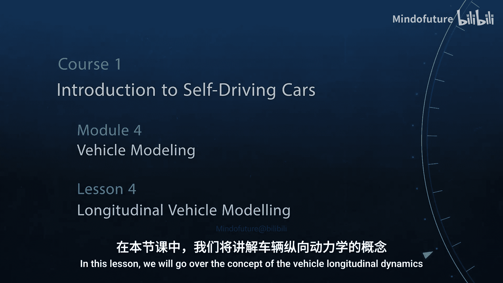
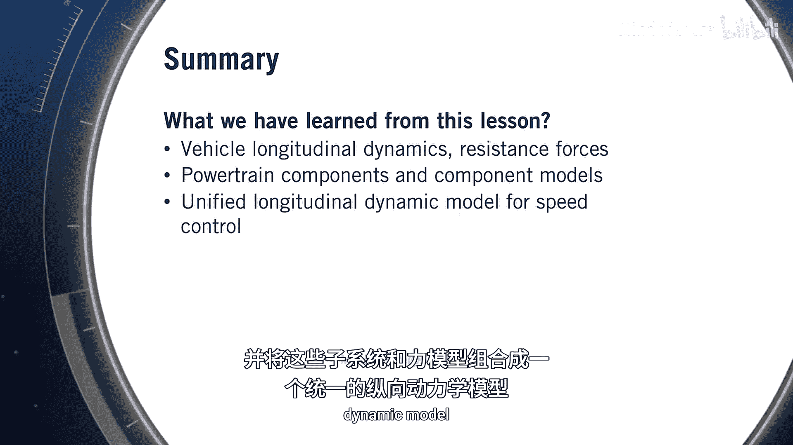

# 031：纵向车辆建模

在本节课中，我们将学习车辆纵向动力学的概念，以及为轮胎产生扭矩所需的动力总成组件模型。

通过本视频的学习，你将能够：

*   定义作用在车辆纵向方向上的动态力平衡。
*   描述内燃机汽车典型的动力总成组件模型。
*   连接典型的动力总成组件模型，形成用于纵向运动的完整车辆模型。

这些模型将帮助我们在本课程的下一模块中构建纵向控制器。

## 概述

现在让我们开始。车辆纵向动力学模型基于产生前进运动的车辆动力学。

## 纵向动力学基础

上一节我们介绍了课程目标，本节中我们来看看车辆纵向运动的基本原理。

下图展示了一辆汽车在倾斜路面上的典型纵向运动。

作用在车辆上的力包括：
*   前轮和后轮的轮胎力，`FXF` 和 `FXR`。
*   空气阻力，`F_aero`。
*   滚动阻力，`R_XF` 和 `R_XR`。
*   重力分量，`M * g * sin(α)`，其中 `α` 是路面坡度角。

根据牛顿第二定律，来自车辆动力总成的前后轮纵向轮胎力 `F_XF` 和 `F_XR`，必须克服阻力，例如空气阻力 `F_aero`、重力分量 `M * g * sin(α)` 以及前后轮的滚动阻力 `R_XF` 和 `R_XR`。这些力之间的不平衡决定了车辆在纵向方向上的加速度，记为 `ẍ`。

纵向动力学方程可以通过将前后轮胎力合并为 `F_X`，前后滚动阻力合并为 `R_X` 来进一步简化。此外，我们可以假设路面坡度适中，这意味着可以应用小角度近似，即 `sin(α) ≈ α`。

于是，我们得到汽车纵向运动的基本动力学模型如下：

**M * ẍ = F_X - F_aero - R_X - M * g * α**

其中：
*   **`M * ẍ`** 是惯性项，定义了车辆的纵向加速度。
*   **`F_X`** 是由动力总成产生的牵引力。
*   **`F_aero`**、**`R_X`** 和 **`M * g * α`** 构成了作用在车辆上的总阻力，我们将其称为 **`F_load`**。

需要注意的是，我们仍需为此方程中的每个力建立模型，并定义它们如何连接到自动驾驶系统将施加的油门和刹车输入。在本视频的其余部分，我们将建立这些模型，并在后续关于动力总成、刹车和轮胎力建模等特定方面的视频中进行更深入的探讨。

## 阻力建模

现在我们已经有了基本的动力学方程，接下来让我们为汽车上的阻力建立一些简单的模型。

车辆的纵向运动受到空气阻力、滚动阻力和重力的阻碍。我们已经建立了重力影响的模型，接下来讨论空气动力学。

以下是空气阻力和滚动阻力的典型建模方法：

*   **空气阻力**：通常可以建模为依赖于空气密度、车辆正面投影面积、车辆摩擦系数和当前车速。给定固定的车辆形状和标准大气压，我们可以定义一个综合的空气阻力系数 `C_aero`，并将其乘以速度的平方来得到阻力：**`F_aero = C_aero * (ẋ)²`**。
*   **滚动阻力**：我们有一个类似的模型，它可能依赖于法向力、轮胎压力和特性以及车速。如果我们再次假设名义运行条件，并为了简化而忽略二阶项，我们可以得到一个线性的滚动阻力模型，其中 `C_R1` 是我们的线性滚动阻力系数：**`R_X = C_R1 * M * g`**。

在这两种情况下，这些都是基本的近似模型，是控制器设计的良好起点。在实践中，所使用的模型的保真度取决于控制器或仿真环境所需的精度。

## 动力总成组件与运动学约束

现在我们已经有了作用在车辆上的阻力模型，让我们更仔细地看看由车辆动力总成产生的驱动力。

用于克服阻力的力来自动力总成，可以建模为由一系列组件产生。汽油或柴油发动机中的燃烧，或电动汽车/混合动力汽车电池中的电化学反应所产生的功率，流经传动系统，最终为车轮提供扭矩。

传动系统指的是发动机和车轮之间的一系列组件，通常包括液力变矩器（或离合器）、变速箱以及差速器。刹车也包含在此图中，可以直接在轮毂上提供阻力扭矩。

由于挂挡时车轮和发动机之间的直接连接，可以将车轮速度与发动机速度之间的关系建模为运动学约束。

以下是动力总成组件之间的运动学关系：

*   车轮旋转速度 `ω_w` 根据液力变矩器涡轮速度 `ω_t` 通过几个齿轮比（包括液力变矩器、变速箱和差速器）而变化。这个组合齿轮比记为 **`GR`**，并根据动力总成组件的状态（例如变速箱处于哪个档位）而变化。
*   发动机速度等于涡轮速度，可以互换使用。
*   车辆前进速度也与车轮角速度乘以轮胎有效半径成正比，我们主要将其建模为固定的轮胎半径 `r_eff`：**`ẋ = r_eff * ω_w`**。然而，为了更高保真度的建模，可以根据汽车上的力和力矩对轮胎的预期变形进行修改。

假设轮胎半径的影响已知，我们可以写出纵向车速 `ẋ` 等于轮胎有效半径 `r_eff` 乘以车轮速度 `ω_w`。

因此，如果我们能对发动机速度的动力学进行建模，我们就可以通过这些运动学约束将其直接与车速联系起来。这个速度表达式可以微分，从而得到用发动机旋转加速度表示的纵向加速度。

## 动力总成动态建模

现在让我们逐一推导每个动力总成组件的动力学方程，以建立整个动力总成的动态模型。

车轮是来自动力总成一侧的扭矩与来自外部阻力的扭矩之间的交汇点。

因此，我们可以通过以下一阶微分方程来描述车轮动力学，以计算车轮角速度 `ω_w`：

**`J_w * dω_w/dt = T_w - r_eff * F_X`**

其中，`T_w` 是由动力总成产生的车轮扭矩。如果已知轮胎力 `F_X`（可以从之前推导的车辆纵向动力学中计算），我们可以使用这个微分方程求解车轮扭矩 `T_w`。

车轮扭矩 `T_w` 实际上是刹车扭矩和变速箱输出扭矩的组合。我们将在后面的视频中讨论刹车建模，本视频将重点讨论动力总成。

施加到变速箱的扭矩称为涡轮扭矩 `T_t`，它来自连接发动机和变速箱的液力变矩器。

回想一下，液力变矩器的涡轮角速度 `ω_t` 通过齿轮比 `GR` 与车轮角速度相关：**`ω_t = GR * ω_w`**。

因此，我们可以为涡轮角速度定义一个类似的常微分方程，作为我们的变速箱动态模型：

**`J_t * dω_t/dt = T_t - T_w / GR`**

同时，我们可以从车轮动力学模型中代入 `T_w` 的表达式。

接下来是液力变矩器。实际上，液力变矩器具有复杂的动力学特性，因为它有多个叶轮和流经叶轮的流体，这允许发动机的耦合和解耦。当耦合时，我们可以假设涡轮角速度几乎与发动机速度相同，因此在变速箱模型中用发动机角速度替换涡轮速度，形成一个包含液力变矩器的动态模型。

最后，我们可以通过包含发动机动力学来定义完整的动力总成模型。

发动机惯性项等于燃烧过程产生的发动机扭矩减去来自液力变矩器的涡轮扭矩 `T_t`，而 `T_t` 仍然依赖于轮胎力 `F_X`。

**`J_e * dω_e/dt = T_engine - T_t`**

如果我们回到原始的纵向车辆模型并求解轮胎力 `F_X`，会发现它进一步依赖于发动机旋转加速度 `dω_e/dt`。这些项可以与发动机、变速箱和车轮的惯性项合并。

我们现在形成了完整的动力总成模型，并将所有单个组件惯性的总和定义为有效动力总成惯性 `J_E`。

动力总成模型简化为以下方程：

**`J_E * dω_e/dt = T_engine - T_load`**

该方程平衡了发动机扭矩 `T_engine` 与总负载扭矩 `T_load`，以驱动发动机加速度，从而驱动车辆纵向加速度。

这个最终方程实现了我们设定的目标，因为它展示了整个动力总成系统从发动机到作用在车辆上的外部阻力的动力学过程。

我们仍然需要将发动机扭矩与油门踏板位置、刹车扭矩与刹车踏板位置联系起来，这将在关于执行器建模的视频中介绍。

## 总结

在本视频中，我们一起学习了以下内容：

*   我们定义了车辆纵向动力学和阻力的紧凑模型。
*   我们描述了典型的动力总成组件并推导了它们的动态模型。
*   我们将这些子系统和力模型组合成一个统一的纵向动态模型，该模型适用于速度控制开发。

在下一个视频中，我们将研究横向动力学和建模的细节，以帮助开发转向控制器。

下次见。

