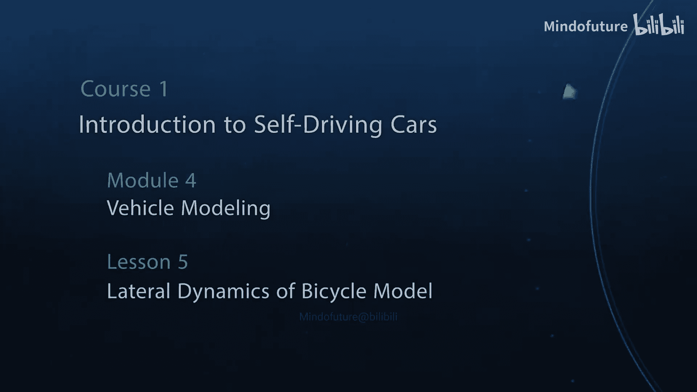
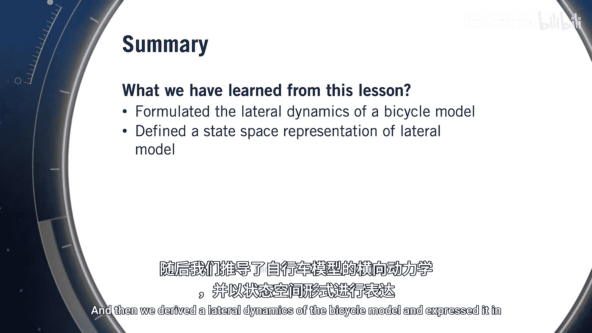

# 032：自行车模型横向动力学 🚗




在本节课中，我们将学习如何将上一节介绍的车辆运动学自行车模型，扩展为一个动力学模型。我们将重点关注车辆的横向动力学，并最终将其表达为标准的状态空间形式，为后续的横向控制设计奠定基础。

上一节我们介绍了车辆的纵向动力学。本节中，我们来看看如何基于自行车建模方法，对四轮汽车的动力学进行建模。

通过本视频的学习，你将能够：
*   以运动学自行车模型为基础，构建汽车的动力学模型。
*   将其表示为适用于横向控制设计的标准状态空间形式。

现在开始学习。

我们希望放宽运动学模型中强制执行的无滑移条件，从而将运动学自行车模型扩展为动力学模型。

回顾完整的动力学自行车模型，我们保留了运动的两个分量：
*   第一个是沿车辆航向的纵向运动。
*   第二个是垂直于航向的横向运动。

具体对于车辆横向模型，我们感兴趣的是基于车辆运动时影响它的力矩，来对车辆的旋转速率进行建模。

为了开始对自行车模型的横向动力学进行建模，我们将做出以下假设。

以下是建模所需的关键假设：
1.  假设前向纵向速度恒定。这样做是为了将横向和纵向动力学模型解耦，从而极大地简化建模任务，但在加速或减速出弯时会导致建模不准确。
2.  与运动学自行车模型一样，前后轴上的左右车轮分别合并为一个车轮。因此，这个假设将四轮模型转换为两轮的自行车模型。
3.  其他非线性效应，如悬架运动、道路倾斜度和空气动力，被假定为可忽略不计。实际上，这些效应会对产生的轮胎力产生重大影响，因此这同样是一个在某些情况下的限制性假设，但足以满足我们的目的。

我们将使用车辆重心作为动力学模型的参考点，因为它简化了牛顿第二定律的应用。

我们可以在惯性坐标系中定义总加速度为 `A_Y`，这包括车身坐标系中的横向加速度 `Y_ddot`，以及来自车辆旋转的向心加速度 `ω²R`。

利用侧偏角的定义，以及 `v = ωR` 和 `ω = ψ_dot` 的事实，这些表达式可以用侧偏角变化率 `β_dot` 和航向变化率 `ψ_dot` 来重写。

现在可以构建横向动力学的模型公式。影响动力学的唯一两个力是前轮和后轮上的横向力。

车辆纵向速度如前所述定义为 `V`，质量为 `M`。

对于角加速度 `ψ_ddot`，轮胎力产生的力矩方向相反，并与惯性项 `I_Z * ψ_ddot` 结合，形成这个二阶方程。参数 `L_F` 和 `L_R` 定义了从重心到每个轮胎的距离。

车辆动力学建模中最重要的组成部分之一是轮胎。轮胎力通常很难精确预测，轮胎模型往往是非线性的，并且需要通过经验来识别。我们将在本模块的最后一个视频中详细探讨一些更常见的轮胎模型。

然而，幸运的是，对于正常驾驶条件，可以使用简单的线性近似来模拟轮胎力的产生。这个近似实际上只对小侧偏角有效，轮胎力被建模为随侧偏角线性变化。

具体公式为：
```
F_y = C_α * α
```
其中 `F_y` 是轮胎横向力，`C_α` 是轮胎侧偏刚度，`α` 是轮胎侧偏角。

由于我们在控制设计中使用线性轮胎模型，我们必须确保通过坚持非激进的驾驶操作，不超出这个小角度假设。

为了使用这些线性轮胎模型，我们需要定义前轮和后轮的侧偏角 `α_F` 和 `α_R`。它们的定义方式与车辆侧偏角 `β` 完全相同，但它们是相对于车轮方向和车轮中心处的车辆速度来定义的。

轮胎的侧偏刚度由其抵抗车辆转弯时变形的能力定义。下图显示了轮胎横向力与轮胎侧偏角之间的关系，在0处的直线斜率被称为侧偏刚度系数 `C_Y`。

从图中可以看出，对于小侧偏角（通常小于8度），关系几乎是线性的。我们可以引入 `C_F` 和 `C_R` 作为自行车模型前轮和后轮的线性化侧偏刚度。

因此，作用在前轮和后轮上的横向力与每个轮胎的侧偏刚度 `C_Y` 和侧偏角 `α` 的乘积相关。

我们可以用车辆侧偏角 `β`、转向角 `δ`、纵向速度 `V` 和横摆角速度 `ψ_dot` 来表示轮胎侧偏角。

现在，可以通过代入轮胎力-侧偏角方程来修改先前推导出的横向自行车模型动力学方程。这导致了以下一对耦合的常微分方程，它们控制着车辆在横向上的动力学。

请注意，左侧变量表示车辆侧偏角的变化率和横摆角速度的变化率。

方便的是，由于在整个推导过程中所做的近似和假设，最终得到的车辆横向动力学模型是线性的。

我们可以定义一个状态向量 `x_la`，它包括横向位置 `Y`、侧偏角 `β`、横摆角 `ψ` 和横摆角速度 `ψ_dot`。系统现在可以表示成标准的状态空间形式，如下所示：
```
x_dot_la = A_la * x_la + B_la * δ
```
其中，系统动力学矩阵是 `A_la` 和 `B_la`，如果前向速度 `V` 保持恒定，它们将是时不变的。系统的主要输入是驾驶员的转向角指令 `δ`。

这种基于状态的表示形式在我们为横向控制设计不同的控制策略（如PID或MPC）时非常有用。该模型的线性特性也使其适用于使用常见滤波器进行状态估计，你将在课程2中了解更多。



本节课中我们一起学习了以下内容：
*   我们首先学习了如何将运动学自行车模型扩展为动力学自行车模型。
*   然后我们推导了自行车模型的横向动力学，并将其表达为状态空间形式。


在下一个视频中，我们将探索并构建车辆执行系统的模型，包括油门、刹车和转向。下节课见。