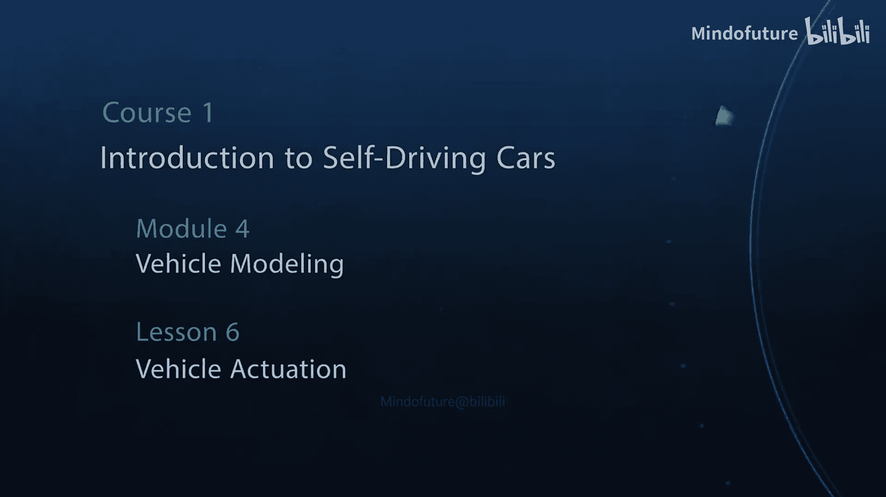
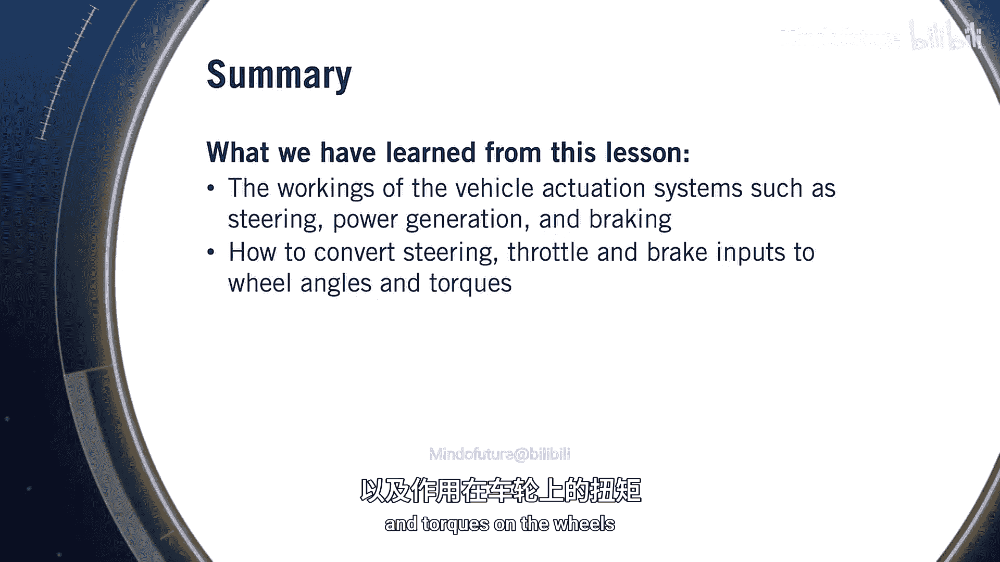

# 033：车辆执行机构 🚗

在本节课中，我们将学习车辆执行机构系统的基础知识，包括油门、刹车和转向。课程结束时，你将能够定义车辆转向、油门和刹车系统的常见模型，并将这些模型与之前视频中推导出的车辆动力学方程联系起来。

车辆横向动力学的主要输入是转向角，而纵向动力学的主要输入是油门踏板位置和刹车踏板位置。这些输入定义了作用在车辆上的部分力和力矩，并输入到控制车辆状态的常微分方程中。需要注意的是，横向动力学和纵向动力学会相互影响，尽管我们目前建立的模型基于假设将它们分开了。

横向力和力矩驱动车辆的横向运动学，从而产生车辆的横向速度和横摆角速度。同样，纵向力驱动纵向运动学，从而决定最终的前进速度和位移。车辆控制的主要任务是提供合适的转向、油门和刹车指令，使车辆保持在期望的路径上并遵循期望的速度曲线。我们假设这些期望元素由运动规划系统提供，并将在本专业的第四门课程中学习如何构建这样的规划器。

现在，让我们转向对三个指令输入子系统进行建模，以进一步完善我们的完整车辆模型。

## 转向模型 🛞

首先，让我们看看转向模型。转向模型本质上是驾驶员或自动驾驶系统的指令，用于控制车辆向左或向右转向。转向角通过特定的齿轮传动比机构转化为车轮转角，从而提供使车辆保持在曲线路径上的横向力。

在最简单的转向系统模型中，车轮转角可以定义为与转向角成正比。因此，转向角 `δ_s` 与车轮转角 `δ` 呈线性比例关系，比例系数为 `C`。这个模型对于我们的仿真工作来说已经足够，并且通常作为非激进驾驶的起点。

实际上，转向系统比上述简单公式更为复杂。如果转向指令的频率非常接近转向总成的带宽，则可能需要一个完全动态的模型。图中展示了转向总成中的主要子系统，例如方向盘、转向柱、转向齿轮以及连接转向柱与左右车轮的连杆机构。图中右侧还展示了齿条齿轮机构，它将方向盘的旋转运动转换为移动车轮连杆所需的线性运动。如果你想了解更多，补充材料中提供了转向总成更详细动态模型的链接。

## 动力总成模型 ⚙️

接下来是动力总成模型。正如我们在本模块前面所看到的，车辆动力总成决定了车辆的前进速度和加速度。在自动变速汽车中，驾驶员或自动驾驶系统有两个输入来加速或减速车辆：油门和刹车。该图展示了将驾驶员或自动驾驶系统的指令转化为车轮运动的机制。

现在，让我们看看典型的动力流通过动力总成的过程。回顾纵向动力学视频中的动力流图，动力流从动力产生单元开始，例如内燃机或电动机。油门踏板位置驱动动力产生单元产生的扭矩。在自动变速系统中，该扭矩被传递到变速系统，液力耦合系统或变矩器被放置在发动机轴和变速箱单元之间。然后，根据操作模式和期望速度，变速箱根据需要换挡。一档和二档是扭矩模式，更高的档位称为速度模式，指的是变矩器中的不同操作模式。接着，动力通过差速器流向车轮，产生车轮扭矩，最终产生牵引力。牵引力必须大于阻力（包括空气动力和路面摩擦力），才能使车辆在纵向上向前加速。

车辆运动的动力源可以通过内燃机的燃烧或电动机的电池产生。简而言之，驾驶员踩下油门踏板来定义加速车辆所需的扭矩需求水平。实际响应更为复杂，取决于所涉及的动力产生单元类型。内燃机、柴油发动机和电动机的特性各不相同。扭矩-转速图被用作表示这些动力单元特性的图表。

左图显示了汽油发动机的扭矩-转速曲线。对于一定范围的发动机角速度或转速，汽油发动机的最高扭矩工作点往往出现在中等转速，对于乘用车发动机通常在2000到3000转/分。在低速和高速时，发动机产生扭矩的能力会下降。中间的图是柴油发动机的扭矩特性，它在更宽的速度范围内表现出更一致的扭矩生成。这就是为什么柴油发动机更适合重型车辆，而汽油发动机最适合小型和城市汽车。右图显示了电动机的扭矩特性。电动机在较低转速（例如1500转/分）时效率更高，但在较高转速时效率不高。需要注意的是，为了弥补电动机在较高转速下扭矩特性的不足，混合动力电动汽车使用内燃机来提高在较高速度下的性能。

该图绘制了内燃机在不同节气门开度下的扭矩特性曲线。扭矩与转速的关系可以表示为一个二阶多项式，这是一个简单但相当好的面向控制的模型。在以下方程中，发动机扭矩表示为 `T_E`，油门踏板位置为 `x_θ`，发动机角速度为 `ω_E`。系数 `a`、`a1` 和 `a2` 针对不同的发动机进行识别和调整。这个模型被称为半经验模型，更详细的模型可以包括流体动力学、热传递、燃烧和许多其他现象，这些不在本课程范围内。给定发动机转速和油门位置，可以基于这个半经验映射计算产生的发动机扭矩，然后将其输入到车辆的纵向动力学模型中。

## 刹车系统模型 🛑

现在让我们转向刹车系统的模型开发。刹车过程从驾驶员指令的刹车踏板位置开始，该位置由电子控制单元转换为刹车压力。刹车压力在刹车盘或鼓上产生制动力，进而在车轮上形成制动扭矩。车轮上的制动扭矩产生一个负的纵向力以使车辆减速。由于控制单元对制动扭矩的管理，刹车系统的响应非常可预测。就本课程的目的而言，没有必要对刹车进行非常详细的建模。同样，可以使用从踏板位置到制动扭矩的简单线性映射。

当然，刹车系统对于控制车辆运动至关重要。事实上，刹车在车辆控制中扮演着一系列重要角色。以下是刹车系统的一些主要功能：
*   通过紧急制动缩短停车距离。
*   通过防抱死制动系统在制动时保持可转向性。
*   在制动时保持稳定性以避免翻车。

这些功能有助于扩展我们可以安全驾驶的操作条件范围，现代制动能力已显著提高了车辆的安全性和性能。

## 总结 📝

我们已经完成了对车辆执行器组件的讨论。让我们总结一下到目前为止所做的工作。在本视频中，我们研究了车辆执行机构系统以及用于在横向和纵向两个方向上移动车辆的主要指令。在自动驾驶汽车中，这些执行信号将是车辆控制模块的主要输出。我们还建立了转向、发动机和刹车模型，将这些指令转换为车轮转角和车轮上的扭矩。

在下一个视频中，我们将完成动态车辆建模过程的最后一部分——连接车辆与道路的轮胎。我们下个视频见。