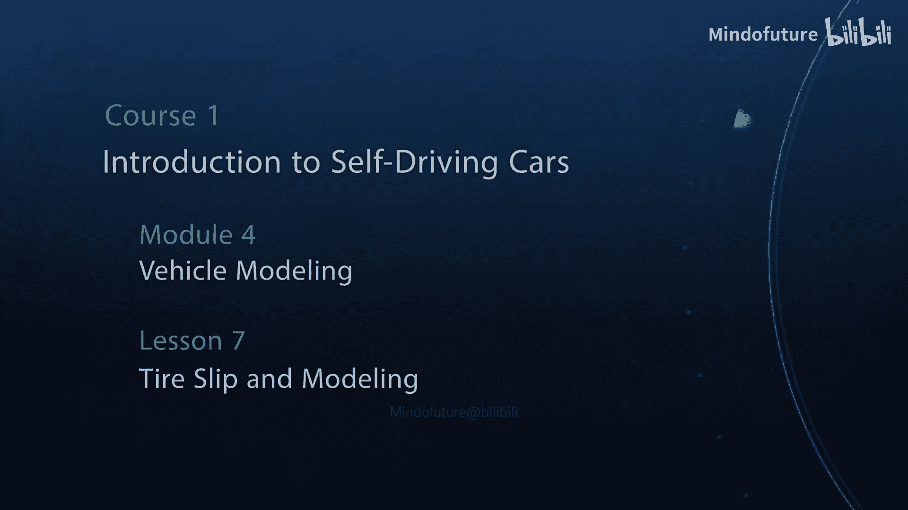
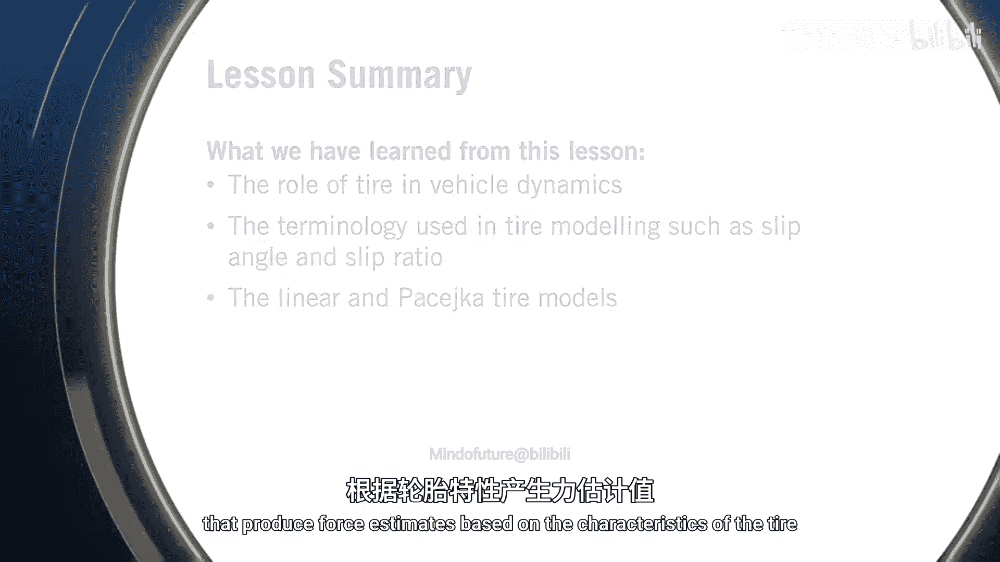

自动驾驶汽车简介：第七课：轮胎滑移与建模

在本节课中，我们将学习轮胎滑移与建模的核心概念。我们将探讨滑移角和滑移比的定义，并介绍一些著名的轮胎模型，以完善我们的车辆动力学模型。

上一节我们介绍了如何将人类或自动驾驶系统的转向、油门和刹车指令，建模为车轮转角和驱动/制动力矩。这些执行器模型驱动着轮胎的状态，因此也是我们将要开发的轮胎模型的输入。

轮胎是车辆与道路之间的接口，作用在车辆上的所有外部力完全由轮胎产生。因此，为了全面分析车辆动力学并基于动力学模型开发控制器，拥有一个良好的轮胎模型来捕捉轮胎在其整个工作范围内的力生成行为至关重要。

让我们回顾两个重要的定义：滑移角和滑移比。

**滑移角**是车辆前进方向与其实际运动方向之间的夹角，我们记作 β。车辆的滑移角可以表示为横向速度 Vy 与纵向速度 Vx 之比的反正切。

`β = arctan(Vy / Vx)`

对于小的滑移角，我们可以使用小角度近似，直接将滑移角 β 近似为横向速度 Vy 与纵向速度 Vx 的比值。

`β ≈ Vy / Vx (当 β 很小时)`

我们可以扩展滑移角的概念，为每个轮胎定义滑移角。这里，前轮和后轮的轮胎滑移角分别定义为 α_F 和 α_R。轮胎滑移角是轮胎指向方向与其实际行驶方向之间的夹角，类似于车辆滑移角。轮胎滑移角在定义完整的轮胎模型中起着重要作用。

我们可以将轮胎滑移角与车辆滑移角、速度以及横摆角速度联系起来，其中车辆质心到前、后轮胎的距离分别用 L_F 和 L_R 表示。

描述轮胎滑移所需的另一个重要定义是**纵向滑移**或**滑移比**。滑移比捕捉了轮胎变形与其所受纵向力之间的关系。当加速或制动时，观察到的轮胎角速度与纯滚动运动的预期速度不匹配，这意味着除了滚动之外，轮胎与路面之间还存在滑动。轮胎旋转速度与汽车纵向速度之间的差异，可以表示为相对于纯滚动速度的比值，称为滑移比。

以下是车辆速度与轮胎角速度之间差异的三种情况：

*   **车轮拖滑**：当车辆速度 V 大于轮胎速度 R·ω 时发生。这出现在车辆减速时。
*   **车轮打滑**：当车辆速度 V 小于轮胎速度 R·ω 时发生。这常见于低摩擦路面（如结冰路面）行驶或漂移时。
*   **车轮抱死**：当轮胎速度为零而车辆速度非零时发生。这是第一种情况的延伸，可能发生在紧急制动时。然而，现代防抱死制动系统会尽量避免进入此状态，因为其制动性能差且会丧失转向控制。

接下来，我们看看轮胎在其整个工作范围内如何产生力的一些建模方法。

轮胎模型的输入包括：车辆滑移角、滑移比、路面摩擦系数以及作用在轮胎垂直方向上的法向力。然后，它计算出横向和纵向的力。当然，额外的输入可以提高准确性，例如轮胎材料特性和外倾角（轮胎旋转平面与路面之间的夹角）。这些额外的输入有助于扩展可建模的力和力矩集合，包括自回正力矩（使轮胎自动与行驶方向对齐的、绕转向轴的力矩）、滚动阻力矩，甚至侧倾力矩。

轮胎建模是一个深入且成熟的领域，已经发展出许多不同类型的模型。我们可以将这些模型分为三种主要的建模方法：

*   **解析模型**：基于轮胎物理建模定义的模型，通常导致模型简单、计算快速，适合控制器开发。尽管从计算角度看很有吸引力，但这些模型在轮胎的整个工作范围内通常表现不佳。刷子模型和Fiala模型是此类的例子。
*   **数值模型**：源于对轮胎多维有限差分和有限元模型的详细求解，并表示为一系列表格。这些模型比前一类更准确，但难以用于基于模型的控制器开发。然而，许多模拟器使用数值模型来提高其车辆动力学的保真度，从而可以在部署前准确评估稳定性和牵引力控制系统。
*   **参数化模型**：通过参数化函数定义轮胎曲线族的模型。然后通过大量测量来识别函数参数，并且每个轮胎必须单独评估。著名的参数化模型，如线性模型、Pacejka模型和Dugoff模型，被广泛用于车辆动力学建模。因为它们结合了准确的力预测和便捷的计算。这些模型易于实现，适合基于模型的控制器开发。

现在，让我们更详细地看看两个参数化模型。

我们将从一个简单的**线性轮胎模型**开始。线性模型由分段线性曲线的两部分组成。第一部分对应于线性轮胎区域，它通过一个力系数 C，将轮胎力（纵向或横向）直接与轮胎滑移比或滑移角联系起来。第二部分对应于饱和区域，对于所有超过最大滑移比或滑移角的值，轮胎施加一个恒定的最大轮胎力。

`F = C * s (或 C * α)，当 s < s_max (或 α < α_max)`
`F = F_max，当 s ≥ s_max (或 α ≥ α_max)`

最大滑移比 S_max 导致最大纵向轮胎力 Fx_max，最大滑移角 α_max 导致最大横向轮胎力 Fy_max。总的来说，线性轮胎模型是线性区域大部分范围的良好近似，但当我们进入饱和区域时，准确性会下降。然而，对于常规的自动驾驶，由于轮胎主要在线性区域运行，线性模型是一个很好的近似。

我们要看的第二个模型是车辆动力学和基于模型的控制中**最重要、使用最广泛的轮胎模型之一**。它被称为Pacejka轮胎模型，也被称为“魔术公式”，因为它能非常好地表示纵向和横向轮胎力。

以下是用于根据滑移比、轮胎法向力和路面摩擦系数计算纵向轮胎力的“魔术公式”：

`Fx = D * sin( C * arctan( B * s - E * (B * s - arctan(B * s)) ) )`

我们通过实验定义系统参数 B、C、D 和 E，这些参数因轮胎而异。图中显示了不同路面摩擦系数下，典型的纵向轮胎力与纵向滑移的关系。

最后，让我们看一些从轮胎道路测试中收集的数据。下面的图表左侧显示了归一化纵向轮胎力，右侧显示了归一化横向轮胎力，分别相对于它们的滑移比和滑移角绘制。实验数据点上叠加了线性模型和Pacejka模型。我们可以看到，在低滑移区域，两种模型都能很好地表示数据，但随着滑移增加，线性模型表现不佳。这些数据也让我们很好地了解了精确建模轮胎力的难度，因为测量力的分散程度相对于模型来说相当明显。尽管如此，这两种模型对于创建动力学可高效计算的模拟车辆，以及基于车辆及其众多子系统的动力学模型开发控制律都极其有用。

在本节课中，我们探讨了车辆动力学建模中最重要的组件之一：轮胎模型。我们回顾了轮胎滑移和滑移比的定义，并探索了基于轮胎特性产生力估计的不同轮胎模型。

恭喜你完成了我们《自动驾驶汽车简介》课程的第三个模块。在本模块中，你提升了车辆运动学和动力学建模的技能。你推导了汽车的自行车运动学模型，并探索了车辆的横向和纵向动力学建模。在下一个模块中，我们将使用这些详细的车辆模型来设计调节车辆纵向运动的控制器。下次见。