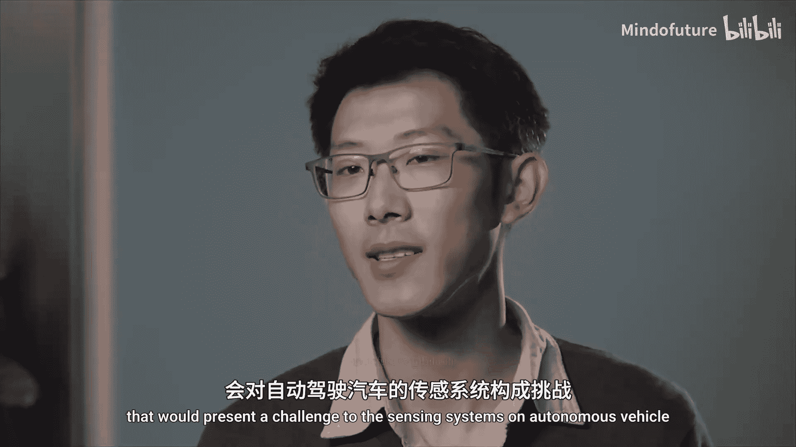

# 035：行业面临的挑战 🚗

在本节课中，我们将探讨自动驾驶汽车行业当前面临的一系列核心挑战。这些挑战不仅涉及技术层面的创新，还包括如何将实验室中的研究成果安全、可靠地大规模部署到现实世界中。

---

因为这是一个全新的行业，我们面临着许多前所未有的挑战。我们必须找到多种不同的方法来解决这些从未遇到过的问题。因此，在寻找解决这些难题的创新方案时，过程既充满挑战，也令人兴奋。

学术界已经投入了大量研究，探索如何让这些汽车首先能够上路行驶。例如，如何检测行人，如何规划行驶轨迹等。

上一节我们提到了基础研究，本节中我们来看看产业界需要解决的核心问题：如何将这种自动驾驶体验交付给成千上万的用户，未来甚至可能是数百万用户。这其中的关键部分在于如何扩展我们的系统。

以下是规模化部署面临的具体问题：
*   如何将相同的算法部署到像旧金山、湾区，乃至最终整个美国大陆这样广阔的地图区域。
*   这是一个非常庞大且令人兴奋的待解决问题。

当然，在任何主要城市，都存在许多对自动驾驶车辆传感系统构成挑战的环境。例如，在旧金山，有些区域高楼林立，这极大地加剧了GPS多路径效应问题。

以下是此类挑战环境的一个例子：
*   旧金山的金融区，那里遍布高楼大厦。

---

目前，自动驾驶领域正围绕一个重大问题展开讨论：我们如何为极其复杂的系统提供强有力的安全性证明？

这是人类迄今为止面临的最困难的工程问题之一。我们如何才能给出强有力的保证？一种观点认为，必须对代码进行形式化验证。然而，就目前我们对形式化验证的了解而言，这种方法似乎难以扩展到如此庞大系统的规模。

当然，困难在于，自动驾驶车辆的输入信息变化多端，似乎很难写下所有可能输入系统的信息。

于是你可能会说，或许我们应该构建出色的模拟器。如果我们能构建模拟器，就可以同时运行成千上万个自动驾驶车辆的副本，一夜之间积累数百万英里的虚拟里程。这个想法同样非常吸引人，但迄今为止，我们还无法真正模拟某些传感器接收到的全部细节。

以下是模拟器面临的挑战：
*   例如，由于交互的复杂性，模拟一个完整的扫描雷达非常困难。

于是，争论又回到了原点：你需要不断地进行实际路测，积累真实里程，记住那些非常有趣的案例，并尝试在模拟器中复现它们。或许你可以建立一个“案例剧本”。

我认为答案是综合运用所有方法。就像我之前说不要只选择一种传感器一样，我建议全部使用。为什么要争论哪种方法最好呢？应该说，所有这些方法都在不同维度上帮助我们理解如何认证和确保车辆安全。没有单一的解决方案，我们也不应急于下定论。

以下是确保安全的综合策略：
*   你需要模拟。
*   你需要实际路测里程。
*   在某些关键环节，例如车辆开始与控制器的交互部分，你可能确实需要对那个指令信号的网关进行验证，以确保如果自动驾驶系统软件合约失败（例如无法保证在50毫秒内恢复），安全触发器就会启动，车辆将减速。

总而言之，就是综合运用所有这些手段。我认为应该对所有方法保持开放态度，不要试图断言必须用某一种特定方式来完成。