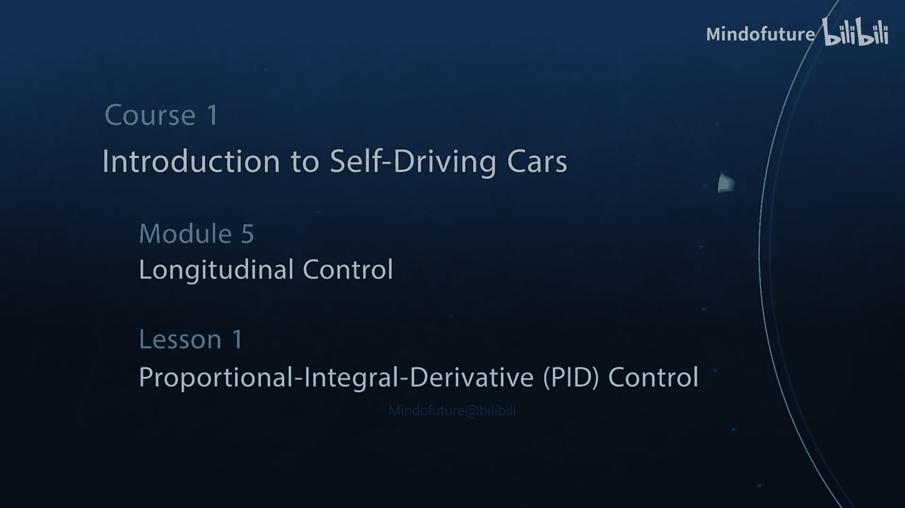
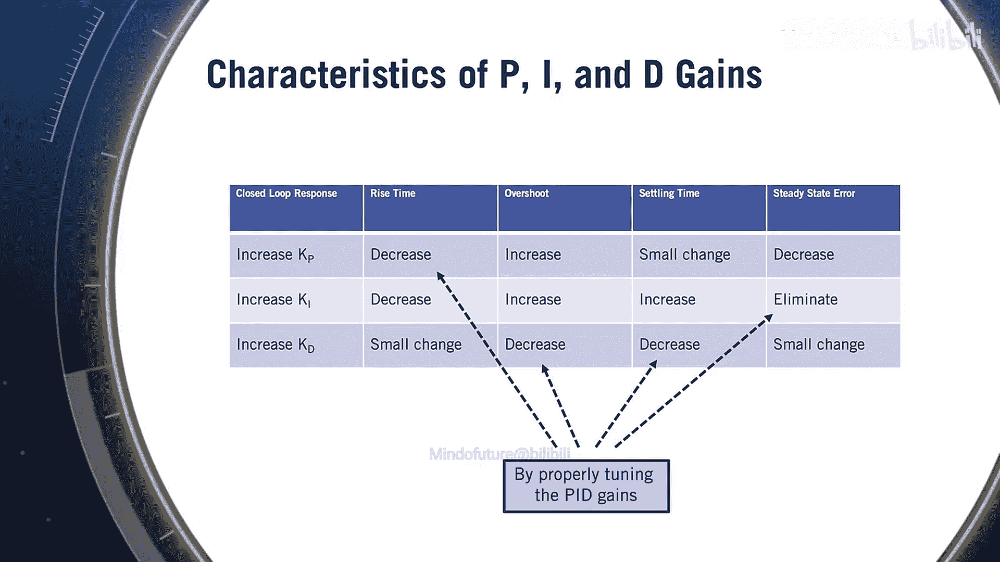
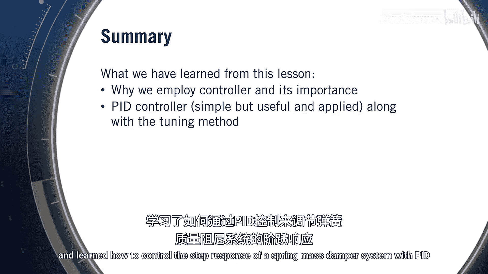

自动驾驶汽车简介：第五周：纵向控制与PID基础 🚗

在本节课中，我们将要学习自动驾驶汽车纵向控制的基础知识，并重点回顾经典线性时不变控制理论中的核心概念——比例-积分-微分（PID）控制器。

在上一模块中，我们学习了如何建立车辆模型来描述纵向和横向动力学。本节中，我们将深入探讨纵向车辆控制的概念，以调节自动驾驶汽车的速度。

具体而言，我们将回顾经典线性时不变控制的一些基本概念，为纵向车辆模型开发PID控制律，并结合前馈与反馈控制来改善期望速度的跟踪性能。纵向速度控制的设计是道路车辆所有性能的基础，也是实现自动驾驶所需的基本组件之一。

在本视频结束时，你将能够为线性时不变系统设计PID控制器。请注意，我们假设你已熟悉经典控制设计，包括在拉普拉斯域中使用传递函数。如果你之前未接触过这些概念，请查阅补充材料中列出的一些优秀控制课程。

让我们开始吧。

**控制器的作用**

在本课程的第三模块中，我们学习了如何基于自行车模型建立车辆的动力学和运动学模型。这些模型旨在捕捉动态系统对驾驶员输入指令（如转向、油门和刹车）以及外部干扰（如风、路面和不同车辆负载）的反应。输入和干扰对车辆状态（如速度和旋转速率）的影响由我们建立的模型定义。

控制器的角色则是通过感知当前状态变量，然后生成执行器信号来满足自动驾驶规划系统提供的指令，从而调节车辆的某些状态。对于纵向控制，控制器感知车辆速度，并调整油门和刹车指令以匹配规划系统设定的期望速度。

**反馈控制回路**

让我们来看一个典型的反馈控制回路。

*   **被控对象/过程模型**：接收执行器信号作为输入，并生成系统的输出或状态变量。
*   **传感器与估计器**：传感器测量这些输出，估计器用于将测量值融合成准确的输出估计值。
*   **误差计算**：输出估计值与期望的参考输出变量进行比较，其差值或误差被传递给控制器。
*   **控制器**：可被视为一种数学算法，它生成执行器信号，以使误差信号最小化，从而使被控对象的状态变量接近期望的状态变量。

被控对象模型，无论是线性还是非线性，都可以用几种方式表示。两种最常见的方式是：
1.  **状态空间形式**：跟踪内部状态的演变，以连接输入和输出。
2.  **传递函数形式**：直接建模输入到输出的关系。注意，对于传递函数，系统必须是线性且时不变的。

**传递函数与PID控制器**

传递函数 `G` 是系统输入 `U` 和输出 `y` 之间的关系，在拉普拉斯域中定义为复变量 `s` 的函数：`G(s) = Y(s)/U(s)`。

我们使用拉普拉斯变换从时域转换到 `s` 域，因为它便于分析输入输出关系，并有助于理解控制性能。在使用传递函数时，分子和分母的根为了解系统对输入函数的响应提供了强大的洞察力。系统的**零点**是分子的根，系统的**极点**是分母的根。

控制算法设计可以多种多样，从简单的常数增益乘法、查找表和线性方程，到基于非线性函数和有限预测时域优化的更详细方法。一些基本且经典的控制器包括超前-滞后控制器以及比例-积分-微分（PID）控制器。在本视频的剩余部分，我们将更详细地介绍PID控制组合，作为纵向控制的一个有用起点。

更复杂的控制设计也是可能的，并且对于非线性系统模型、时变模型或具有限制输出选择的约束的模型特别有用。非线性方法（如反馈线性化、反步法和滑模控制）超出了本课程的范围，但当然可以应用于自动驾驶车辆控制问题。基于优化的方法在自动驾驶中被大量使用，因此我们将在课程后面以模型预测控制为例介绍这类控制器。

**PID控制器的数学形式**

PID控制通过添加三个依赖于误差函数 `e(t)` 的项来数学表述：
*   一个与误差 `e` 直接成比例的**比例项**。
*   一个与误差积分成比例的**积分项**。
*   一个与误差导数成比例的**微分项**。

常数 `K_P`、`K_I` 和 `K_D` 称为比例、积分和微分增益，它们决定了PID控制器（记为 `u(t)`，作为被控对象模型的输入）的响应。

对PID控制进行拉普拉斯变换，得到其传递函数 `G_c(s)`：
`G_c(s) = K_P + K_I/s + K_D * s`

在拉普拉斯域中乘以 `s` 相当于在时域中求导，除以 `s` 相当于求积分。将PID控制器的这三个项相加，我们得到PID控制的单个传递函数。注意，并非所有系统都需要使用所有增益。如果一个或多个PID增益设置为零，控制器可以称为P、PD或PI控制器。

PID传递函数在原点包含一个单极点（来自积分项），还包含一个二阶分子，其两个零点可以通过选择适当的增益值放置在复平面上的任何位置。因此，PID控制设计归结为基于被控对象模型选择零点位置以实现期望的输出或性能。也有几种算法可以调整PID增益，其中齐格勒-尼科尔斯法是最流行的方法之一。

**闭环响应与增益影响**

闭环响应表示当控制器决定应用于被控对象模型的输入时系统的响应。对于参考信号的阶跃输入，我们可以定义：
*   **上升时间**：达到参考值90%所需的时间。
*   **超调量**：输出超过参考值的最大百分比。
*   **调节时间**：稳定在参考值5%范围内所需的时间。
*   **稳态误差**：稳态时输出与参考值之间的误差。

以下是每个P、I和D作用效果的总结：

| 控制器增益 | 上升时间       | 超调量       | 调节时间       | 稳态误差       |
| :--------- | :------------- | :----------- | :------------- | :------------- |
| `K_P` 增加 | 减少           | 增加         | 微小变化       | 减少           |
| `K_I` 增加 | 微小变化       | 增加         | 增加           | **消除**       |
| `K_D` 增加 | 微小变化       | **减少**     | **减少**       | 微小变化       |

例如，`K_P` 的增加导致对误差的反应更强，因此响应参考信号阶跃变化时的上升时间减少。类似地，由于 `K_D` 对误差变化率作出反应，`K_D` 的增加会导致超调量减少（在误差变化率高的地方），同时可能减少围绕参考值的振荡，从而缩短调节时间。最后，`K_I` 的增加可以消除稳态误差，但可能导致响应中的振荡增加。

最终，必须了解P、I和D增益效应的相互作用来选择它们，以调整系统响应，获得正确的闭环性能。在本课程的评估部分，当你开发自己的PID控制器时，将有机会看到这些相互作用。

**示例：弹簧-质量-阻尼器系统**

现在，让我们看一下著名的二阶弹簧-质量-阻尼器模型，如图所示。在这个例子中，我们将首先回顾所提出的动态系统的传递函数，然后为其设计一个PID控制器。

弹簧-质量-阻尼器系统的动力学已在本课程前面的视频中推导。系统受到输入力 `F` 的作用，模型的输出是物体的位移 `x`。质量 `m` 通过一个弹簧常数为 `k` 的弹簧和一个阻尼系数为 `b` 的阻尼器连接到刚性基础。

为了将方程转换到 `s` 域（拉普拉斯域），我们使用拉普拉斯变换，并将二阶方程写为：
`m * s^2 * X(s) + b * s * X(s) + k * X(s) = F(s)`
这依赖于时域中的导数对应于拉普拉斯域中乘以 `s` 这一事实。

最后，形成传递函数，它表示输出 `X(s)` 与输入 `F(s)` 之间的关系，并定义为被控对象传递函数 `G(s)`：
`G(s) = X(s)/F(s) = 1 / (m*s^2 + b*s + k)`
这是一个二阶系统，具有由质量、弹簧常数和阻尼系数定义的两个极点。

为了评估系统特性，我们使用单位阶跃输入来激励系统。这通常是评估被控对象动态特性的第一步。例如，对于给定参数值 `m=1`，`b=10`，`k=20`，系统响应 `x` 绘制在此处。这种类型的响应很容易用MATLAB或SciPy等科学计算工具生成。输入是单位阶跃 `f=1`，输出同样是 `x`。这种响应称为**开环响应**，因为此时没有控制器应用于系统。

如果在被控对象上添加控制器，并且测量模型的输出并与期望的输出或参考信号进行比较，那么系统的响应称为**闭环响应**。对于单位反馈，传感器传递函数假定为1，通常它可以是任何传递函数。此处给出的闭环传递函数可以从控制器和被控对象的传递函数推导出来。对于学过经典反馈控制的人来说，你们会知道开环系统的极点定义了闭环响应的特性。你们可能也见过根轨迹、伯德图和奈奎斯特设计技术，这些可用于选择满足特定输出规格的控制器。我们在补充材料中为想了解更多信息的人留下了一些相关资源的链接。

**不同PID控制器的阶跃响应**

让我们看看几种不同PID控制器的阶跃响应。虚线水平线代表参考或期望输出，控制器的目标是使实际输出接近此参考。

1.  **纯比例控制**：在P控制器响应中，我们看到快速上升时间、显著超调和导致长调节时间的持续振荡。
2.  **加入微分控制**：添加微分控制改善了超调量和调节时间方面的阶跃响应，但减慢了上升时间。
3.  **加入积分控制**：添加积分项保持了较短的上升时间，并能减少振荡和超调，从而实现较快的调节时间。对于弹簧-质量-阻尼器系统，简单的PI控制是一个优秀的设计。
4.  **完整的PID控制**：在控制器中包含所有三个PID项，为设计阶跃响应提供了更大的灵活性。通过仔细调整控制器增益，我们可以利用三者的优点来消除超调，同时保持非常短的上升和调节时间。如图所示，在PID控制下，系统更快地接近参考值，且没有任何超调。

**总结**

在本视频中，我们涵盖了控制器设计的概念以及为何将控制器集成到动态模型中。我们还回顾了PID控制器，并学习了如何使用PID控制来控制弹簧-质量-阻尼器系统的阶跃响应。在下一个视频中，你将学习如何应用PID控制来调节自动驾驶汽车的速度。