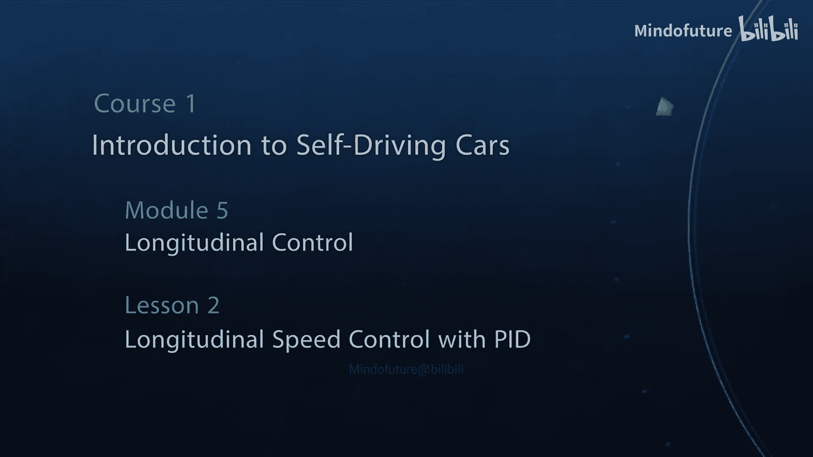
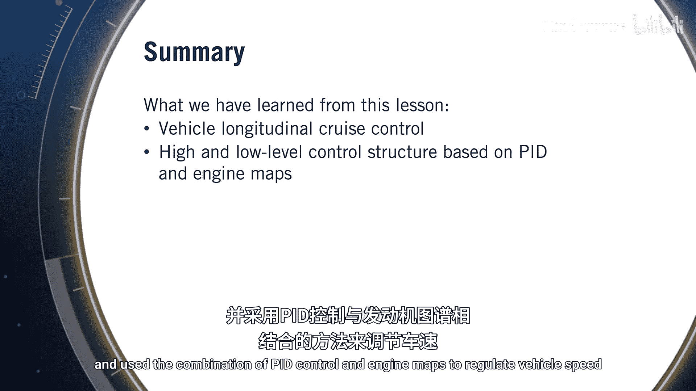

# 037：基于PID的纵向速度控制

在本节课中，我们将学习如何将PID控制器应用于车辆的纵向动力学模型，以实现对设定参考速度的调节，例如定速巡航功能。课程结束时，你将能够定义完整的车辆规划与控制架构，并设计一个基于PID的控制器。

上一节我们简要回顾了PID控制器的设计和经典控制器设计。本节中，我们将看看PID控制如何应用于车辆的纵向模型。

首先，让我们更仔细地观察车辆控制架构，以及它如何融入整个自动驾驶软件栈。我们可以将该结构分为四个相互连接的部分。

以下是这四个部分：

1.  **感知层**：通过传感器感知道路和环境，为系统生成输入参考。
2.  **规划层**：包含路径生成和速度曲线生成（在汽车领域常称为“驾驶循环”）。这些曲线通过运动规划过程产生。
3.  **控制层**：对于车辆的横向和纵向控制，唯一需要执行的任务是尽可能精确地跟随规划，从而最小化实际与参考路径及速度之间的误差。自动驾驶所需的所有其他任务都由系统的其他部分完成。
4.  **执行层**：控制器生成车辆的执行命令或作动器信号，如我们之前模块所见，这包括用于横向控制的转向命令，以及用于纵向控制的油门和刹车命令。

现在，让我们看一个纵向车辆控制的例子。汽车控制中最著名和最常用的应用之一是在高速公路速度下运行的定速巡航。

定速巡航系统执行的功能是使用油门命令维持一个固定的参考速度，并根据驾驶员的要求加速或减速到一个新的参考速度。当车辆承受不同的负载和阻力时，巡航控制器会相应地改变油门开度。

许多现有系统具备扩展功能，例如自适应巡航控制（可根据前车测量值改变参考点），以及像交通拥堵辅助这样的半自动驾驶系统（可在整个车速范围内运行并为并线车辆创造间距）。这些扩展示例需要额外的控制器设计来处理更广泛的工作点。

这个框图展示了巡航控制器和被控对象（车辆模型）作为一个闭环系统，旨在使车辆速度接近参考速度。控制器可以分为高层和低层两个级别，尽管低层控制器对于控制任务并非必需。

高层控制器获取设定点速度与车辆实际速度之间的差值，并生成期望的车辆加速度以缩小差距。低层控制器获取车辆加速度，并生成油门或刹车作动以跟踪参考加速度。

在实践中，这种两级方法使我们能够超越单纯的PID控制，并直接对车辆请求的加速度施加限制或曲线，以维持速度。它还允许我们将之前模块中学习的、用于根据发动机状态生成期望扭矩的发动机图谱，与巡航控制的输入响应分离开来。

让我们更深入地看看高层控制器。上层或高层控制器根据速度误差决定每个时间步需要多少加速度。让我们在这里应用一个PID控制器，它在连续时域中表达。

高层控制器的输入是速度误差，输出是车辆的期望加速度。在上一课中，我们学习了如何设计PID控制器，并研究了不同增益如何影响控制器的性能。为了在软件中实现这样的控制器，我们将控制律离散化，将积分改为在固定长度时间步长上的求和。如果参考加速度或估计的车辆加速度不可用，微分项可以通过固定时间步长上的有限差分来近似。

低层控制器生成油门和/或刹车信号，以跟随高层控制器计算出的期望加速度。在设计低层控制器时，我们做一些假设来简化问题。

以下是我们的假设：

1.  我们假设在巡航控制期间，仅需油门即可管理车速，如果需要刹车以避免事故，驾驶员将接管。
2.  我们假设车辆在3档或更高档位运行，使得变矩器锁止，这意味着发动机扭矩直接传递到变速箱而无损失。
3.  我们假设轮胎滑移角和滑移率可以忽略不计，因为巡航控制运动通常是平缓的。

低层控制器旨在通过增加或减少发动机产生的扭矩，来生成高层控制器期望的加速度。这由油门开度控制，但受动力总成动力学和发动机图谱的制约，使其成为一个非线性问题，对经典控制方法构成挑战。

因此，期望的加速度被转换为扭矩需求，然后扭矩需求再被转换为油门开度命令。回顾之前的模块，我们建立了一个二阶常微分方程，用发动机扭矩和负载扭矩之差来描述车辆的加速度。我们可以重新排列这个方程，在已知负载扭矩和车辆期望加速度的情况下，求解所需的发动机扭矩。

然后，稳态发动机图谱（通过在不同工作点测试发动机生成）可用于确定产生所需扭矩量所需的油门开度。在这些标准图谱中，所需的发动机扭矩和当前的发动机转速定义了所需的油门位置，如果需要可以进行插值。这种方法是一种数据驱动的近似，但在实践中效果很好。近似性源于图谱中的数据点是稳态点，而动力总成在不断改变其工作点以满足当前的驾驶条件。

最后，我们可以将车辆控制器的各个部分组合起来，模拟带有PID控制器的动态车辆模型对期望速度阶跃变化的控制响应。PID增益通过试错法调整，使车速跟随30米/秒（即108公里/小时）的参考速度。

在左侧的结果图中，我们看到以百分比表示的油门开度（即车辆的命令油门），在右侧我们看到实际速度如何随时间变化，并在一个稳定时间后达到参考速度。由于发动机图谱的非线性，我们看到车辆在接近参考速度时，其响应中出现了一些有趣的现象。在本课程最终评估的Carla模拟车辆中，你将看到更有趣的效果，换档会对纯PID控制带来巨大挑战。

在本视频中，我们介绍了用于定速巡航系统的纵向速度控制概念。这是在本课程中为自动驾驶汽车设计控制器以跟随期望前进速度的第一个案例。我们学习了高层和低层控制器的概念，并使用了PID控制与发动机图谱的组合来调节车速。

本节课中，我们一起学习了如何将PID控制应用于车辆的纵向速度控制，理解了完整的控制架构，并看到了一个从误差计算到最终油门命令的完整控制流程示例。

在下一个视频中，你将学习如何应用前馈控制来改善纵向控制系统的性能。我们下节课见。

