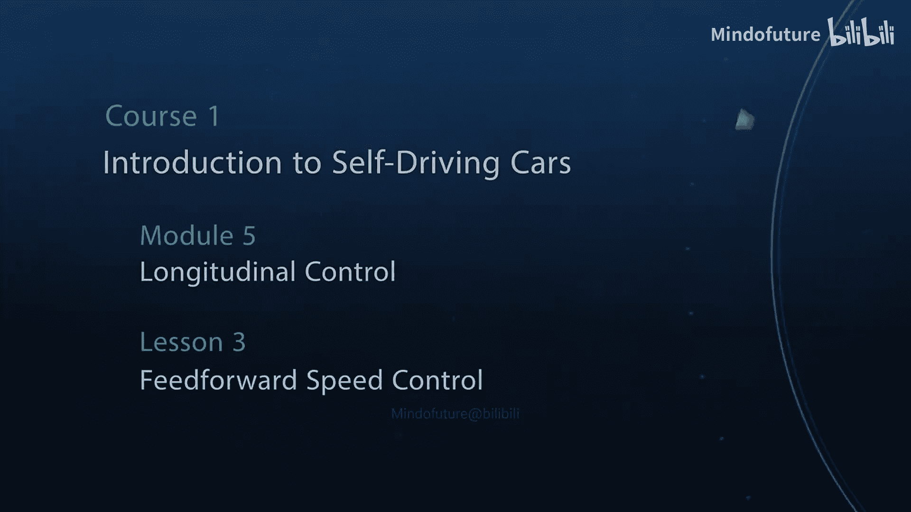
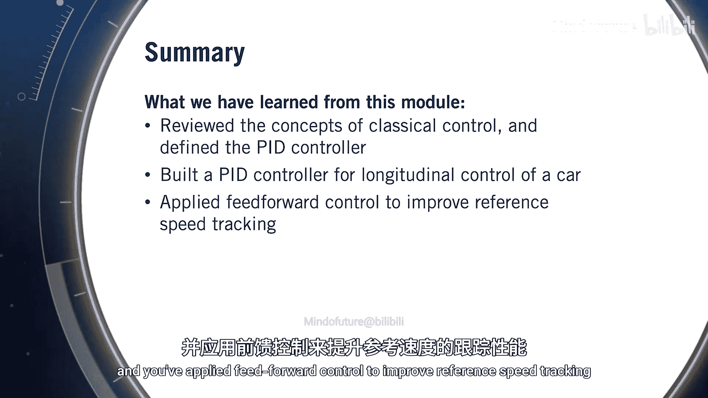

自动驾驶汽车简介：3.6：前馈速度控制

在本节课中，我们将学习如何将前馈控制与反馈控制相结合，以提升自动驾驶汽车纵向速度跟踪的性能。我们将探讨前馈控制的基本原理，并将其整合到现有的控制架构中。

上一节我们介绍了使用PID反馈控制器进行纵向速度跟踪。本节中，我们来看看如何引入前馈控制来进一步提升性能。

首先，我们来比较反馈控制与前馈控制的框图结构。

反馈控制框图展示了典型的闭环结构。当前输出与参考信号进行比较，两者之间的误差被输入到反馈控制器，由控制器生成对受控对象的输入。

前馈控制框图则展示了一种开环结构。参考信号直接输入到前馈控制器，同样由它生成对受控对象的输入。前馈控制器通过建模受控过程（正如我们在本课程模块3中所做的那样）并直接施加相应的输入来生成控制信号。

在许多应用中，前馈和反馈回路会结合起来以提升控制器性能。

以下是一个典型的前馈-反馈控制结构的工作原理框图。

可以将前馈控制视为提供维持受控对象跟踪其参考信号所需的预期输入，而反馈控制器则用于纠正由干扰或前馈控制器所用模型不准确所导致的误差。对受控对象的输入就是前馈输入和反馈输入的简单相加。

总结这个概念，同时使用反馈和前馈控制器来控制一个系统的主要原因如下：

*   **前馈控制器**提供预测性响应，它们为达到特定的跟踪响应而生成参考输出，尤其是在所需输入非零的情况下。
*   **反馈控制器**提供反应性响应，能在干扰发生时消除由此产生的控制误差。

正是由于这种互补关系，反馈与前馈控制的结合被广泛使用。

因为自动驾驶汽车需要非零的转向指令来维持恒定半径转弯，以及恒定的油门或刹车指令来维持恒速或减速率，所以前馈指令对于提升自动驾驶中的跟踪性能极为有益。

现在，让我们看看如何结合反馈和前馈控制器来为纵向速度控制生成车辆执行指令。

参考速度或行驶循环由更高层的规划器定义，期望车辆能精确跟随参考速度。

参考速度是前馈模块的输入，而速度误差是反馈（或PID控制）模块的输入。两个控制器都会产生两个车辆执行信号：油门和刹车指令。

请注意，此框图中没有包含低级控制器，这与上一视频中纯PID反馈控制的情况不同。现在，通过从加速度到发动机指令的映射来实现期望加速度这一低级控制器的角色，将由前馈模块来处理。

前馈模块仅以参考信号作为输入，其主要目标是精确设置受控对象的输入。为此，我们可以将整个纵向动力学模型转换为一个固定的查找表或参考映射。

该映射在假设车辆处于稳态的情况下，将参考速度映射到相应的执行器信号。这种前馈方法在稳态下效果良好，但忽略了车辆动力总成的内部动态特性，并且也必须依赖当前的车辆状态估计来解析所用的一些力和动态模型。

让我们看看如何从前馈查找表生成执行器指令所需的步骤。

在我们的例子中，我们关注的是在每个时间步长跟随参考速度。

1.  **计算所需车轮角速度**：基于车速与车轮角速度之间的运动学关系，我们可以计算出所需的车轮角速度。
2.  **计算发动机转速**：车轮角速度通过变速箱、差速器和主减速器的传动比与发动机角速度（发动机转速RPM）相关联。因此，我们现在可以通过建模模块中定义的运动学关系，计算出与所需车轮角速度相对应的发动机转速。
3.  **计算所需发动机扭矩**：假设为稳态运行，动力总成的动力学表明，发动机扭矩必须等于作用在车辆上的总负载扭矩。负载扭矩的来源包括空气阻力、滚动阻力和车辆重力阻力。我们可以使用车辆的当前状态（包括当前速度和道路坡度）来计算组合负载扭矩。
4.  **确定油门位置**：现在我们有了所需的发动机扭矩，可以将其与当前的发动机运行转速（RPM）结合，来确定产生所需扭矩所需的油门位置。同样，发动机图谱是针对发动机扭矩和转速的离散稳态值定义的，并根据车辆当前运行点进行插值。

让我们看一下上一视频描述的PD控制方法与本节讨论的结合前馈-反馈方法之间的比较。我们使用了与上一视频相同的仿真参数，包括发动机图谱和动态模型元素。

两种响应之间的关键差异在参考速度变化时可见。因为PID控制器需要先存在误差才能进行纠正，所以其响应滞后于前馈方法，后者会立即施加相关的输入参考值。

然而，前馈跟踪仍然不完美，因为车辆响应最终受其惯性支配，而我们介绍的前馈方法依赖于汽车的稳态建模。

随着前馈模型变得更加精确，反馈组件可以专注于纯粹的干扰抑制，速度曲线跟踪也能以一致的精度完成。

在本节课中，我们一起学习了前馈控制器的概念，以及整合反馈与前馈控制器以提升参考跟踪性能的方法。我们还应用了反馈和前馈回路来实现自动驾驶汽车的速度控制。

恭喜你，现在已经完成了关于自动驾驶汽车纵向控制的这个模块。你回顾了经典控制的概念并定义了PID控制器。你构建了一个用于汽车纵向控制的PID控制器，并应用了前馈控制来改善参考速度跟踪。

在下一个模块中，我们将深入探讨横向车辆控制设计，以引导我们的车辆沿着参考路径行驶。我们下个模块见。