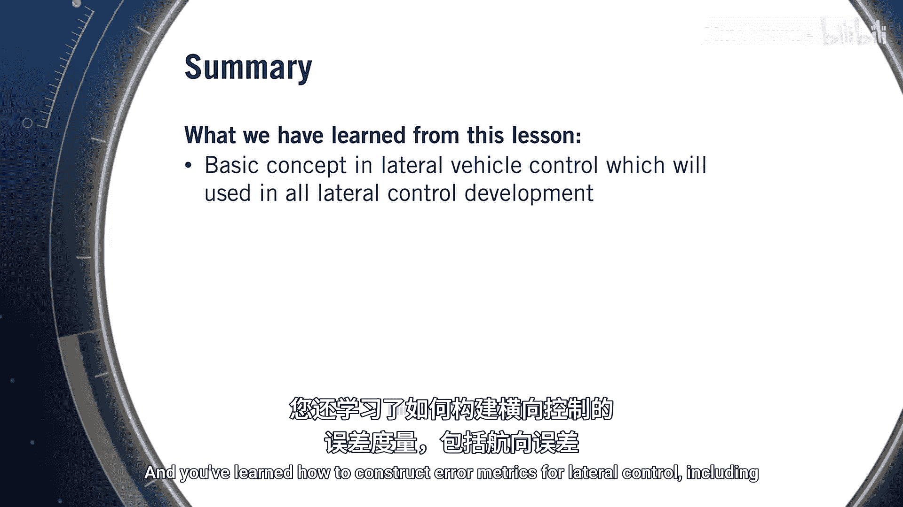

# 040：横向车辆控制导论 🚗

在本节课中，我们将要学习自动驾驶汽车横向控制的核心概念。我们将了解如何定义不同类型的参考路径，以及如何计算相对于这些路径的航向误差和横向跟踪误差。

在之前的模块中，我们学习了自动驾驶汽车纵向控制的一些基础知识。本节中，我们将进入横向控制的学习。本周我们将涵盖四节课。在第一课中，我们将看到横向车辆控制的介绍。在第二和第三课中，我们将介绍两种基于运动学模型无滑移假设的几何路径跟踪控制策略。最后，在最后一课中，我们将重点介绍模型预测控制，这是自动驾驶汽车中常用的一种高级控制策略示例。

具体到本课，我们将介绍执行横向控制所需的核心概念。你将学习如何定义不同类型的参考路径，以及如何计算相对于这些参考路径的航向和横向跟踪误差。

## 横向控制的目标

自动驾驶汽车的一个主要关注点是确保车辆能够精确地遵循预定义的路径，执行高层规划模块制定的运动计划。这是横向控制的主要目标，它必须选择所需的转向角来纠正累积的任何误差，并在路径方向出现变化时进行跟踪。

为了设计横向控制器，我们需要：
*   定义车辆位置与适当期望路径坐标之间的误差。
*   选择一种控制设计策略，该策略能在满足转向角限制的同时将误差驱动至零。
*   考虑车辆的动态限制和期望的行驶特性，例如最大横向加速度和最小急动度。

控制指令必须了解可用的轮胎力，并且在纠正跟踪误差时不能超过车辆的能力。

## 参考路径的定义

参考路径是规划系统和横向控制器之间的基本接口，可以通过多种方式定义。

以下是三种主要的路径定义方法：

*   **线段序列**：通过连接一系列端点顶点来定义直线段序列。这种路径定义非常紧凑且易于构建，假设点间距良好且环境允许大部分直线运动（如曼哈顿网格道路）。然而，该路径包含航向不连续性，这使得转向车辆的精确跟踪具有挑战性。
*   **密集航点序列**：提供一系列紧密间隔的航点。这种间距通常在距离或行驶时间上是固定的，并且航点的相对位置可以受到限制以满足近似的曲率约束。航点路径非常常见，因为它们易于使用，并且可以直接从特定路线早期运行中收集的状态估计或GPS航点构建。
*   **参数化曲线序列**：使用一系列连续参数化曲线来定义路径，这些曲线可以来自固定的运动基元集合，也可以在规划期间通过优化确定。这些曲线提供了连续变化运动的优点，并且可以构建具有平滑导数，以帮助误差和误差率计算的一致性。

在所有路径跟踪的情况下，控制器都试图消除车辆与期望路径的偏移，并使车辆航向与路径航向对齐。对于这些路径定义中的每一种，沿路径的行驶方向也会被提供，这可以通过点顺序或曲线顺序来编码。

## 横向控制设计的两大类别

现在我们来介绍自动驾驶汽车中广泛使用的两大类横向控制设计。

第一类控制器是**几何控制器**，它依赖于期望路径的几何形状、坐标以及车辆的运动学模型。我们将考虑两种几何控制器：纯追踪控制器和斯坦利控制器，我们将在本模块的后续课程中详细研究它们。

另一类控制器称为**动态控制器**。这类中最流行的高级控制器是模型预测控制器。它执行有限时域优化以确定要应用的控制指令。MPC之所以常用，是因为它能够处理各种约束，并能识别出不仅考虑当前误差的优化解决方案。我们将在本模块的最后一个视频中研究MPC设计。

## 路径跟踪中的误差定义

现在我们来研究路径跟踪控制中误差的定义。我们将使用运动学自行车模型作为讨论的基础。

运动学自行车模型是四轮车辆的一个合适的面向控制的模型，其中前左轮和前右轮组合成一个可转向轮，后左轮和后右轮组合成一个驱动轮。

对于本次讨论，我们将使用一个线段作为参考路径。为了横向控制的目的，我们重新定义了相对于当前路径线段的航向。变量 **ψ** 将被重新用来表示车辆相对于路径线的相对航向角。前轮速度 **V** 和相对于航向方向的转向角 **δ** 没有改变。

我们可以根据控制器设计，将车辆的参考坐标系放在后轴中心、前轴中心或重心处。

我们将介绍两种类型的误差：航向误差和横向跟踪误差。

**航向误差**等于沿路径参考点处的路径航向与车辆航向之差。它是衡量车辆与期望路径对齐并沿其方向行驶情况的主要指标。航向误差的变化率 **ψ̇** 帮助我们理解航向误差如何随时间演变，并且可以从运动学自行车模型方程中计算出来。对于直线段，期望的航向变化率为零，可以移除。

另一种误差是偏移误差，称为**横向跟踪误差**。横向跟踪误差是车辆上的参考点与期望路径上最近点之间的距离。它是衡量车辆位置沿路径与期望位置接近程度的主要指标。为了使车辆正确跟踪期望路径，航向误差和横向跟踪误差都必须收敛到零。从车辆参考点到路径参考点的连线垂直于路径。

横向跟踪误差的变化率可以通过提取前进速度的横向分量来计算。从公式 `ė = V * sin(ψ)` 中，我们可以看到，随着速度增加，横向跟踪误差变化更快，这意味着纠正相同大小的横向跟踪误差所需的转向角更小。

将关于航向和横向跟踪误差的讨论扩展到曲线路径会增加一些额外的复杂性，因为曲线路径上的参考点应该位于何处并不立即明确。所需的几何关系超出了本视频的范围。

## 总结

本节课中，我们一起学习了横向控制的概念。你研究了定义参考路径的三种方法：线段、航点和曲线。你还学习了如何构建横向控制的误差度量，包括航向误差和横向跟踪误差。

在下一个视频中，我们将使用这些定义来构建我们的第一个横向车辆控制器——纯追踪控制器，以定义将跟踪我们参考路径的转向指令。