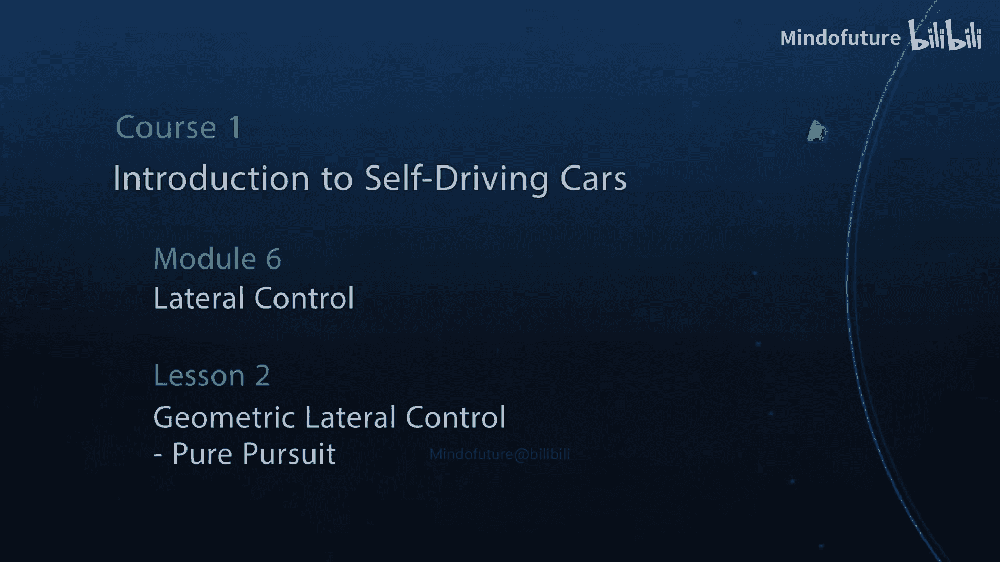
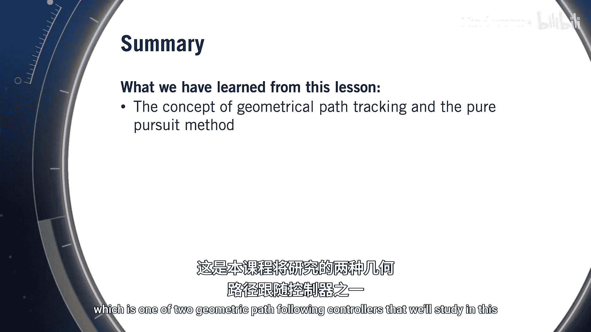

自动驾驶汽车简介：第二课：几何横向控制 - 纯追踪算法 🚗




在本节课中，我们将学习一种重要的横向控制方法——几何路径跟踪控制器，并详细推导其中的纯追踪算法。我们将利用上一课定义的车辆运动学模型和误差度量，来构建一个能够引导自动驾驶汽车跟踪参考路径的转向指令规则。

上一节我们介绍了与车辆横向控制相关的重要概念。本节中，我们将把这些概念付诸实践。

### 什么是几何路径跟踪控制器？

广义上讲，几何路径跟踪控制器是**仅利用车辆运动学几何和参考路径的几何关系**来实现路径跟踪的任何控制器。对于自动驾驶汽车而言，它是一种横向控制器，其特点是**忽略车辆的动态力**，并假设车轮满足**无滑移条件**。它依赖于运动学自行车模型和上一课定义的误差度量，来构建实现路径跟踪的转向指令规则。

由于其简单性，这种方法在机器人和自动驾驶领域非常流行和实用。然而，这种简单性也有其缺点：当车辆运动不符合无滑移假设时（例如在具有高横向加速度的激烈机动中），其性能会下降。在这些情况下，需要更深入地理解可用轮胎力的极限，并采用更复杂的控制策略。不过，当车辆在线性轮胎区域运行且轮胎未饱和时，几何路径跟踪控制器可以工作得很好。

几何路径跟踪控制器依赖于期望路径上的一个参考点。这个参考点可以是用于计算航向误差和横向误差的同一点，也可以是车辆前方路径上一定距离处的**预瞄点**。我们将要推导的纯追踪控制器就使用路径上的一个预瞄点，而下一课将介绍的斯坦利控制器则使用与误差计算相同的参考点。

### 纯追踪控制器详解

现在，让我们深入了解纯追踪控制器。在纯追踪方法中，核心思想是：在路径上车辆前方一个固定距离处设置一个参考点，然后计算出一个恒定的转向角，使车辆能够以圆弧轨迹驶向并经过该点。随着车辆转向以跟随这条曲线，预瞄点持续前移，从而减小转向角，平缓地将车辆引导回路径。

在此方法中，我们使用**后轴中心**作为车辆上的参考点。我们将后轴中心与目标参考点（预瞄点）连接的线段定义为固定距离 **`LD`**，称为**预瞄距离**。车辆航向与这条“预瞄线”之间的夹角记为 **`α`**。

为了构建纯追踪控制律，我们再次利用**瞬时旋转中心**的概念。轨迹上的目标点、后轴中心和瞬时旋转中心形成一个三角形，其中两条边长为 **`R`**（转弯半径），另一条边长为 **`LD`**。我们希望定义一条将车辆参考点带到路径上目标点的圆弧，该圆弧是覆盖角度 **`2α`** 的 ICR 圆的一部分。

基于正弦定理，我们可以写出以下方程：
```
LD / sin(2α) = R / sin(π/2 - α)
```
利用三角恒等式进行简化：
```
LD / (2 sinα cosα) = R / cosα
```
最终得到简洁表达式：
```
LD / sinα = 2R
```
因此，曲率 **`κ`**（即转弯半径 **`R`** 的倒数）为：
```
κ = 1/R = 2 sinα / LD
```

接下来，我们结合自行车模型来计算跟踪此圆弧所需的转向角。回顾之前内容，转向角定义了圆弧半径，关系式为：
```
tan(δ) = L / R
```
其中 **`L`** 为轴距。将此表达式与之前推导出的 **`R`** 的表达式结合，我们现在可以用易于计算的值来表示跟踪圆弧所需的转向角：
```
δ = arctan( (2L sinα) / LD )
```
这是一个易于实现的转向控制律，但它的性能如何呢？

### 控制律性能分析

为了理解其性能，我们需要深入分析误差值在闭环系统中的演变。对于纯追踪控制器，我们可以将横向误差 **`e`** 定义为车辆航向矢量与目标点之间的距离。由此，我们得到关系式：
```
sinα = e / LD
```
将此式与曲率表达式结合，表明纯追踪控制器产生的路径曲率与预瞄参考点处的横向误差成正比：
```
κ = 2e / LD²
```
随着误差增大，曲率也随之增大，从而更积极地将车辆带回路径。该方程证明，**纯追踪控制器的工作方式类似于比例控制器**，它使用路径曲率作为控制器输出来校正横向误差。比例增益取决于 **`2 / LD²`**。因此，随着预瞄距离增加，比例增益以非线性方式减小。

需要注意的是，采用固定 **`LD`** 值的纯追踪控制器产生的曲率控制律**没有考虑车速**。这意味着无论车辆以10公里/小时还是100公里/小时行驶，所选择的转向角都是相同的，但这会导致完全不同的横向加速度。为高速调校的控制器在低速时会过于迟钝，而为低速调校的控制器在高速时会危险地过于激进。

### 引入速度自适应

为了克服这个限制，我们对纯追踪控制律进行一项修改：**根据车速动态调整预瞄距离 `LD`**。我们定义预瞄距离随车辆前进速度 **`vf`** 成比例增加：
```
LD = K_pp * vf
```
其中 **`K_pp`** 是纯追踪预瞄增益。将这一调整代入转向角指令方程，我们得到了完整的纯追踪控制器：
```
δ = arctan( (2L sinα) / (K_pp * vf) )
```
该控制器选择能形成一条通往预瞄参考点的圆弧的转向角，并根据车速调整预瞄点的远近：车速越快，预瞄点越远。这种设计产生的转向指令和转弯速率在给定可用轮胎力的前提下是可实现的，但需要通过调参来达到最佳效果。

### 总结

本节课中，我们一起学习了几何路径跟踪控制器这一类方法，并推导了纯追踪控制器，这是本课程我们将研究的两种几何路径跟踪控制器中的第一种。你现在已经准备好开始为自动驾驶汽车构建几何横向控制器了。




在下一个视频中，我们将探索第二种几何路径跟踪控制器——斯坦利控制器。