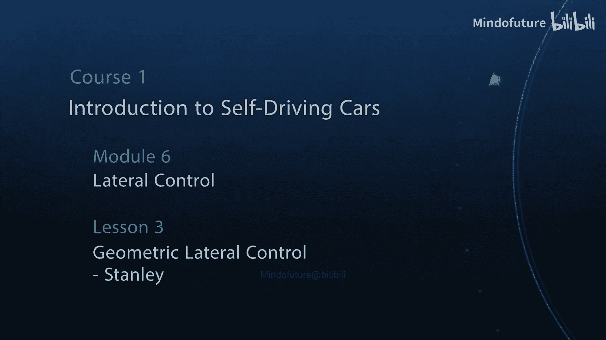

# 042：几何横向控制-斯坦利算法

## 概述
在本节课中，我们将学习第二种几何路径跟踪控制器——斯坦利控制器。我们将推导其控制律，分析其在不同误差下的转向指令变化，并评估其从任意初始条件收敛到期望路径的性能。

---

## 斯坦利控制器简介
上一节我们介绍了纯追踪控制器，它是一种基于前瞻参考点定义转向输入的几何路径跟踪控制器。本节中，我们来看看另一种几何控制器——斯坦利控制器。该控制器由斯坦福大学赛车团队开发，并帮助他们赢得了第二届DARPA无人驾驶挑战赛。

斯坦利控制器是一种简单但实用的几何路径跟踪控制器，适用于自动驾驶机器人和汽车。其核心思想是改变控制器使用的车辆参考点，并同时考虑航向误差和横向跟踪误差。

## 控制器推导
斯坦利控制器由三个主要部分组成，旨在实现全局路径收敛和误差的稳定衰减。

以下是斯坦利控制器的三个核心组成部分：

1.  **航向误差校正**：转向角直接设置为车辆航向与路径航向之间的误差角，以消除航向偏差。
2.  **横向误差校正**：增加一个比例控制项，其增益与前进速度成反比，并通过反正切函数映射到转向角范围。
3.  **转向角限幅**：最终的转向指令被限制在车辆的最小和最大转向角范围内。

最终的控制律结合了这三个元素，其公式如下：
`δ = ψ + arctan( (k * e) / v )`
其中，`δ`是转向角，`ψ`是航向误差，`k`是增益，`e`是横向跟踪误差，`v`是前进速度。

## 误差响应分析
现在，我们来分析斯坦利控制器对不同误差信号的响应。

对于航向误差，转向指令与航向误差方向相反，促使车辆转向以对齐路径。如果航向误差超过最大转向角，控制器将请求最大转向指令。

对于大的正向横向跟踪误差，`(k * e) / v`的值会很大，使得`arctan`项接近`π/2`。因此，控制律近似为`δ ≈ ψ + π/2`。这个较大的值会将转向指令限制在最大值，使车辆转向路径。这个转向动作会增加反方向的航向误差，因此当航向误差达到`-π/2`时，转向指令将降为零。随后，车辆将沿直线驶向路径，直到横向误差减小。

## 收敛性分析
我们可以利用本模块第一个视频中定义的横向误差动力学表达式，来理解斯坦利控制器的收敛特性。

横向跟踪误差的变化率满足一个一阶微分方程。其解是一个指数函数。由于增益`k`为正，误差会以指数形式衰减到零。这项分析最有趣的一点是，衰减率完全与速度无关。这意味着，速度较快的车辆在收敛到路径的过程中行驶距离会更远，但收敛所需的时间与速度较慢的车辆相同。

## 仿真示例
接下来，我们通过仿真示例来观察斯坦利控制器的收敛特性。我们将查看两种极端场景：大的初始横向误差和大的初始航向误差。

**场景一：大的初始横向误差**
假设初始横向误差为5米，最大允许转向角为25度，前进速度为5米/秒。仿真显示，斯坦利控制器能够有效纠正大的横向误差并收敛到期望路径。大的初始误差导致大的转向指令，使车辆快速转向路径。随后，航向误差项和横向误差项达到平衡，车辆沿直线驶向路径。随着横向误差减小，向路径的指数衰减变得明显，最终车辆在仿真后期稳定跟踪路径。

**场景二：大的初始航向误差**
参数与之前相同，但车辆起始于路径上，且指向错误的方向。仿真结果表明，斯坦利控制律首先纠正航向误差，转向指令达到限幅值。随后，随着横向误差开始增长，转向指令继续纠正车辆航向，使其超越与路径的对齐状态。最后，车辆像之前一样进入指数收敛阶段。

这些仿真结果很好地展示了斯坦利控制器纠正任意大误差的能力。事实上，该控制器具有全局稳定性证明，意味着无论初始条件如何，控制器都能引导车辆回到路径。

## 实际应用与增强
然而，斯坦利控制器仍然是一个几何路径跟踪控制器，因此没有考虑真实自动驾驶汽车的许多方面。例如，它不考虑测量噪声、执行器动力学或轮胎力效应，这些都可能在机动过程中导致不理想的行驶特性。

不过，我们可以对几何路径跟踪控制器进行一些调整，以帮助减轻一些最不理想的影响。

以下是几种增强方法：

1.  **低速软化**：在低速运行时，当速度估计有噪声时，纯追踪和斯坦利控制器的行为可能非常激进。由于速度项位于反正切函数内部的分母中，低速估计误差往往会在转向指令中被放大。为了解决这个问题并提高低速下的稳定性，我们在分母中添加一个正的软化常数，确保分母始终有一个最小值。
2.  **高速阻尼**：在高速下，转向指令需要缓慢变化以确保侧向力不过大。即使有速度缩放，斯坦利控制器在高速下的响应也可能过于激进。因此，可以增加一个航向变化率的阻尼项。这实质上将航向误差控制部分转换为一个比例控制器，同样的思想也可以应用于纯追踪的曲率控制。
3.  **前馈项**：对于高曲率的弯曲路径，控制器可能无法很好地跟踪，因为几何控制器的推导中没有考虑参考路径的动力学。与纵向控制类似，可以通过向控制器添加前馈项来增强性能并更快地将误差驱动到零。在这种情况下，只需简单地包含维持期望路径曲率所需的转向角即可。

经过这些修改，只要车辆避免超出轮胎线性区域，斯坦利控制器就能成为执行中等驾驶任务的有用工具。

## 总结
本节课中，我们一起学习了如何将斯坦利控制器作为几何路径跟踪控制器来应用，了解了斯坦利控制器的收敛特性，以及如何通过添加增强功能来提高控制器的实际性能。

在下一个视频中，我们将介绍模型预测控制方法，这是一种先进的基于模型的控制方法，能够克服几何控制器的许多局限性。下次见。