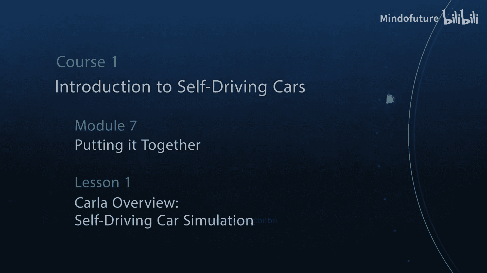
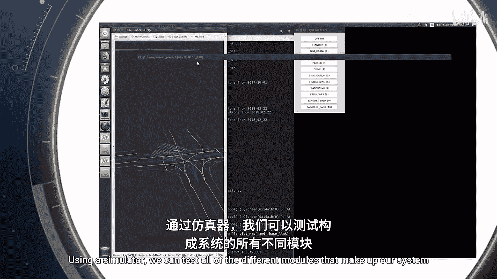
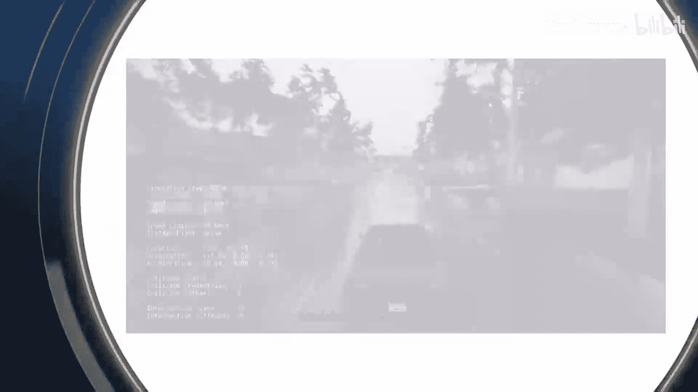

# 044：CARLA概述与仿真入门 🚗

在本节课中，我们将学习自动驾驶汽车仿真的重要性，并详细介绍本课程将使用的仿真器——CARLA。我们将了解仿真如何帮助安全地测试自动驾驶系统的各个模块，并初步探索CARLA的功能与使用方法。

---

欢迎来到自动驾驶汽车专项课程第一课的最后一个模块。

在这个模块中，你将有机会综合运用并测试我们在整个课程中讨论过的概念。

我们将首先讨论各种自动驾驶汽车仿真环境。

然后，我将向你展示在本课程乃至整个专项课程中你将使用的仿真器。

一个逼真的仿真环境是开发自动驾驶汽车的重要工具，因为它能让我们在真正上车之前，确保车辆能够安全运行。

使用仿真器，我们可以测试构成系统的所有不同模块，包括感知、规划和控制，既可以一起测试，也可以独立测试。

我们可以运行涉及多辆AI控制车辆和行人的复杂场景。

我们可以对这些场景进行数百甚至数千次变体测试，以确保我们的汽车始终能做出正确决策。

最重要的是，我们可以在实际道路上过于危险的情况下测试我们的汽车。

市面上有各种各样的仿真器，由工业界和学术界的团队开发。在本课程中，我们将使用名为CARLA的仿真器。

CARLA是由巴塞罗那自治大学计算机视觉中心、英特尔和丰田研究所的成员团队共同开发的仿真器，并使用虚幻引擎构建。

它拥有高度详细的虚拟世界，包含道路、建筑、天气、车辆和行人代理。

这些环境的图像可以以多种格式捕获，包括深度图、分割图像等，你将在本专项课程的第三课中了解更多相关内容。

整个仿真可以通过外部客户端控制，该客户端可用于向车辆发送命令、记录数据以及自动执行场景以评估汽车的性能。

最重要的是，CARLA是开源的，任何人都可以自由修改代码的任何部分，以满足其特定的仿真需求。

对于本专项课程，我们开发了一个定制版本的CARLA，其中包含一些额外工具，以帮助你在仿真中实现和测试代码。

让我们来看看如何与仿真器交互并使用它。

无需担心后续操作，评估说明中有一份关于如何设置CARLA和运行Python客户端的详细指南。

我们已经下载并安装好所有内容，现在让我们直接进入仿真器本身。

启动CARLA最简单的方法是使用提供的启动脚本。

该脚本本身用于加载CARLA会话，并选择我们想要的地图或场景。在这里，我选择CARLA提供的城镇环境进行演示。

我们还可以更改仿真器会话的各种配置，例如仿真窗口大小，以及设置较小或较大的固定时间步长。

CARLA会话也可以在服务器模式下加载。

这允许一个可编程客户端连接到服务器，并发送命令来控制汽车或接收有关仿真环境的信息。

能够编程我们的客户端，为利用仿真器反馈开辟了多种可能性。从反馈中，我们可以知道地图上每辆车的位置，开发控制器和规划器以使我们的汽车平稳导航，甚至可以使用深度和分割图像来学习检测汽车和行人。

来自客户端的仿真结果也可以进行后处理，以评估我们当前软件算法和方法的性能。

这有助于深入了解仿真器和算法的改进空间与局限性。

对于我们即将开始的课程项目，我们将使用这些结果来评估你算法的性能。

并鼓励你探索所开发算法的优势和劣势。

---

我们讨论了仿真为何有用以及你可以用它做什么，并且认识了CARLA——这个我们将在整个专项课程中使用的仿真器。

我们还看到了CARLA的一些功能，你将在接下来的课程项目中使用它们。

现在，在我们进入项目细节之前，是时候让你更仔细地看看仿真器本身了。

并在你自己的电脑上设置它。现在是时候按照那些详细的说明，完成整个设置过程了。

如果你遇到任何问题，我也鼓励你查阅讨论论坛。很可能之前有人遇到过和你相同的问题。

一旦你成功运行仿真器，并且能够熟练地启动和运行客户端，你就准备好开始将其用于课程项目了。

在下一个视频中，我们将介绍最终项目的要求，并让你准备好开始为你的仿真自动驾驶汽车设计控制器。

我们下个视频见。

---

**本节课总结**

在本节课中，我们一起学习了自动驾驶汽车仿真的核心价值，并深入了解了CARLA仿真器。我们认识到仿真对于安全、高效地测试感知、规划和控制模块至关重要。CARLA作为一个开源、功能强大且高度可定制的仿真平台，为我们提供了逼真的虚拟环境和灵活的控制接口，是进行自动驾驶算法开发和测试的理想工具。现在，你已经为在仿真环境中动手实践做好了准备。