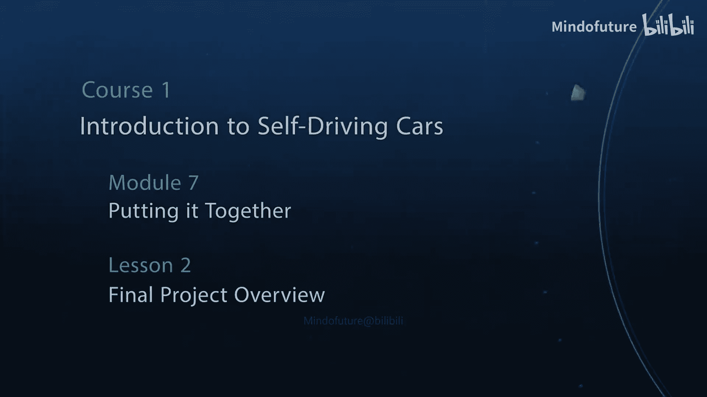
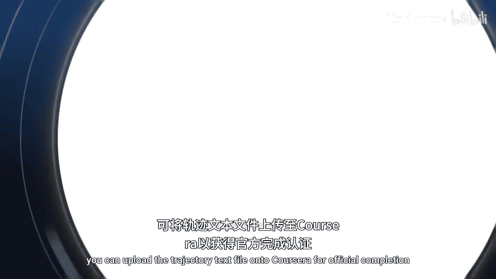

自动驾驶汽车简介：P45：期末项目概述 🚗

在本节课中，我们将概述本专项课程第一门课的期末项目。你将了解项目目标、需要实现的控制模块、代码结构以及评估方式。

---

现在你已经了解了Carla模拟器的一些功能，并且有机会下载模拟器并开始自行实验。

既然我们已经有了一个可运行的模拟环境，你就可以开始实现和测试在本课程中学到的概念了。

让我们来看看你将在本专项课程第一门课中完成的期末项目。

在这个项目中，你将用Python实现一个简单的控制器，并用它在Carla模拟器中驾驶汽车绕赛道行驶。

赛道是一个环形，如图所示。你将获得一个有序的路径点列表，这些路径点等间距地分布在赛道上。

每个路径点都包含其位置信息以及车辆应达到的速度。因此，这些路径点将成为你控制器的参考信号，成功导航到所有路径点即意味着完成了整条赛道。

由于控制器参考信号同时包含位置和速度，因此你需要同时实现纵向控制和横向控制。

在开始项目之前，你可能需要回顾一下关于纵向控制和横向控制的模块。

你的控制器输出将是车辆的油门、刹车和转向角指令。

油门和刹车指令将来自你的纵向速度控制，而转向指令将来自你的横向控制。

请务必从尽可能简单的控制器设计开始，只有在车辆未能按预期跟踪路径时，才增加复杂性。

当然，一旦你有了一个可工作的控制器，不要犹豫去挑战它的极限，看看它在赛道上究竟能表现如何。

那么，你该如何为这个项目构建你的代码呢？

我们为你准备了一个起始脚本，这样你就不需要担心任何Carla的实现细节，可以专注于编程实现控制器本身。

如果你打开模拟器目录并导航到“Course one final project”文件夹，你会看到一个名为 `controller_2D.py` 的文件。这就是你课程项目的起点。

当你打开这个文件时，你会看到车辆控制器被实现为一个Python类。

这个类包含了实现控制器所需的所有相关信息，车辆状态、期望路径点、期望速度和控制器输出都存储在变量中，随时可用。

该类还包含一些将直接与Carla交互的函数。

这些函数将持续更新车辆状态，并将控制器输出发送给Carla，使你能够将精力完全集中在控制器实现上。

现在你可能想知道你的代码将如何被评估，以及你将如何获得这个项目的成绩。

运行你的控制器后，将生成一个文本文件，记录车辆的整个行驶轨迹。

这个文件名为 `trajectory.txt`，位于“controller_output”子文件夹中。

你的控制器性能将基于这个轨迹文件进行评分。

Coursera平台将使用一个评分脚本来检查你的代码。它会绘制你的路径点、车辆轨迹以及车辆速度与期望速度的对比。

每个路径点都有一个距离阈值和一个速度阈值，在图中以绿色显示。😊

如果车辆轨迹同时在这两个阈值范围内，则认为成功到达该路径点。

评分脚本会告诉你成功到达了多少个路径点，如果你成功到达超过一半的路径点，就能通过评估。

一旦你的轨迹通过了评分脚本，你就可以将轨迹文本文件上传到Coursera，以正式完成项目。

---

现在，你已经拥有了实现你的第一个控制器并在模拟中测试它所需的一切。

这是开发自动驾驶汽车的重要一步，也是你将在该领域遇到的一个基本场景。

如果我在本视频中未能解答你的任何疑问，本模块的阅读材料中还有进一步的说明，你也可以随时在讨论区提问。

希望你在这个期末项目中玩得开心，等项目完成后，我们将再次见面来结束这门课程。

祝你好运。