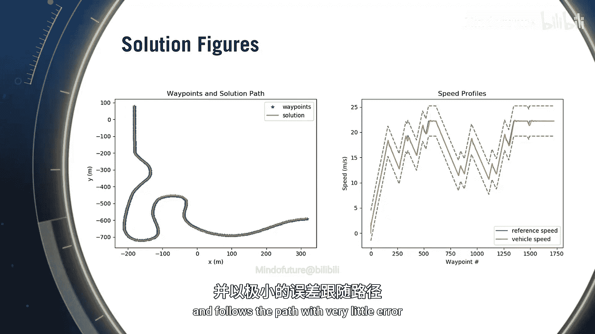

# 046：期末项目解决方案 🚗

在本节课中，我们将一起学习期末评估项目的官方解决方案。我们将回顾如何结合纵向与横向控制器，使自动驾驶汽车能够同时跟踪目标速度和目标路径。

---

## 纵向控制：PID控制器

上一节我们介绍了控制器的设计思路，本节中我们来看看具体的实现。对于纵向控制，我们实现了一个PID控制器，其目标是以期望速度为参考，输出油门和刹车指令。由于目标速度较低且平稳，我们完全绕过了底层控制器。

PID控制器由三个部分组成：

1.  **比例项 (KP)**：根据速度误差按比例调整车辆加速度。公式为：`输出 = KP * 速度误差`。这确保了车辆以与误差成比例的幅度朝正确方向加速。
2.  **积分项 (KI)**：根据累积的历史误差设定输出。公式为：`输出 += KI * 累积速度误差`。这确保了对于斜坡参考信号，稳态误差能够被消除。
3.  **微分项 (KD)**：抑制由积分项引起的超调。公式为：`输出 += KD * 速度误差变化率`。

为了完成纵向控制，我们需要将PID控制器输出的加速度转换为油门和刹车指令。为简化处理，我们规定：正输出对应油门，负输出对应刹车。

---

## 横向控制：Stanley控制器

完成了纵向速度跟踪，接下来我们需要控制车辆的方向以跟随路径。对于横向控制，我们实现了在横向控制模块中学到的Stanley控制器。

由于参考信号是给定的路径点位置，我们需要将它们转换为横向误差和航向误差。

以下是计算和控制步骤：

1.  **生成轨迹线**：使用当前路径点和上一个路径点生成一条轨迹参考线。
2.  **计算横向误差**：利用这条线的方程，确定车辆前轴中心到该线的垂直距离，这就是我们的横向误差。
3.  **计算转向角（来自横向误差）**：将横向误差乘以一个增益K，除以当前速度，然后取反正切。公式为：`δ_crosstrack = arctan(K * e / v)`，其中`e`是横向误差，`v`是当前速度。
4.  **计算航向误差**：用轨迹线的角度减去车辆当前的横摆角。轨迹线角度可通过计算其斜率的反正切得到。
5.  **计算总转向角**：将来自横向误差的转向角与航向误差相加，得到最终的总转向输入。公式为：`δ = δ_crosstrack + θ_heading_error`。

至此，我们的横向控制器也设计完成。

---

## 综合表现与总结

将纵向PID控制器与横向Stanley控制器结合后，我们得到了以下速度曲线和轨迹跟踪结果。如图所示，控制器能很好地跟踪参考速度，并以极小的误差跟随路径。

当然，你也可以使用其他控制器来解决这个项目，例如纯追踪控制器、前馈控制器或模型预测控制器。如果你实现了这些控制器，欢迎分享它们的表现。

恭喜你！你已经完成了本课程的最终项目。这是你迈向自动驾驶汽车工程师道路上的一个重要里程碑。😊

你将在整个自动驾驶领域运用你新掌握的仿真和控制算法设计技能，请继续保持出色的工作。我们希望你在这个真实的编程场景中应用所学知识的过程，是一次愉快的学习体验。

在本系列的后续课程中，你将学习到更多关于编程实现自动驾驶汽车所需的知识。😊

---

**本节课中我们一起学习了**：期末项目的完整解决方案，包括使用PID控制器进行纵向速度跟踪，以及使用Stanley控制器进行横向路径跟踪。通过结合两者，自动驾驶汽车能够成功完成既定的速度和路径跟踪任务。