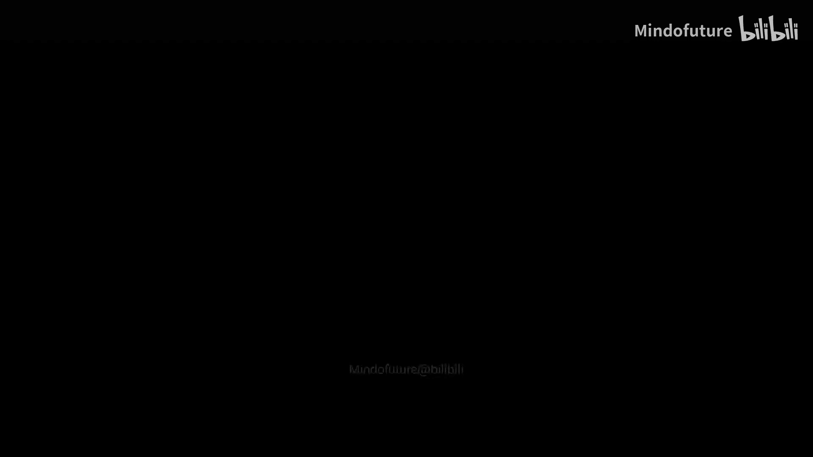
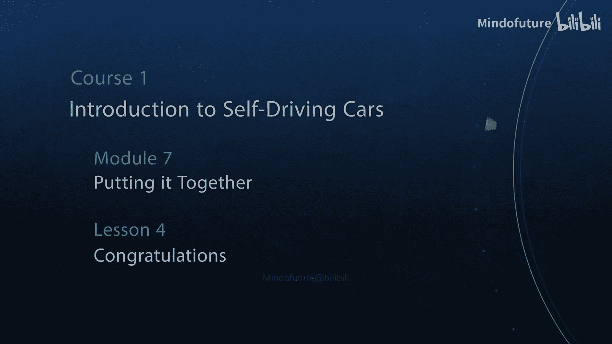
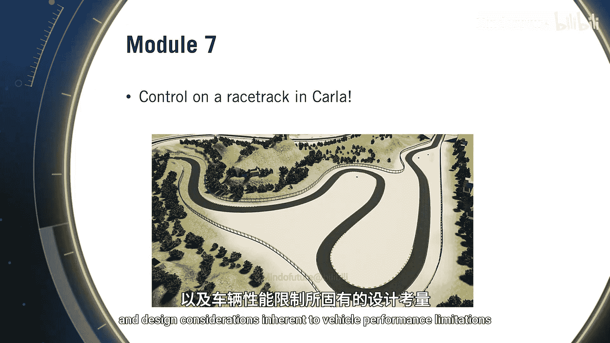
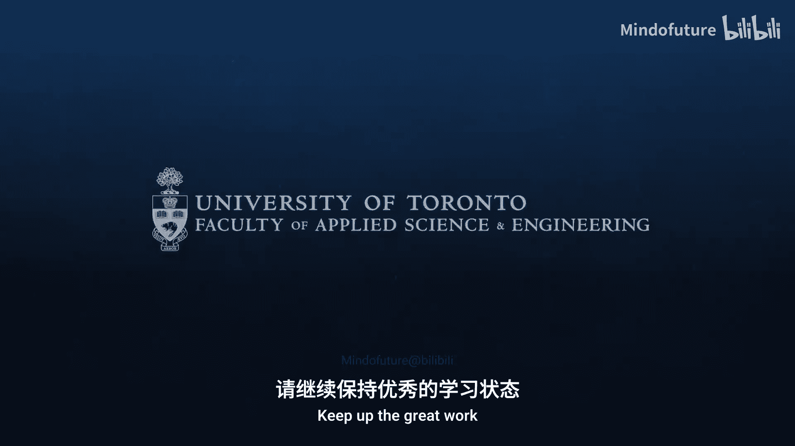

# 047：课程一总结与展望 🚗





在本节课中，我们将回顾并总结自动驾驶汽车专项课程第一门课的核心内容，并对后续课程进行展望。我们已共同学习了自动驾驶的基础架构、硬件软件栈、安全评估以及车辆建模与控制等关键概念。

## 课程一核心内容回顾

上一节我们完成了课程一的最终项目，本节中我们来系统回顾整个课程的学习成果。

以下是我们在课程一中学习的主要内容：

*   **第一周：自动驾驶概述与需求框架**
    *   学习了自动驾驶汽车的分类法。
    *   理解了自动驾驶对感知和规划的需求。
    *   建立了车辆需求框架，以明确需要做出的驾驶决策以及实现这些决策所需的自动化等级。

*   **第二周：硬件与软件架构**
    *   学习了用于感知的各种传感器（如摄像头、雷达、激光雷达）。
    *   掌握了传感器配置设计的基础知识。
    *   了解了典型自动驾驶软件栈的各个组件。
    *   初步探索了自动驾驶的环境表示方法。

*   **第三周：安全评估**
    *   探讨了自动驾驶汽车安全评估的重要性。
    *   评估了硬件和软件栈的多个安全方面。
    *   研究了一些行业内的安全方法，并讨论了流行的安全框架。

*   **第四周：车辆建模与控制**
    *   学习了车辆的**运动学**和**动力学**建模。
    *   建立了详细的纵向和横向模型，以描述车辆对转向、油门和刹车指令的响应。其核心关系可概括为：
        *   **纵向模型**：描述车辆加速、减速，通常涉及力与加速度的关系，例如 `F = m * a`。
        *   **横向模型**：描述车辆转向与轨迹变化，涉及转向角与路径曲率的关系。
    *   基于模型开发了纵向和横向车辆控制器。
    *   学习了如何设计速度调节控制器，以及路径跟踪控制器。
    *   了解了用于安全高效执行复杂操作的预测轨迹控制器。

*   **最终项目：综合应用**
    *   在Carla模拟器中，综合运用所学知识，成功操控自动驾驶汽车沿赛道行驶。
    *   测试了车辆性能限制下的控制与设计考量。

## 总结与课程展望

本节课中，我们一起学习了自动驾驶汽车的基础知识体系。从概念分类到具体的硬件软件组成，从至关重要的安全评估到实现控制的车辆建模，我们构建了对自动驾驶系统初步但完整的认识。

然而，要实现L5级别的完全自动驾驶社会，我们仍有大量工作要做。现在，你应该已经对设计自动驾驶汽车时需要考虑的许多基础挑战有了清晰的认识。




在接下来的第二门课程中，Jonathan将为大家介绍**状态估计与定位**。

你将学习相关的数学和算法方法，例如**最小二乘法**及其与三种常见递归状态估计滤波器（如卡尔曼滤波器）的关系。代码实现可能涉及如下核心更新步骤：
```python
# 卡尔曼滤波预测步骤示例（伪代码）
x_prior = F * x_posterior  # 状态预测
P_prior = F * P_posterior * F.T + Q  # 误差协方差预测
```

此外，你将更深入地了解自动驾驶汽车中常见的几种传感器，包括**全球导航卫星系统（GNSS）**和**激光雷达（LiDAR）**，并学习如何进行**传感器融合**，即将多个数据源的信息组合成对自动驾驶汽车有用的信息。

我将在第三门课程中再次与大家见面，讨论自动驾驶的**视觉感知**。现在，你将跟随Jonathan继续深入学习。你们正在掌握这些重要的概念，这些知识将帮助我们共同构建自动驾驶的未来。



请继续保持出色的学习状态。😊