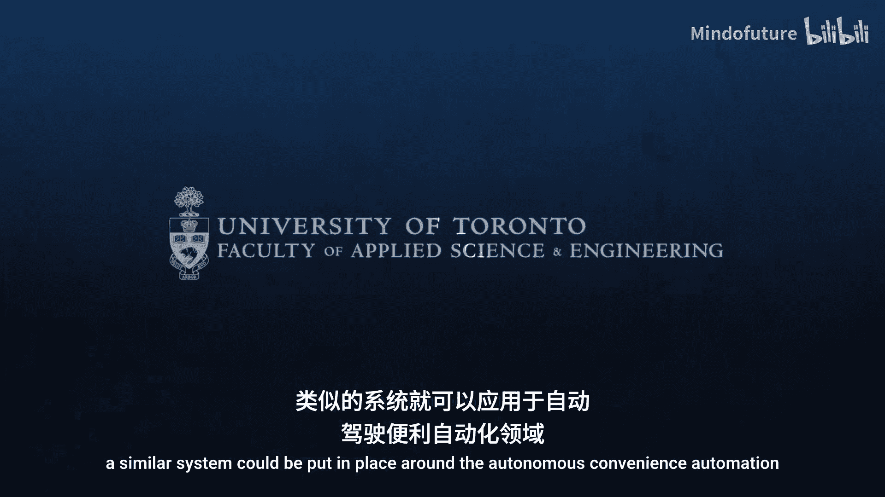

# 050：安全驾驶员与“守护天使”系统

在本节课中，我们将探讨当前自动驾驶系统对安全驾驶员的依赖问题，并了解一种名为“守护天使”的替代性安全模型。我们将分析人类监控自动驾驶系统的局限性，并讨论如何通过技术手段来增强行车安全。

## 当前自动驾驶系统的现状

目前，道路上大多数自动驾驶系统仍然需要安全驾驶员在车内监控系统运行。只有少数几个案例实现了无安全员的自动驾驶。这些首批解决方案是否仍需要我们人类来监控系统？这种部分自动化或依赖人类来确保系统安全的模式将如何发展？这是否是让自动驾驶汽车更快落地、但可能不具备完全自主能力的一个可行解决方案？这是一个极好的问题，也是一个难题。

## 人类监控的局限性

这是一个需要实证研究的问题。为了回答它，我们必须积累足够的实践经验。我们正在收集关于高级驾驶辅助系统的经验，包括一些最先进的系统，例如**二级自动驾驶系统**（如Autopilot）。我们从中学到了很多。同时，也有研究基于这些经验展开。

我们知道，每当需要接管车辆时，驾驶员重建**情境感知**需要时间。我们也知道，驾驶时驾驶员可能会走神，这是一个大问题。人类不一定是自动驾驶系统的可靠监控者。航空领域也提供了重要的经验教训：如果驾驶员没有持续参与任务，就可能出现潜在的风险。

## 航空领域的经验与教训

在航空领域，我们自动化了简单和中等难度的任务。简单任务就是巡航，中等任务如起飞和降落。而我们将所有紧急情况都留给了飞行员处理。事实证明，我们为飞机引入的一些自动化系统，由于其增加的复杂性，反而使困难情况变得更加棘手。例如，需要**覆盖自动驾驶系统**，或者有时会创造出新的操作模式，这些模式现在需要飞行员去处理，而不是让他们始终拥有，比如说，几秒钟甚至一分钟的反应时间。

研究表明，在正常、放松的条件下，人类的平均失误间隔时间大约是半小时。如果处于压力下，或者任务复杂，这个时间可能缩短到大约五分钟。如果同时面临压力和复杂任务，失误可能每隔几秒就会发生。因此，研究显示，依赖人类在自动驾驶系统不知所措时进行接管，不是一个可持续的模式。

## 自动驾驶等级与人类参与度

从**一级自动驾驶**到**二级自动驾驶**是一个巨大的跨越。一级自动驾驶意味着系统至少负责转向或油门控制中的一项，这要求驾驶员持续参与。而到了二级，车辆基本上完成了大约90%的驾驶任务。这很容易导致驾驶员过度依赖系统、失去专注力，从而无法有效监控环境。这是一个挑战。

## “守护天使”模型介绍

上一节我们讨论了人类监控的局限性，本节中我们来看看一种不同的安全理念。我认为丰田提出的“守护天使”模型是一个很好的范例。请详细介绍一下“守护天使”模型。

这个理念基本上是为车辆创建一个安全边界。这个概念源自航空航天领域。当你驾驶飞机时，一个基本准则是让飞机保持在空中，你不想让它失速。失速意味着飞机失去升力，会从空中坠落。像空客这样的公司在其飞机的安全理念中，就引入了计算机系统，该系统会覆盖飞行员的某些操作，以确保飞行员虽然可以给出指令，但系统能防止飞行员将飞机带入失速状态。

以下是“守护天使”系统的核心运作方式：
*   这个系统是在监控飞行员，而不是由飞行员监控系统。
*   它针对的是飞行中的关键部分。
*   当飞行员因任何原因犯错或无意中（例如，错误地断开自动驾驶）时，系统至少能始终在那里避免坠毁。

## “守护天使”在自动驾驶中的应用

按照这个逻辑，在自动驾驶中的类比就是拥有一个非常可靠的防撞系统。我们知道防撞系统是存在的，例如**零级系统**中的自动紧急制动或紧急避让功能。但它们的功能非常有限。其设计初衷是避免误触发，因此它们被调校得相当保守，只有在碰撞迫在眉睫的最后时刻才会启动。

但如果我们能扩展这些系统的能力呢？例如，确保即使是反应能力可能不足的人（如老年人）也能通过给出指令来驾驶汽车。在棘手情况、碰撞风险或危险临近时（通常可能是因为其他道路使用者，例如突然加塞），车辆能像条件反射一样自动做出反应。我认为，当我们完善这种系统后，类似的机制可以围绕自动驾驶的便利性自动化系统建立起来。

## 总结

本节课中我们一起学习了当前自动驾驶对安全驾驶员的依赖及其挑战。我们分析了人类作为系统监控者的局限性，并借鉴了航空领域的经验教训。最后，我们探讨了“守护天使”这一创新安全模型，它通过让系统主动监控并保护驾驶员和车辆，为解决人机协同驾驶的安全问题提供了一种潜在路径。这提示我们，未来的自动驾驶安全可能更依赖于强大、可靠的主动安全系统，而非完全依赖人类的即时接管。