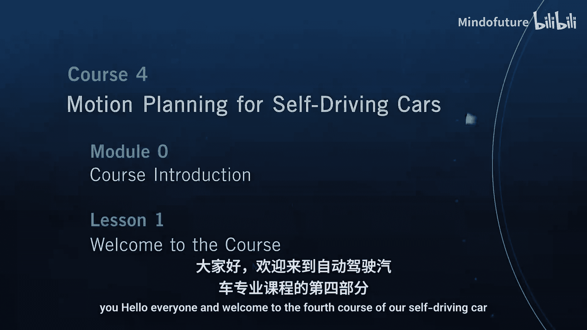

# 002：课程概述与结构 🚗

在本节课中，我们将要学习自动驾驶汽车运动规划课程的整体概述与结构安排。运动规划是自动驾驶系统的核心，它负责生成从起点到终点的安全、平滑的路径和速度。

## 课程概述

大家好，欢迎来到自动驾驶汽车专项课程的第四门课程。在本课程中，我们将聚焦于运动规划问题，以及可以用来解决这些问题的一些技术。

从宏观层面看，运动规划问题的任务是生成自动驾驶汽车从A点移动到B点所需的**路径**和**速度**。为了实现这一点，我们将需要前序课程中描述的感知与传感信息，因为运动规划需要了解周围环境中的其他车辆、行人以及其他障碍物。

由于问题的复杂性，通常会将规划问题分解为更小的子问题。在本课程中，我们将聚焦于一个三阶段的**任务规划层次结构**，它包括：
*   **地图级导航**：你可能在使用在线地图工具规划行程时对此很熟悉。
*   **行为规划**：确保我们的驾驶行为遵守道路规则。
*   **局部规划**：确保我们的路径平滑且无碰撞。

## 课程结构详解

在模块1介绍了运动规划问题及规划层次结构之后，我们将在课程其余部分重点讲解解决每个规划子问题的方法。

### 模块2：地图与静态障碍物

上一节我们介绍了规划的整体框架，本节中我们来看看规划的基础——环境表示。我们将讨论自动驾驶背景下的地图绘制，以及如何表示规划过程中必须避开的静态障碍物。这两种地图都是为自动驾驶汽车生成安全轨迹的必要组成部分。

### 模块3：任务规划

接下来，我们将聚焦于模块3中的任务规划，这是我们规划问题中最高层的部分。我们将使用模块2中生成的地图，以尽可能高效的方式导航至目的地。

### 模块4：与动态智能体的交互

从全局导航转向具体交互，模块4将重点讲解自动驾驶汽车如何与驾驶场景中的其他移动智能体（如其他车辆、行人）进行交互。这是一项复杂的任务，对于确保规划过程中的安全至关重要。

### 模块5：行为规划

理解了交互的复杂性后，模块5将聚焦于行为规划这一子问题。其任务是确定自动驾驶汽车应根据其周围环境表现出哪些行为（例如跟车、变道、停车）。

### 模块6：局部规划

在确定了高层行为之后，模块6将转向局部规划。我们将介绍一种反应式规划器，为我们在课程1中介绍的自行车模型生成轨迹。

### 模块7：解耦的路径与速度规划

最后，在模块7中，我们将创建一个**解耦的路径规划器**和**速度剖面生成器**作为总结。它建立在我们的反应式规划器之上，能够生成可用于自动驾驶汽车道路驾驶的路径和速度剖面。

## 实践与项目

在整个课程中，我们将提供作业来测试你实现分层运动规划器各个子组件的能力。这将为你提供必要的实践经验，以便在最终的课程项目中开发一个完全集成的运动规划系统。在该项目中，你将在CARLA模拟器中开发一个完整的运动规划系统。

## 总结

本节课中，我们一起学习了自动驾驶运动规划课程的整体框架。我们了解到运动规划的核心任务是生成安全、可行的路径与速度，并通常将其分解为任务规划、行为规划和局部规划三个层次。后续课程将依次深入讲解地图构建、导航、交互、行为决策以及具体的轨迹生成方法，最终通过实践项目整合所有知识。希望你对深入探索运动规划问题感到兴奋，让我们开始吧。