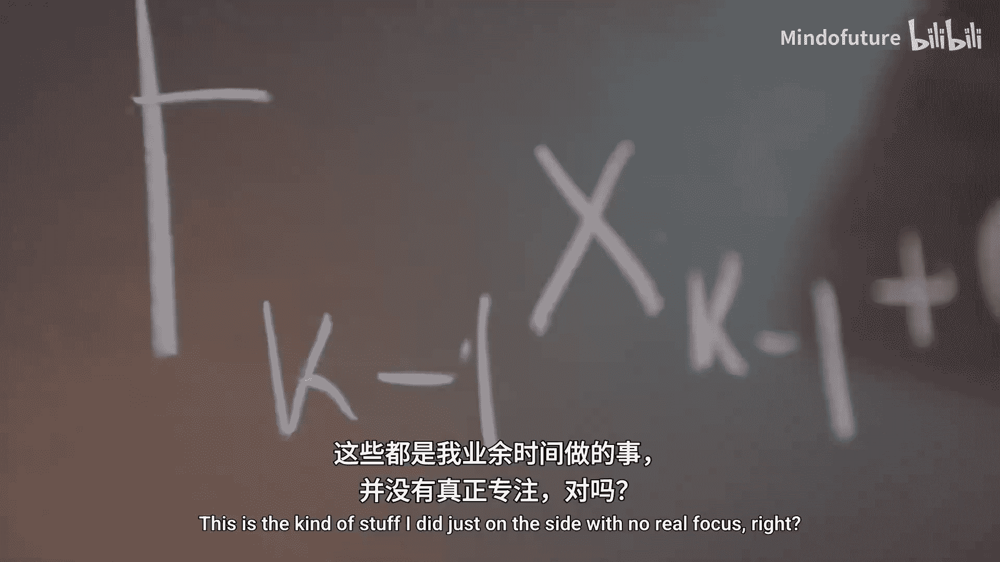
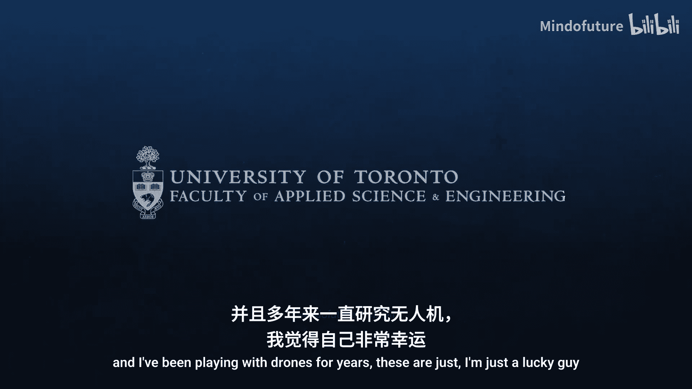

# 003：认识讲师史蒂文·瓦斯兰德

## 概述
在本节课中，我们将通过讲师史蒂文·瓦斯兰德的个人经历与职业发展，了解他如何从一名广泛的兴趣爱好者成长为自动驾驶与机器人领域的研究者。他的故事揭示了将个人兴趣与实际问题解决相结合的重要性，并为我们理解自动驾驶技术的现实挑战与未来方向提供了背景。

---

## 童年与广泛的兴趣
我童年时兴趣广泛，热爱各种事物。我曾认为自己可以成为一名科学家，或许是物理学家，也可能是化学家，但当时对未来并没有明确的想法。

我成长过程中并未过多担忧未来，拥有一个田园诗般的童年。我是一名重度运动爱好者，热爱越野滑雪和山地自行车，这些活动占据了我的大部分时间。

---

## 发现挑战与兴趣的结合
大约在16至18岁时，我开始思考需要做一些有趣的事情来度过人生。正是在这个阶段，我开始接受各种挑战，并逐渐认识到是什么在持续驱动着我。

我热爱解决数学问题，喜欢在放学后与朋友们一起研究化学或微积分挑战。这些活动都是我课余时间自发进行的，并没有明确的目标。

直到我开始尝试选择一项事业时，我才发现，我喜欢的这些事情在特定的应用领域中频繁出现。

---

## 职业生涯的起点：航空航天工业
大学毕业后，我在普拉特·惠特尼加拿大公司工作，这是一家小型喷气发动机制造商。在普拉特·惠特尼的工作经历令人着迷。

我们有机会测试喷气发动机控制系统，这让我充分接触了航空学的乐趣。然而，航空学领域的挑战在于其极其严格的安全要求。

你所做的每一件事都必须严谨无误，并且每次都必须精确工作。因此，该领域的发展实际上受制于经过反复验证的、已有30年历史的技术。

作为一名试图推动变革、改变世界的年轻工程师，这让我感到非常沮丧。于是，我带着从航空航天工业中获得的美好经验和对安全的专注，进入了研究生阶段的学习。

我选择了航空与航天学专业，并开始建造无人机。

---

## 转向机器人学与问题解决
是的，这就是问题解决和算法开发。具体来说，是处理机器人任务。

例如，让无人机降落在行驶的汽车上，或者让自动驾驶汽车自行泊车、在障碍物区域中导航。所有这些问题都非常实际、具有应用性，并且你在构建过程中就能看到结果。

你可以看到它的工作效果如何。如果无人机错过了汽车，它就会坠毁并失败。这其中有一种令人兴奋的、非常有趣的成分。

---

## 构建自动驾驶汽车的基础步骤
要制造一辆自动驾驶汽车，首先必须将一辆普通汽车改造成线控驾驶车辆。这意味着你可以将计算机接入汽车，并向油门、转向和刹车发送指令，汽车将实际执行这些操作。

一旦具备了这种能力，你就可以开始编程让它执行任何你想要的指令。

接下来，你必须在后备箱中添加一整套传感器和计算设备。拥有了所有这些部件，你就可以开始构建自己的自动驾驶车辆。

---

## 研究实验室的哲学与目标
我的研究实验室围绕这样一个理念建立：如果我们拥有一个真实的测试平台，并将其置于真实情境中，我们就能更快地了解当前方法的局限性。

我们真正关注的是寻找特别适合学术界的研究问题。例如，处理恶劣天气条件、处理一些边缘案例，或者试图从理论上证明我们所使用的方法具有可量化的安全性。

在学术界，我们确实有很多具体问题可以研究。我们可以尝试许多大胆的想法，可以比工业界更快速地、或许更少约束地探索可能的解决方案空间。

---

## 自动驾驶的未来与挑战
我们肯定会看到这些车辆的性能不断提升。例如，特斯拉的自动驾驶系统每年都会变得越来越好。我们还将看到真正自主的车队在受限领域内工作，这些领域被认为是安全的运营环境。

但我仍然认为，要实现最终的、在任何你想驾驶的地方都能实现的完全自主，我们还有很多工作要做。这仅仅是因为汽车可能失败的方式太多，它们必须理解的情境太多，以及许多无法提前预测的奇怪条件。

---

## 给新学习者的建议
如果你是自动驾驶领域的新手，认为这是一个美妙的领域并想尝试，我认为你首先应该完成这个Coursera专项课程。

除此之外，还有数百种方法可以丰富你的知识，并更好地了解如何进入这个领域。整个领域依赖于机器人学基础、计算机视觉基础、神经网络与深度学习基础。

这些领域你可以进行广泛的学习，其有趣之处在于它们也适用于其他美妙的应用。想想机器人操纵器、手机摄像头系统及其视频拍摄的改进功能、无人机飞行与物体跟踪等，你可以用这些技术做很多事情。

对于那些正在思考自动驾驶是否是一个值得探索方向的人，可以明确的是，这个市场将持续增长。对我们项目中毕业生的需求是巨大的，这非常惊人。

---

## 总结
回顾过去，从放学后研究随机数学问题，到现在从事自动驾驶汽车研究并多年来一直与无人机打交道，我只是一个幸运的人。本节课中，我们一起了解了史蒂文·瓦斯兰德如何将广泛的兴趣、工程实践与学术研究相结合，最终投身于自动驾驶这一前沿领域，并探讨了该领域的基础、挑战与未来方向。