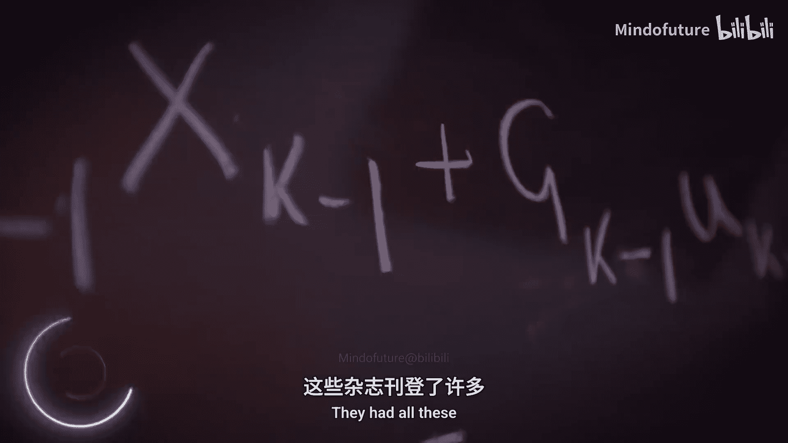

自动驾驶汽车的运动规划：P04：认识讲师乔纳森·凯利

在本节课中，我们将认识本课程的讲师乔纳森·凯利教授，了解他的背景、职业动机以及对自动驾驶技术安全性的深刻见解。

---

我叫乔纳森·凯利，是加拿大多伦多大学航空航天研究所的助理教授。

童年时期，我每月都喜欢去杂志店，阅读《大众机械》或《大众科学》。这些杂志包含了从太空旅行到新型交通工具，再到新计算设计的各种有趣文章。正是这些内容，最终促使我开始将科学技术视为一个可能的职业选择。

在我还很小的时候，发生了第一起航天飞机灾难，即挑战者号事故。我至今仍清楚记得那一刻，心想一定是出了什么严重的问题，其后果是多么可怕。当时看到巨大的爆炸，我震惊地呆坐着，因为我曾认为技术总是可靠的——技术不会失败，汽车不会无缘无故爆炸。但电视上的这一幕让我深刻认识到，扎实的工程学在这些关乎生死或可能改变人生的情境中至关重要。

上一节我们了解了凯利教授的职业启蒙，本节中我们来看看他对自动驾驶领域的看法。

自动驾驶汽车在许多方面与此非常相似。作为工程师，我们有责任将这些系统设计得尽可能安全可靠。这是近期最令人兴奋的技术革命之一。每天都有新的想法、技术和设计涌现。我常常坐在办公桌前，看到人们提出的众多创新理念和技术时，都会感到眼前一亮。

这种兴奋感也来自于它正在改变技术格局，并可能造福许多人。

---

本节课中，我们一起认识了乔纳森·凯利教授，了解了他从童年兴趣到职业选择的历程，以及他对工程责任和自动驾驶技术安全性与创新性的核心观点。他强调，**可靠的技术**和**严谨的工程**是保障安全的基础，而该领域日新月异的**创新**则带来了巨大的潜力与责任。