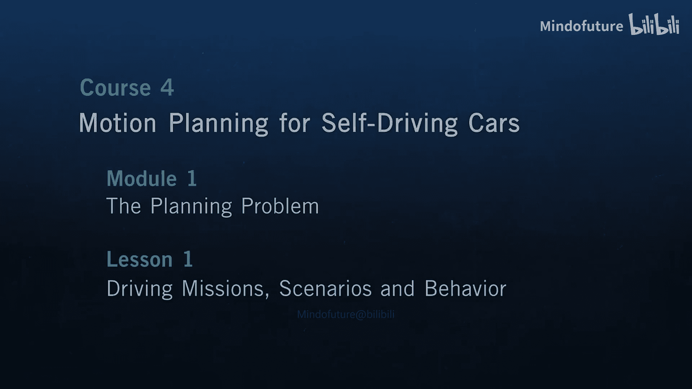
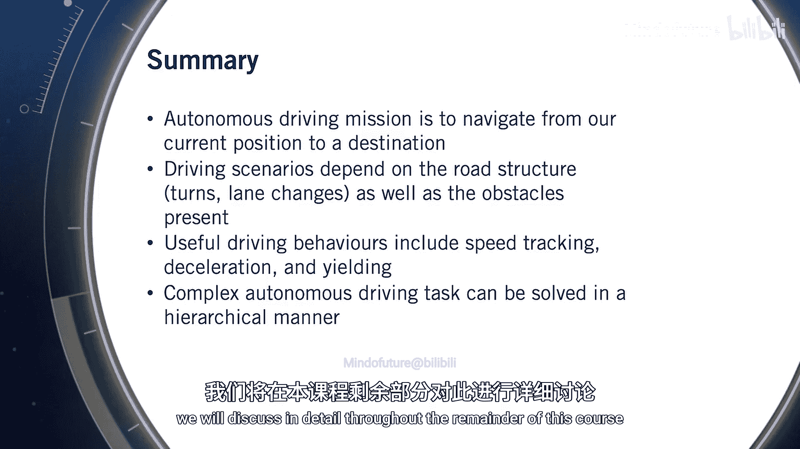
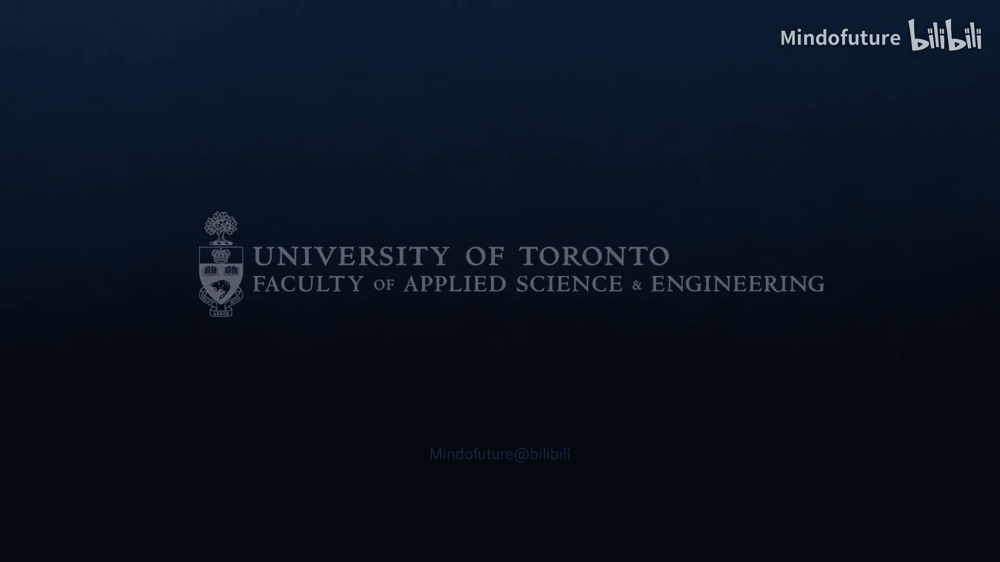

# 005：驾驶任务、场景与行为

在本节课中，我们将学习自动驾驶运动规划的基本问题。我们将了解自动驾驶的任务目标，识别一些重要的道路驾驶场景，并学习处理这些场景所需的关键驾驶行为。

## 自动驾驶任务概述

自动驾驶任务的核心是从地图上的一个点（当前位置）导航到另一个点（最终目的地）。在此过程中，系统需要考虑不同道路的连接及其相关的交通状况，以在道路网络中找到最高效（时间或距离最短）的路径。任务规划将许多重要的底层变量（如道路结构、障碍物和其他交通参与者）抽象化以简化问题，但这些变量对于运动规划至关重要。

## 道路结构相关场景

上一节我们介绍了自动驾驶的总体任务，本节中我们来看看由道路结构定义的一些常见驾驶场景。道路结构指的是车道边界以及与驾驶员相关的交通管制元素。

以下是几种核心场景：

*   **车道保持**：这是最简单的场景，车辆需要跟随当前车道的中心线行驶。目标是**最小化与路径中心线的横向偏差**，同时达到参考速度（通常是限速）。
*   **变道**：当车辆需要更换车道时，即使相邻车道没有动态障碍物，也需要在横向和纵向加速度约束、道路限速以及执行时间范围内，优化变道轨迹的形状。参数选择会影响轨迹，导致缓慢保守或激进不适的变道。
*   **左转/右转**：车辆通过路口时经常需要执行转弯。与变道类似，转弯的轨迹形状和激进程度会因情况而异。此外，自动驾驶车辆可采取行动的可行性受周围环境状态影响，例如，在红灯时即使路口空旷也不能左转。
*   **掉头**：在某些需要高效改变方向的场景中，掉头很重要。其轨迹形状同样受参数影响，并且高度依赖于周围环境状态（例如，在某些国家的某些路口，掉头可能不合法）。

## 静态与动态障碍物的影响

道路结构并非影响场景的唯一因素。静态和动态障碍物会极大地改变场景结构，并增加确定所需行为的难度。

*   **静态障碍物**：指不移动的物体，如停放车辆、隔离带和路缘。它们限制了自动驾驶车辆在规划路径时可以占据的位置，因为车辆占据的空间不能与障碍物重叠。
*   **动态障碍物**：指在自我车辆规划工作空间中移动的参与者，对速度曲线和驾驶行为影响更大。例如，在车道保持时前方有前车。如果前车速度比我们的参考速度慢，我们需要在**保持安全时距**（以当前速度到达前车当前位置所需的时间）和**尽可能接近参考速度**之间取得平衡。

动态障碍物也会影响转弯和变道场景。根据它们的位置和速度，自我车辆可能只有特定的时间窗口来执行这些操作。这些窗口是基于对其他交通参与者行为的预测估算的。例如，在左转前等待对向车流出现空档。

动态障碍物不仅包括汽车，还有自行车、卡车和行人等。它们各有其行为模式和道路规则。

## 高层驾驶行为

尽管驾驶任务场景丰富多样，但大多数场景所需的行为可以看作是一些高层动作或操作的简单组合。

以下是一组核心的高层操作：

*   **速度跟踪**：这是常态驾驶行为。我们有一个参考速度或限速，在车道内向前行驶时保持该速度。
*   **减速至停止**：如果前方有停车标志，我们需要平稳减速至停止，以保证舒适性。
*   **保持停止**：某些交通管制元素要求此行为。例如，在红灯前，我们需要保持停止直到绿灯亮起。
*   **让行**：某些管制元素也要求让行。最明显的是在让行标志处，如果有优先级更高的车辆，我们需要减速并等待，直到可以安全通过。
*   **紧急停车**：当自动驾驶汽车检测到问题时，车辆需要立即停止并靠边。

这些高层行为还可以通过导航行为（如执行变道和转弯）来增强。结合这些操作，我们可以覆盖最基本的驾驶场景。但需要注意的是，这个行为列表并不详尽，可以通过增加行为复杂性来处理更多有趣的场景。

## 边缘案例与规划挑战

就驾驶场景而言，我们仅仅触及了表面。许多异常情况使得自动驾驶成为一个极具挑战性的任务。

例如，假设有行人乱穿马路。这就有一个违反道路规则的参与者，从运动规划的角度看，其行为变得难以预测。另一个例子是摩托车进行车道分割（在车流中穿行），这取决于所在国家/地区可能合法也可能不合法。这种行为可能会让自动驾驶汽车感到困惑，因为自动驾驶汽车通常使用车道边界来预测道路上其他参与者的行为。

由此可见，解决运动规划问题是一项复杂的任务。如果不进行任何形式的抽象和简化，直接求解最优运动方案是难以处理的。

## 运动规划的层次结构

为了解决这个问题，我们将任务分解为一个层次化的优化问题。通过这样做，我们可以为每个优化问题定制适当抽象级别的输入和输出，从而能够实时进行运动规划。

在这个层次结构中，越高层意味着优化问题的抽象级别越高。

*   **任务规划**：位于层次结构顶端，专注于解决地图级别的自动驾驶任务，即导航到目的地。
*   **行为规划**：决定自动驾驶车辆应根据当前驾驶场景采取哪种行为。
*   **局部规划**：基于所选行为，计算一条无碰撞的路径和速度曲线以达到目标状态。在我们的课程中，为了提高性能，我们将此过程解耦为**路径规划**和**速度曲线生成**。
*   **控制器跟踪**：最后，计算出的运动计划将交给控制器（我们在第一门课程中设计过）进行跟踪。

每个优化问题都将有不同的目标和约束，我们将在后续课程中详细讨论。

## 总结

本节课中我们一起学习了自动驾驶运动规划的基础知识。

我们明确了自动驾驶运动规划的任务是从自我车辆的当前位置导航到指定目的地。我们看了一些常见的道路驾驶场景，以及道路结构和存在的障碍物如何决定场景的性质。然后，我们讨论了一些有用的驾驶行为来应对这些场景。最后，我们描述了一个运动规划优化问题的层次结构，我们将在本课程的剩余部分详细探讨。

希望本节课让你对作为自动驾驶工程师在设计运动规划器时会遇到的不同场景有了一些了解。关键要点是，虽然我们列举了许多自动驾驶所需的基本场景和行为，但如何在所有潜在驾驶场景中规划安全、鲁棒的行为，仍然存在许多开放性问题。

在下一课中，我们将探讨在解决运动规划层次结构中的优化子问题时，会遇到的一些常见约束。