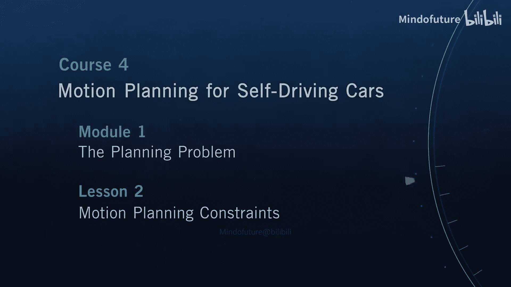
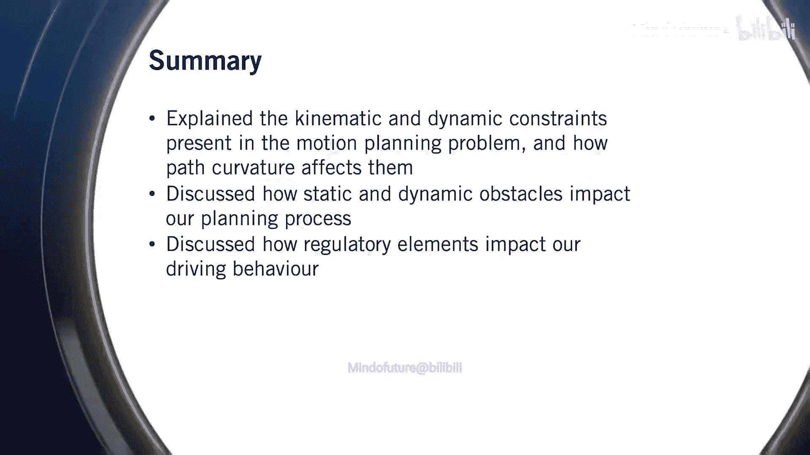

# 006：运动规划约束

在本节课中，我们将要学习运动规划中涉及的一些最重要的约束条件。这些约束对于维持车辆的稳定性和舒适性，以及确保特定驾驶场景中所有交通参与者的安全至关重要。

具体来说，你将了解车辆的**运动学**和**动力学**模型如何约束我们的运动规划。你将学习**静态和动态障碍物**如何影响车辆的运动规划。最后，你将看到**交通规则元素**如何在运动规划过程中影响我们可用的行为选择。

让我们开始吧。

## 车辆运动学约束 🚲

上一节我们介绍了运动规划的基本概念，本节中我们来看看第一个约束条件：车辆运动学。在自动驾驶的运动规划中，我们通常使用**自行车模型**来简化自车的运动学。

选择这个模型的一个原因是，自行车在固定速度 `V` 下，其转向角 `δ` 有一个可接受的范围，这个范围对应于车辆可以遵循的一系列允许的曲率 `κ`。这意味着，在使用自行车模型进行运动规划时，车辆在遵循给定路径时所能执行的最大曲率是有限制的，我们称之为 `κ_max`。

对于自动驾驶汽车也是如此。这意味着我们规划的任何路径的曲率都必须考虑这个最大曲率限制。不幸的是，这是一种**非完整约束**。直观地说，这意味着约束不仅取决于机器人的状态，还取决于机器人如何到达当前状态。非完整约束减少了机器人在其工作空间中任意给定点可以移动的方向数量。通常，非完整约束会使规划问题变得更加复杂。

现在你可能想知道，曲率如何影响我们运动计划中给定路径的形状？为了让你直观地理解曲率是什么，这里有一条任意曲线。

对于路径上的每个点，我们可以根据该点处曲线在空间中的瞬时变化率，拟合一个圆。这类似于我们最初推导自行车模型时使用的瞬时旋转中心的概念。

基于图形的形状，不同点的弯曲程度似乎不同。因此，我们的直觉应该是，曲线上的不同点将具有不同的曲率。

例如，这里有一个与曲线上特定点拟合的圆。如你所见，它的半径 `R` 相当大。曲率的一个直观解释是，它是沿曲线该点拟合圆的半径的倒数。由于这个半径很大，该点的曲率相对较低，从图中可以看出该点的弯曲更平缓。

如果我们看这条曲线上的第二个点，可以看到它的半径比前一个点小。这反过来对应于一个曲率更高的点。从图中可以看出，这个点比前一个点的弯曲更剧烈。

虽然这种圆拟合方法作为一种几何解释很有用，但这里给出了曲率更精确的数学公式。它可以使用给定路径的 `X` 和 `Y` 分量相对于弧长的一阶和二阶导数来计算。这些弧长导数由 `x'`、`y'`、`x''` 和 `y''` 表示。

## 车辆动力学约束 ⚙️

接下来我们将讨论的约束源于车辆动力学。这些动态约束侧重于保持汽车处于稳定、安全的状态。

第一个动力学约束是由所谓的汽车**摩擦椭圆**施加的。如果你还记得，我们在第一门课程中讨论过轮胎滑移和摩擦椭圆。摩擦椭圆表示汽车轮胎与路面之间可以产生的摩擦力的最大大小。如果汽车发动机施加的力超过轮胎的摩擦力，轮胎将在路面上打滑。车辆的转向功能依赖于轮胎抓地力，因此为了保持控制和稳定性，汽车必须保持在摩擦圆内。

归根结底，这归结为横向和纵向加速度约束。然而，通常加速度约束远高于车内乘客在物理上感到舒适的水平。因此，在非紧急情况下，我们通常关注加速度的**舒适矩形**。

这些值将横向和纵向加速度各自限制在一个舒适范围内，分别表示在纵向加速度 `a_long` 轴和横向加速度 `a_lat` 轴上。如下图所示，蓝色的舒适矩形完全位于绿色的摩擦椭圆内部。这导致对规划可行的加速度约束比摩擦椭圆的要求更严格。

## 速度约束 🏎️

从横向加速度约束以及路径的曲率，我们现在间接地约束了汽车的速度。汽车的速度 `V` 是汽车横向加速度 `a_lat` 以及路径瞬时转弯半径 `R` 的函数。

回想一下，沿路径的瞬时曲率 `κ` 是汽车转弯半径的倒数。如果我们现在组合这些方程，可以看到速度的平方受到最大横向加速度 `a_lat_max`（一个常数）以及路径曲率 `κ`（沿路径每个点都在变化）的约束。

因此，很明显，当我们为自动驾驶车辆生成速度曲线时，必须考虑路径的曲率以及车辆的最大横向加速度。

## 静态障碍物约束 🚧

静态障碍物也对我们的路径规划过程施加约束。由于静态障碍物（如停放的汽车或施工路锥）具有不随时间变化的固定位置，它们通常通过阻挡自车工作空间的某些部分来建模。

这个概念将在本课程的第2模块中更详细地介绍，届时我们将讨论占据栅格地图。本质上，静态障碍物限制了汽车在其路径上可以占据的位置。

有多种方法可以执行静态碰撞检查。一种方法是检查车辆沿给定路径行驶时的**扫掠区域**。这个扫掠区域是自车在遍历路径时，其车身占据的所有位置的并集。如果扫掠区域与静态障碍物重叠，则该路径不可行。

另一种快速碰撞检查的选择是用一组圆来近似汽车的车身，并计算汽车沿其路径移动时这些圆的位置。如果任何圆内存在静态障碍物，则该路径被视为不可行。这些圆的并集通常比车辆车身大，确保了保守的近似。我们将在未来的课程中更详细地讨论这一点。

## 动态障碍物约束 🚶‍♂️🚗

另一方面，动态障碍物对运动规划问题提出了一些最具挑战性的约束。不同类别的动态障碍物，如汽车、自行车和行人，都将具有不同的行为和运动模型。基于这些其他交通参与者的行为来约束我们的运动计划通常涉及预测，而预测存在不确定性。

然而，如果我们采取保守的方法，将自己约束在所有交通参与者的所有可能行为上，我们的运动规划问题很快就会变得过度约束，无法有意义地解决。我们在保守主义的安全性和前进所需的激进性之间取得平衡的程度，是自动驾驶研究的一个活跃领域。

举一个简单的例子，动态障碍物会约束我们运动的一个场景是在十字路口。如果两辆车正交地进入十字路口，那么我们就有一个潜在的碰撞场景。检查是否会发生碰撞的一种方法是跟踪自车行驶方向与从自车位置到其他交通参与者位置的向量所形成的角度。如果这个角度随时间推移保持不变，那么自车将与其他交通参与者发生碰撞，我们的运动规划器需要减速以防止这种情况发生。

因此，动态障碍物迫使我们根据障碍物在驾驶场景中的进展来修改我们的行为。我们在上一课讨论的另一个例子是，当自车前方存在一辆前导车辆时。这辆前导车辆对自车的纵向速度施加了上限约束。因为如果我们在同一条车道上超过他们的速度，最终会发生碰撞。

如你所见，动态障碍物将同时约束我们的**行为规划过程**（我们在此做出机动决策）和我们的**局部规划过程**（它将影响我们的速度曲线规划）。我们将在后续模块中进一步详细讨论这一点。

## 交通规则与监管元素约束 🚦

我们将讨论的最后一个约束包括道路规则，以及自车工作空间中存在的监管元素。虽然道路规则为规划问题提供了一些约束，但它们也帮助我们做出关于环境中其他交通参与者行为的明智决策。例如，对向交通极有可能保持在它的车道内，而不会试图与我们的自车正面碰撞。这有助于在尝试预测其他交通参与者行为时减少搜索空间。

道路规则施加的最常见约束之一是**车道约束**。简单来说，车道约束是为了防止我们的运动计划让自车离开其当前车道，除非这样做是合法的。车道约束也告知自车在何处执行转弯操作是安全的。

我们还需要遵守其他软性的道路规则，例如保持自车与我们车道中前导车辆之间的**时间间隔**。时间间隔是指自车以当前速度行驶到达前导车辆当前位置所需的时间量。保持足够的时间间隔有助于确保运动规划期间的安全，为自车提供充足的反应时间来应对工作空间中的事件。

工作空间中的监管元素也会影响我们的驾驶行为。自车显然需要遵守红灯和停车标志以确保安全，但也需要了解不同区域的限速以及其他动态监管元素，例如施工场地带来的限制。

总的来说，监管元素将对我们执行运动规划时可用的行为产生重大影响，并将在第5模块中进一步详细讨论。

## 总结 📝

现在我们已经讨论了许多自动驾驶运动规划的约束，让我们总结一下到目前为止所学的内容。

在本视频中，我们首先回顾了自行车模型，并研究了模型的运动学和动力学以及路径曲率如何约束我们的运动规划问题。接下来，我们研究了静态障碍物如何限制我们汽车可以安全占据的位置，从而限制了我们的可行运动规划工作空间，以及动态障碍物如何影响自车可用的机动操作及其速度曲线。最后，我们讨论了监管元素的作用以及它们如何影响我们的驾驶行为。

希望本节课让你对自动驾驶运动规划问题的一些约束有了一些了解。在下一个视频中，我们将深入探讨用于解决运动规划问题的一些优化目标。下次见。

