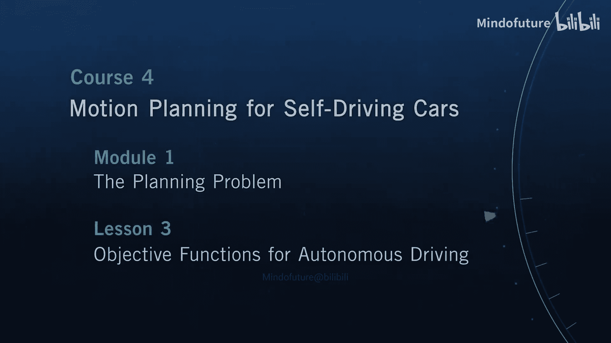
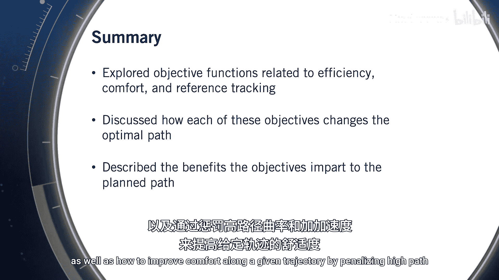

# 007：自动驾驶目标函数

在本节课中，我们将探讨自动驾驶运动规划问题中最常用的一些目标函数。目标函数为我们提供了一种评估当前运动计划优劣的方式，并允许我们优化运动计划，使其具备理想的特性。

完成本课后，你将能够列举一些可用于自动驾驶运动规划的有用目标函数，并理解每个目标函数为运动规划过程带来的益处。

## 效率目标函数

上一节我们介绍了目标函数的基本概念，本节中我们来看看与行驶效率相关的目标函数。

在进行路径规划时，最简单直观的目标是希望尽可能高效地到达目的地。在路径规划中，这通常转化为最小化规划路径的弧长。

**弧长** 直观上是指车辆沿路径行驶所累积的总距离。在许多情况下，路径会以弧长为参数进行参数化。因此，这可以表述为一个与弧长成比例的惩罚项。在其他情况下，我们需要通过数值积分来计算路径的弧长。

通用的弧长积分公式如下：

`S_F = ∫_{x_I}^{x_F} √(1 + (dy/dx)^2) dx`

其中，`S_F` 是累积的总弧长，`x_I` 是路径起点的x坐标，`x_F` 是路径终点的x坐标。通过最小化弧长，我们计算的是从当前位置到目标位置的最短路径。

当优化速度曲线时，我们通常希望最小化到达目的地所需的时间。从弧长的角度看，这等同于沿路径对纵向速度的倒数进行积分，积分变量为弧长。直观上，这相当于将总距离除以沿曲线每个点的行驶速度，但由于速度沿路径变化，我们将其表述为一个积分。

该积分公式如下：

`T_F = ∫_{0}^{S_F} (1 / v(s)) ds`

其中，`T_F` 是速度曲线的总时间。通过最小化这个积分，我们可以在遵循给定规划路径的同时，最小化到达目的地的时间。

以下是两个路径示例：
*   **路径A**：弧长较长，效率较低。
*   **路径B**：弧长较短，效率较高，目标函数值更低，更符合驾驶任务需求。

## 跟踪参考目标函数

在自动驾驶路径规划中，我们可能会得到一个希望遵循的参考路径。这通常由地图模块提供，例如道路的中心线或路口转弯的必需路径。

为了确保尽可能紧密地跟随参考路径，我们引入一个称为**差值积分** 的项。本质上，它惩罚我们计算出的路径与输入的参考路径 `x_ref` 之间的偏差。

路径跟踪的差值积分公式如下：

`J_path = ∫ (x(s) - x_ref(s))^2 ds`

类似地，在进行速度曲线优化时，我们通常希望最小化整个路径上我们的速度与某个参考速度 `v_ref`（可能是限速或其他方式确定的速度）之间的差异。

速度跟踪的差值积分公式如下：

`J_speed = ∫ (v(s) - v_ref(s))^2 ds`

虽然这可以表述为绝对差值惩罚，但通常我们希望对超速的惩罚比对低于限速的惩罚更严厉。因此，我们可以在目标函数中添加一个**铰链损失** 项。

铰链损失项公式如下：

`J_hinge = ∫ max(0, v(s) - v_limit(s))^2 ds`

本质上，只有当速度曲线超过限速（即我们的速度与限速之差为正）时，该项才生效；否则该项为0。这允许我们更严厉地惩罚超速行为，同时仍鼓励自动驾驶车辆达到所需的参考速度。

## 舒适性目标函数

接下来，我们探讨与乘坐舒适性相关的目标函数。

回顾上一课，为了保持稳定性和舒适性，我们限制了最大加速度大小。当在速度曲线的目标函数中优化舒适性时，我们将重点转向最小化轨迹上的**加加速度**。

**加加速度** 是加速度随时间的变化率，即位置的三阶导数。车辆轨迹上的加加速度极大地影响车内乘客的舒适度。因此，在规划速度曲线时，我们希望尽可能减小加加速度绝对值的累积量。

加加速度惩罚项公式如下：

`J_jerk = ∫ (da/dt)^2 dt`

让我们看两个不同速度曲线的例子：
*   **左侧线性斜坡曲线**：在曲线开始和结束时加加速度最大，在图中表现为开始和结束时的巨大尖峰。这对乘客来说可能相当不舒服。
*   **右侧双二次曲线**：没有加加速度尖峰，将为乘客带来更平稳的乘坐体验。

由于舒适性上的这种差异，尽可能选择能减少乘客感受到的加加速度的曲线非常重要。

在规划路径时，我们必须注意路径结构也会影响速度曲线的舒适性。回顾上一课，高曲率的路径会限制沿路径的最大速度，以保持在车辆的摩擦椭圆内。

为了确保避免路径上的高曲率点，我们需要对大的绝对曲率值制定某种惩罚。一个常用的表示这种惩罚的目标函数称为路径的**弯曲能量**。

弯曲能量公式如下：

`J_curvature = ∫ κ(s)^2 ds`

其中，`κ` 表示曲率。这个目标函数使曲率沿路径分布更均匀，防止路径上任何一点的曲率达到过高的总值。

以下是两个路径示例：
*   **左侧路径**：左转路径在到达目标状态前有一个相当急的弯道。根据我们的弯曲能量目标，这将受到高度惩罚，因为路径上存在一个曲率峰值点。如果为此路径规划速度曲线，我们到达曲线弯道时需要大幅减速，否则将牺牲乘客舒适度甚至车辆稳定性。
*   **右侧路径**：左转路径的曲率分布更广，整体曲率更低。这将带来更平稳、更舒适的转弯，并允许我们在优化速度曲线时，在保持在舒适矩形内的同时，维持合理的速度。

## 总结

本节课中我们一起学习了多种用于运动规划的目标函数。

我们首先讨论了与效率相关的目标函数，以及它们如何减少路径长度和通行时间。接着，我们探讨了如何鼓励轨迹跟踪参考路径和速度曲线。最后，我们学习了如何通过惩罚高路径曲率和加加速度来提高给定轨迹的舒适性。

现在，你应该对优化路径和轨迹时需要考虑的一些目标函数类型有了基本了解。在设计一个总体的目标函数时，这些项中的每一项通常需要以加权和的形式组合成一个函数。你选择的具体权重组合是一个工程决策，需要根据特定应用进行微调。

当然，对于路径和轨迹规划的优化目标这个丰富的话题，我们只是浅尝辄止。随着你成长为一名自动驾驶工程师，相信你自己也能想出有趣且有用的目标函数。

在下一个视频中，我们将讨论如何将运动规划问题解耦为更简单、更小的子问题，并概述解决每个子问题的不同方法。下节课见。

