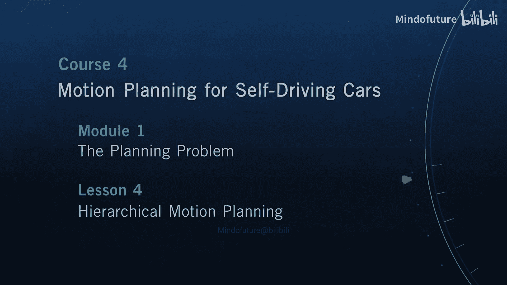
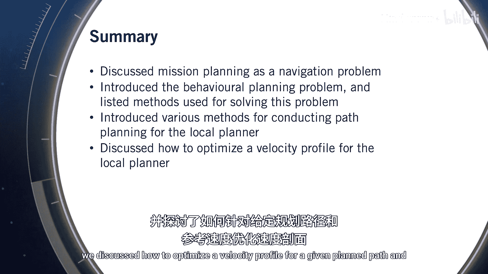
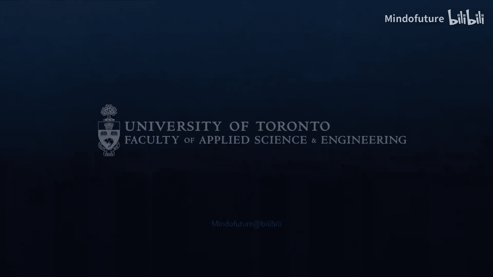

# 008：分层运动规划详解

在本节课中，我们将详细探讨如何将复杂的整体运动规划问题分解为更小的子问题。我们将深入了解任务规划、行为规划和局部规划这三个层次的具体范围、目标以及常见的解决方法。

## 概述

到目前为止，我们已经描述了规划问题的概貌，介绍了用于解决复杂规划问题的分层结构，并阐述了使规划变得困难的约束与目标。本节课程将更详细地讨论如何将整体规划问题分解为更小的子问题。通过本视频的学习，你将理解任务规划、行为规划和局部规划子问题的范畴，能够列举解决每个问题的一些方法，并理解为何这种分层结构被广泛应用于自动驾驶系统，以实现对环境运动计划的逐步细化。

## 规划层次回顾

在模块的第一课中，我们介绍了用于自动驾驶运动规划的分层结构。我们描述了规划层次中的每一级都定义了其自身的优化问题，每一级在相关目标函数和约束方面都具有特定的抽象程度。

*   **任务规划** 是最高级别的优化问题，专注于从车辆当前位置到给定目的地的地图级导航。
*   **行为规划** 则专注于当前的驾驶场景，根据工作空间中的其他智能体和道路规则来决定执行何种操作。
*   **最后是局部规划**，它将专注于以解耦的方式生成运动学上可行且无碰撞的路径，以及舒适的纵向速度曲线。

随后，这些规划结果将输出到我们在第一门课程中讨论过的车辆控制器。

通过将规划问题分解为子问题，我们限制了运动规划过程每个部分所需的知识和计算量，从而允许进行更高效的计算。然而，这需要权衡取舍，因为当我们分解问题时，每个子问题都会丢失一些领域信息。与同时考虑规划过程所有方面的运动计划相比，我们最终得到的是一个次优的运动计划。对于自动驾驶而言，实时运行运动规划器至关重要，因此这种权衡几乎总是值得的。一些运动规划方法在不同程度上整合了不同的子问题，但在本课中，我们将重点讨论这种特定的分层分解。

接下来，让我们详细探讨这些步骤。

## 任务规划

如前所述，我们分层运动规划器的第一个也是最高级别的步骤是任务规划。

任务规划专注于从自车当前位置到所需目的地的地图级导航。由于任务规划的尺度通常在公里级别，我们需要高度的抽象来使问题易于处理。从这个意义上说，我们通常会忽略运动规划问题的某些方面，例如障碍物和交通规则元素，转而关注问题的宏观方面，例如交通流量和道路连接。通过这样做，我们可以将问题简化到能够在大的空间尺度上规划所需驾驶任务的程度。

这里展示了一个例子，我们在加利福尼亚州伯克利市的地图上规划两点之间的路径，考虑了地图上的各种交叉路口和道路连接，以及每条道路的方向性。这样，我们就能计算出道路网络中到达目的地的最短路径。

这可以通过多种方式实现。如果我们关注道路网络中道路的空间长度，我们可以从道路网络构建一个图，然后使用 **Dijkstra算法** 或 **A*搜索** 来找到最短路径。如果我们将最小化到达目的地的时间作为目标，问题会变得更复杂，但仍然可以使用相同的算法解决。我们将在模块3中更详细地讨论这些方法。

## 行为规划

我们分层规划器的下一步是行为规划。什么是行为规划？

行为规划是运动规划的一部分，专注于遵循道路规则所需的高级决策，并识别在给定驾驶场景中哪些操作是安全的。我们在最初的课程中讨论了许多这样的场景。例如，回想一下我们讨论过的在交叉路口转弯的场景。

假设自车已进入交叉路口准备左转，并且交通灯即将变绿。行为规划器应向路径规划器和速度生成器明确，只有在自车位置与交叉路口的对向车流和行人之间有足够的时间间隙时，继续行驶才是安全的。根据我们在第一课中讨论的操作分类，行为规划器应向运动规划的其余部分输出一个“让行”操作，这将确保它们只在确认安全后才继续行驶。

当然，我们的分类法并非通用标准。在决定自动驾驶汽车应表现出何种类型的操作和行为范围时，存在许多可能性。

现在，你可能想知道，行为规划器应该如何接收关于自动驾驶汽车周围环境的所有信息，并以高效的方式计算它应该执行什么操作。这是一个活跃的研究领域，目前还没有公认的最佳方法来实现这一点。总的来说，解决行为规划问题似乎有三种主流架构。

以下是三种主要的行为规划方法：

1.  **基于有限状态机的方法**：有限状态机的核心概念是，它们由代表自车所需操作的状态和决定状态如何根据输入演变的转换组成。这些输入可能包括车辆位置、交通信号灯转换或当前驾驶场景中任何其他感兴趣的元素。例如，可以想象一个处理停车标志的状态机，它可能包含诸如“减速至停车”、“停车”和“跟踪速度”等状态。当汽车遇到停车标志时，它会首先进入“减速至停车”状态，此时行为规划器会发出减速信号。一旦在停车位置停下，行为规划器将在“停车”状态保持设定的时间。一旦时间超过且交叉路口畅通，行为规划器将进入“跟踪速度”状态，这意味着可以安全地继续行驶。我们将在本课程后面的一个模块中更详细地讨论这个例子。需要注意的是，在决定有限状态机每一步进行哪种转换时，我们完全专注于当前状态和有限状态机的输入。本质上，这意味着有限状态机是无记忆的，其过去的状态不会影响当前的转换或输出。这是一个有用的特性，使得有限状态机易于实现，但对于动作序列确实很重要的系统，可能会导致许多相似的状态。

2.  **基于规则的系统**：本质上，这类系统由规则层次结构组成，其中层次结构代表了每条规则的相对重要性。每条规则可能对应一条道路规则，例如在红灯时停车，也可能对应一个驾驶最佳实践，例如保持自车与前车之间两秒的间隙。自车及其周围环境的状态将以逻辑谓词的形式输入到基于规则的系统中。然后，这些谓词将根据每条规则进行评估，基于规则优先级，与最高优先级规则对应的操作将输出给运动规划器的其余部分。例如，假设我们有以下两条规则：第一条规则检查前方是否有绿灯，并发出继续行驶的决策；第二条规则检查自车车道中是否有行人，并发出执行紧急停车操作的决策。在我们的系统中，为前方的行人停车比在绿灯时通过具有更高的优先级。现在，假设我们正在行驶，观察到前方交叉路口有绿灯，同时有一个行人正在违章横穿马路。在这种情况下，两条规则都会被触发，但由于紧急停车的优先级更高，基于规则的系统将输出该操作。可以想象，确保基于规则的系统在逻辑上一致既重要又具有挑战性，否则它们可能会表现出不稳定的行为。

3.  **基于机器学习的方法**：特别是，强化学习是这类方法中一个有趣的例子。强化学习是确定一个最优决策策略的过程，该策略最大化某个奖励函数 **R**。这个奖励函数评估给定时间步长内一系列动作的质量，对未来状态的折扣比当前状态更重。强化学习的过程要求智能体在通常由模拟提供的环境中执行动作。然后，根据其与环境的交互给予奖励，从而使其能够通过连续的交互收敛到最优策略。这类行为规划方法是一个快速扩展的研究领域，遗憾的是，深入探讨超出了本课程的范围。

## 局部规划

我们分层规划器中下一个也是最后一个模块是局部规划。如前所述，局部规划的目标是为自车生成运动学上可行且无碰撞的路径，以及舒适安全的纵向速度曲线。

我们将局部规划问题分解为两个子问题：路径规划和速度曲线生成。开发一个好的路径规划算法的关键创新在于减少优化的搜索空间。

路径规划器主要有三类：基于采样的规划器、变分规划器和栅格规划器。

以下是三类主要的路径规划器：

1.  **基于采样的规划器**：这类规划器均匀地随机采样汽车的控制输入，以生成汽车可能行驶的潜在路径。最具代表性的基于采样的算法之一是快速探索随机树及其变种。这些算法通过在随机采样的位置生成点，并从树中最近的点规划一条到达该点的路径来构建路径树的分支。如果该路径与任何静态障碍物无碰撞，则该路径被添加到树中。这棵树能快速探索工作空间，生成许多潜在路径。当到达目标区域时，终止于该区域的路径将被返回。基于采样的算法通常速度极快，但代价是在运行周期较短时可能生成质量较差、不稳定的路径。

2.  **变分规划器**：这类规划器依赖于变分法来优化轨迹函数，该函数根据某个考虑障碍物和机器人动力学的成本泛函，将时间点映射到工作空间中的位置。变分规划器通常是轨迹规划器，这意味着它们将路径规划和速度规划结合到一个步骤中，因此不必解耦路径规划和速度规划问题。例如，假设我们从一个给定的空间路径离散采样开始。起初，它与一个障碍物发生碰撞。变分规划器将迭代地移动离散点，使其相对于机器人的动力学是平滑的，同时保持无碰撞。最终，轨迹将既无碰撞，又相对于机器人的动力学更加平滑。然而，变分方法通常速度较慢，更复杂，并且其收敛到可行路径对初始条件敏感。变分方法的一个例子是Chomp算法。变分规划器超出了本课程的范围，但对于感兴趣的学习者，Chomp算法提供了一个极好的进一步探索的例子，补充材料中的链接包含了相关信息。

3.  **栅格规划器**：这类规划器通过限制自车在工作空间中任何一点可以采取的动作来约束搜索空间。这组动作被称为栅格规划器的控制集。这个控制集与工作空间的离散化相结合，隐式地定义了一个图。然后可以使用图搜索算法（如Dijkstra或A*）搜索该图，从而实现路径的快速计算。障碍物可以将穿过它们的边设置为无限成本，因此图搜索也允许我们执行碰撞检查。虽然栅格规划器通常速度相当快，但路径的质量对所选控制集很敏感。栅格规划器的一个常见变体称为共形栅格规划器，其中目标点被选在汽车前方一定距离处，相对于道路方向横向偏移。然后对到达这些点的每一条路径进行优化。最能满足某些目标同时保持无碰撞的路径被选为要执行的路径。在之前的视频中，我们概述了一些可以影响路径规划过程的目标，例如弧长和弯曲能量。

我们局部规划的第二部分是速度曲线生成。速度曲线生成通常被设置为一个约束优化问题。通常，我们会结合上一视频中描述的许多速度曲线目标，例如最小化加加速度或最小化与期望参考值的偏差。我们还在第二课中讨论了一些重要的约束，其中之一是舒适加速度矩形。这绝不是目标或约束的详尽列表，在你作为自动驾驶工程师的职业生涯中会遇到更多。一旦目标和约束被形式化，就变成了如何高效解决问题的事情。一种方法是计算优化域和目标的凸近似，这有助于确保我们的优化器不会陷入局部最小值。

## 总结

现在我们已经讨论了分层规划器中的每个级别，让我们总结一下本课涵盖的内容。

我们首先介绍了任务规划，以及我们的规划器如何在地图中导航以到达目的地。接着，我们讨论了行为规划，我们需要根据当前情况选择驾驶行为。最后，我们讨论了局部规划，我们将其分为路径规划和速度曲线生成。我们给出了几种路径规划算法的例子，并讨论了如何为给定的规划路径和参考速度优化速度曲线。

恭喜你，你已经完成了我们自动驾驶专项课程第四门课程的第一个模块。希望你现在对设计分层运动规划器时的不同方法有了清晰的认识。在本课程的其余部分，我们将介绍解决运动规划问题每个级别所需的工具。但在那之前，我们将在下一个模块中学习如何构建占据栅格地图以进行有效的碰撞避免检测。下节课见。