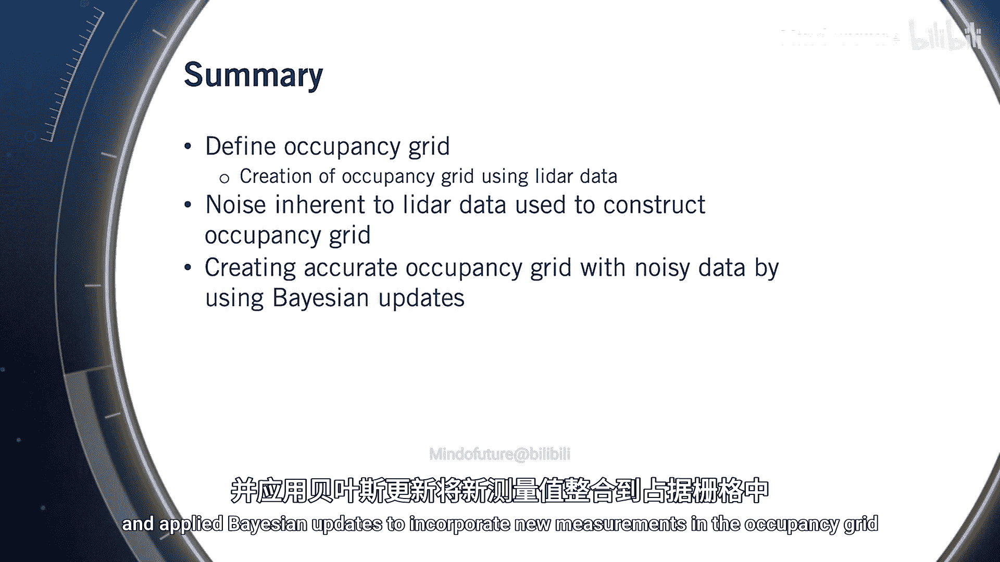

# 009：占据栅格地图 🗺️

在本节课中，我们将学习环境地图创建模块。我们将详细讨论两种关键的地图：占据栅格地图和高清路线图。它们对于自动驾驶汽车的运动规划任务至关重要。

我们将从详细定义占据栅格地图开始，并理解如何在自动驾驶汽车上创建它。接着，我们将探讨用于创建地图的测量数据中固有的噪声问题。最后，你将学习如何通过贝叶斯更新来处理这些噪声，以完善对栅格占据状态的“信念”。

## 占据栅格地图的定义

上一节我们介绍了本模块的学习目标，本节中我们来看看占据栅格地图的具体定义。

占据栅格是一个围绕当前自车位置进行离散化的网格。这种离散化可以在二维或三维空间中进行，我们讨论的方法也适用于两者。然而，为了简化解释并降低本模块的计算需求，我们将只关注二维版本。

占据栅格的每个方格表示该网格位置是否存在静态或静止物体。如果存在，则该网格位置被分类为“被占据”。会被归类为占据网格单元的静态物体示例包括树木、建筑物、路标和灯杆。在自动驾驶领域，一些你可能不认为是障碍物的物体也应被分类为占据空间，包括所有不可行驶的表面，如草坪或人行道。

每个由 `m_i` 表示的栅格方格映射到一个二进制值，其中 `1` 表示该方格被静态物体占据，`0` 表示未被占据。在这张地图中，我们可以看到有树木和草地覆盖的方格被标记为 `1`，而道路被标记为 `0`。生成的地图如下所示：所有被占据的方格显示为紫色，其余对应于可行驶表面的区域保持透明。

## 创建占据栅格的假设

为了创建准确的占据栅格，需要做出以下一组假设。

以下是创建占据栅格地图所依赖的三个核心假设：
1.  用于创建此占据栅格的环境测量数据仅对应于静态物体。这意味着所有动态或移动物体在传感器数据用于占据栅格建图之前必须被移除。
2.  每个栅格单元独立于所有其他单元。做出此假设是为了简化创建占据栅格所需的更新函数。
3.  在每个时间步，车辆相对于占据地图的当前状态是确切已知的。

## 传感器数据与预处理

在自动驾驶汽车领域，最常用于观测汽车与世界当前状态之间距离的传感器是激光雷达。快速回顾一下，激光雷达传感器使用光脉冲来测量到汽车周围所有物体的距离，并在其视野范围内返回一个测量点云。

在将激光雷达数据用于构建占据栅格之前，需要过滤掉其中的几个组成部分。

以下是处理激光雷达数据的三个关键步骤：
1.  过滤所有构成地平面的激光雷达点。在本例中，地平面是自动驾驶汽车可以安全行驶的路面。
2.  过滤掉出现在车辆最高点以上的所有点。这组激光雷达点可以忽略，因为它们不会阻碍自动驾驶汽车的行驶。
3.  移除激光雷达捕获的所有非静态物体。这包括所有车辆、行人、自行车和动物。

一旦完成所有激光雷达数据的过滤，就需要将3D激光雷达数据投影到2D平面上，以用于构建我们的占据栅格。在本模块后面的视频中，将介绍如何通过过滤和压缩激光雷达数据来为自动驾驶汽车创建准确的占据栅格。

经过过滤和压缩的激光雷达数据，类似于来自高清晰度2D测距传感器的数据，能准确测量车辆周围平面上到所有静态物体的距离。

## 处理噪声与概率化占据栅格

然而，即使在所有过滤完成后，仍然存在一个问题：由于数据使用的过滤方法、手头数据的复杂性以及最主要的环境和传感器噪声，地图仍然存在很大的不确定性。

为了处理这种噪声，占据栅格将被修改为概率形式。现在，每个单元 `i` 存储的不再是表示占据的二进制值，而是一个介于 `0` 和 `1` 之间的概率，对应于该方格被占据的确定程度。存储的值越高，该方格被占据的概率就越高。

为了使用这组概率，占据栅格现在可以表示为一个信念地图，用术语 `bel` 或 `b` 表示。为了保持符号简单，`m_i` 表示占据栅格中的一个方格，其信念可以根据测量值 `y` 和车辆位置 `x` 来构建。

`m_i` 的信念等于给定为该单元位置收集的传感器测量值，当前单元 `m_i` 被占据的概率。要转换回二进制地图，可以设定一个阈值，当某个信念值足够高时，即可确信其被分类为“被占据”。任何低于设定阈值的值都将被设置为“空闲”。

例如，左侧图中的被占据方格概率为 `0.94`，这将其分类为被占据。另一方面，街道上的方格被占据的概率仅为 `0.12`，因此将被分类为空闲位置。

## 贝叶斯更新与信念融合

可以将从时间 `1` 到时间 `T` 的多组测量结果结合起来，以获得更准确的占据信念。事实上，我们可以以递归的方式更新信念，以便在每个时间步 `T`，我们使用从时间 `1` 开始的所有先前信息来定义我们的信念。

在时间 `T` 对地图单元 `m_i` 的信念定义为，给定从时间 `1` 到 `T` 的所有测量值和车辆位置，`m_i` 被占据的概率。

为了将多个测量结果合并到单个信念地图中，可以应用贝叶斯定理。在占据栅格的情况下，我们得到一个采用以下形式的贝叶斯更新步骤：

`bel_t(m_i) = η * p(y_t | m_i) * bel_{t-1}(m_i)`

其中，给定 `m_i` 的 `y_t` 的分布 `p(y_t | m_i)` 是在单元 `m_i` 被占据的情况下获得特定测量值的概率。这被称为测量模型，你在课程2中已经详细学习过。

时间 `t-1` 时 `m_i` 的信念对应于从前一个时间步存储在我们的占据栅格中的先验信念。我们依赖于马尔可夫假设，即估计单元占据所需的所有必要信息都在每个时间步的信念地图中捕获，因此在单元更新方程中不需要考虑更早的历史。

最后，此处的 `η` 对应于应用于信念地图的归一化常数。这是为了缩放结果以确保其仍然是一个概率分布所必需的。

## 实例演示

让我们看一个实际运行中的占据栅格。在这个视频中，我们将跟随自动驾驶汽车驶出车道并沿道路行驶，同时占据栅格正在实时更新。颜色较浅的栅格单元表示空闲方格，而黑色的栅格单元表示被占据的方格。我们还可以看到红色的原始激光雷达数据和橙色的过滤输出。注意地图是如何跟踪车辆运动的，这是使用与我们在课程2中介绍的相同技术进行估计的。

在此视频中，将一个物体分类为障碍物所需的信念阈值设置得非常高。因此，只有大型静态物体被识别为被占据。降低此阈值将导致更多单元被标记为被占据，但也会导致地图噪声更大。

## 总结

本节课中我们一起学习了占据栅格地图的基础知识。

总结一下，在本视频中，你学习了占据栅格地图的基本定义，并看到了激光雷达传感器数据如何被过滤和压缩以创建占据栅格。然后，你学习了如何将占据栅格表示为信念地图，并应用贝叶斯更新来在占据栅格中整合新的测量结果。

在下一个视频中，我们将讨论信念空间地图表示中的一些数值问题，并引入对数几率函数作为此问题的解决方案。我们还将研究一个逆测量模型，该模型是使用对数几率函数从2D激光雷达数据创建占据栅格地图所必需的。下节课见。