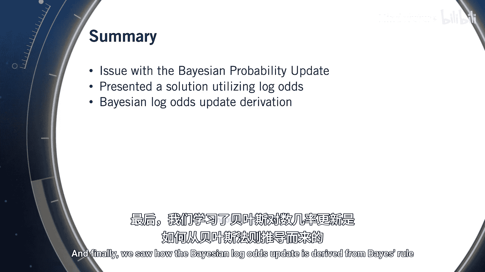

# 010：占据栅格更新与对数几率表示 🧮

在本节课中，我们将学习如何高效且稳定地更新占据栅格地图。我们将首先分析直接使用贝叶斯概率更新存在的问题，然后引入对数几率表示法来解决这些问题，并最终推导出用于更新占据栅格的对数几率贝叶斯更新公式。

## 贝叶斯更新存在的问题

上一节我们介绍了如何应用贝叶斯定理，将先前的占据信念图与当前的传感器测量信息相结合，以在每个时间步生成高精度的占据栅格。这通过以下公式实现：

`P(M_i | y_{1:t}) = η * P(y_t | M_i) * P(M_i | y_{1:t-1})`

其中，`η` 是归一化常数，`P(y_t | M_i)` 是当前测量值，`P(M_i | y_{1:t-1})` 是先前的信念图。

然而，这种简单的贝叶斯更新方法存在一个问题。为了演示这个问题，我们来看一个例子：一个原本空闲的栅格单元收到了一个新的“空闲”测量值。

假设一个单元先前的占据信念值很低，为 `6.38 × 10^{-4}`。新的测量结果概率也很低，为 `1.2 × 10^{-5}`。这意味着更新后的信念值将非常低，约为 `8.0 × 10^{-7}`。可以看到，所有这些概率值都非常接近零。

在计算机上对浮点数进行乘法运算时，当乘数是很小的数字时，会导致显著的舍入误差，进而导致概率估计的不稳定。此外，概率乘法本身也是一种低效的信念更新方式。因此，我们直接应用贝叶斯规则来更新占据单元信念的方法并不理想。

## 解决方案：对数几率表示法

不过，存在一个解决方案。我们不再存储范围在0到1之间的信念值，而是可以使用 **Logit函数** 将我们的信念转换为 **对数几率** 概率。

我们首先在第三门课程中见过这个Logit函数。对数几率表示法将单元格的值域映射到负无穷到正无穷的整个实数轴，从而避免了数字接近零的问题。

Logit函数取概率 `P` 与 `1-P` 之比的自然对数。因此，它将0到1的概率值映射到整个实数轴。

`logit(p) = ln( p / (1-p) )`

也可以从对数几率域转换回概率域，这通过以下公式实现：

`p = e^{logit(p)} / (1 + e^{logit(p)})`

现在我们有了单元格概率的另一种表示方法，接下来看看这如何影响我们的贝叶斯更新方程。

## 对数几率贝叶斯更新公式推导

我们将从对 `P(M_i | y_{1:t})` 应用贝叶斯规则开始推导，其中 `M_i` 是位置 `i` 的当前占据栅格地图单元，`y_{1:t}` 是从时间1到时间 `t` 对该单元的传感器测量值。

写出完整的贝叶斯更新方程以将最新测量值纳入我们的占据信念，我们得到以下等式。分子中的第一项是在给定单元格状态和所有先前测量的情况下获得测量值 `y_t` 的概率。第二项是给定直到时间 `t-1` 的所有测量值，单元格被占据的概率。分母是在给定直到时间 `t-1` 的所有先前测量的情况下获得测量值 `y_t` 的概率。

接下来，我们将应用马尔可夫假设，该假设确保如果地图状态 `M_i` 已知，则当前测量值独立于先前的测量值。

然后，我们再次应用贝叶斯规则来扩展测量模型 `P(y | M)`。这导致当前测量值下地图单元 `M_i` 的概率乘以获得该测量值的概率，再除以栅格单元 `M_i` 被占据的概率。

将这个扩展的测量模型代入主贝叶斯推理方程后，我们得到分子中有三项，分母中有两项。我们现在将这个扩展形式通过Logit函数，然后开始简化结果表达式。

经过一系列代数运算和同类项抵消，我们最终得到一个简化的几率比表达式，其中分子和分母各只剩下三项。这个方程可以更好地视为三个比率：概率与其补概率（1-概率）之比。

第一个比率是给定测量值 `y` 时单元格被占据的概率。第二个是单元格未被占据的概率。第三个是给定直到时间 `t-1` 的所有测量值时单元格被占据的先验信念。

最后，我们对这一系列概率比取对数，得到三个Logit函数的加法。这就是我们最终的更新方程，它具有一个很好的特性：当需要新测量值时，只需要进行加法运算。

这三个项可以用一个方便的简写表示：
*   `L_{t-1, i}` 是时间 `t-1` 时单元格 `i` 被占据的信念的logit值。
*   `L_{0, i}` 是时间 `0` 时的初始信念。
*   `L_{t, i}` 是时间 `t` 时的信念。

我们现在得到了用于占据栅格地图贝叶斯推理的便捷的对数几率更新规则：

`L_{t, i} = logit(P(M_i | y_t)) + L_{t-1, i} - L_{0, i}`

它由三项组成，在每个时间步根据最新的测量数据组合而成：
1.  **逆测量模型**：`logit(P(M_i | y_t))` 是使用新测量信息形成的logit值。概率分布 `P(M_i | y_t)` 被称为逆测量模型，我们将在下一个视频中学习如何为激光雷达数据构建它。
2.  **先验信念**：`L_{t-1, i}` 是单元格 `i` 在时间 `t-1` 的先前信念。
3.  **初始信念**：`L_{0, i}` 是同一单元格在时间零的初始信念。初始信念代表栅格单元被占据的基线信念，通常统一设置为50%，因为我们不期望有能改进此值的先验信息。它在每个时间步都出现在这个方程中，这有点令人惊讶，但这只是我们本节推导的结果，它调整了前两项的加法，以确保更新后的信念与对数几率形式一致。

## 对数几率表示法的优势

与直接更新概率相比，贝叶斯对数几率表示法有两个显著优势：
*   **数值稳定**：由于logit将0-1的概率映射到整个实数轴，更新过程数值稳定。
*   **计算高效**：它完全依赖加法来完成占据栅格的所有更新，计算效率显著更高。

## 本节总结

本节课中我们一起学习了：
1.  我们首先指出了使用直接的贝叶斯概率更新来存储和更新占据栅格时存在的一些问题。
2.  然后，我们看到了如何通过采用概率空间的对数几率表示法来解决这个问题。
3.  最后，我们看到了贝叶斯对数几率更新是如何从贝叶斯规则推导出来的。

在下一个视频中，我们将学习如何应用贝叶斯对数几率更新，并构建所需的逆测量模型，以使用过滤后的激光雷达数据来更新占据栅格。