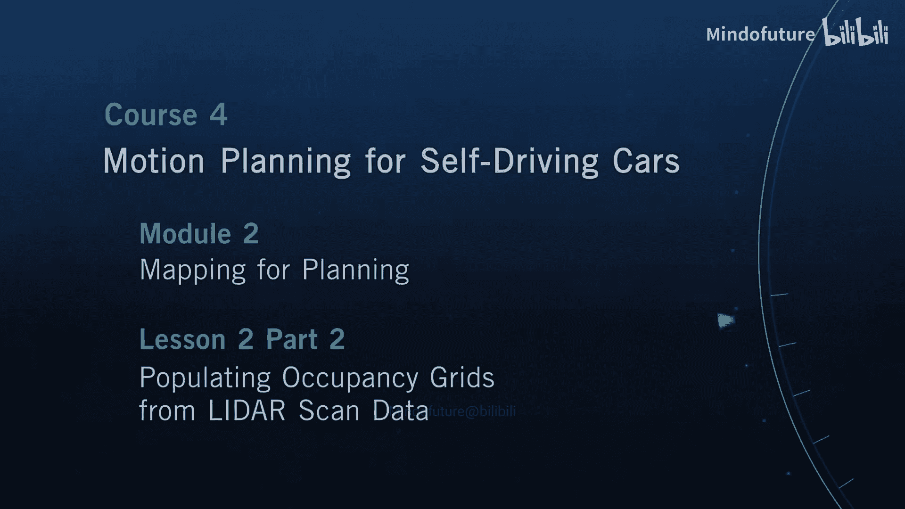
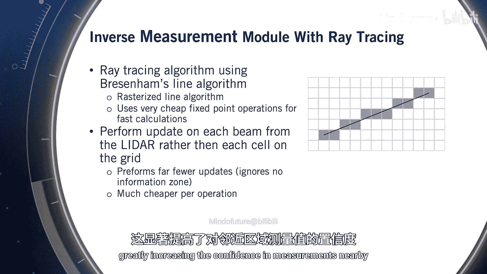
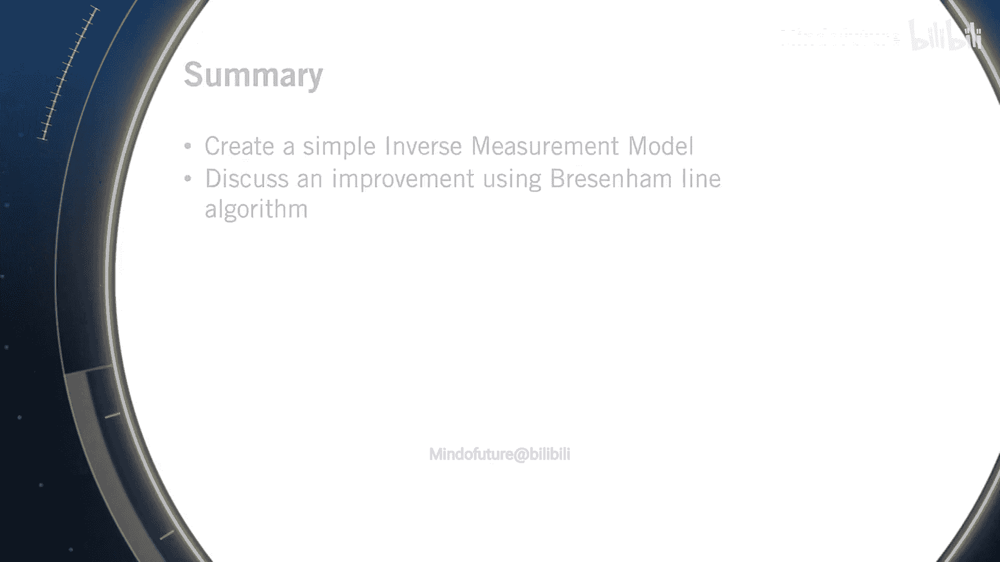

# 011：构建占据栅格（第二部分）🚗

在本节课中，我们将学习如何为激光雷达数据定义并构建一个逆测量模型，这是执行占据栅格贝叶斯更新的关键步骤。我们还将探讨如何使用光线追踪算法来显著提升计算效率。

## 概述

上一节我们介绍了占据栅格的基本概念和贝叶斯更新规则。本节中，我们来看看如何具体实现更新所需的核心组件——**逆测量模型**。

## 逆测量模型的定义

为了执行占据栅格的贝叶斯更新，我们需要计算 `P(m_i | y_t)`，即在给定当前激光雷达测量值 `y_t` 的情况下，栅格单元 `m_i` 被占据的概率。然而，我们之前见过的测量模型形式是 `P(y_t | m_i)`，即给定单元被占据时获得特定测量的概率。

因此，对于占据栅格更新，我们需要将这个测量模型“翻转”过来。也就是说，我们必须为每一个新接收到的测量值，构建一个能计算出 `P(m_i | y_t)` 的**逆测量模型**。

## 激光雷达数据表示

为简化起见，本课程中我们将激光雷达数据视为2D距离数据，包含两组信息：
1.  每个激光束发射的**方位角**。
2.  激光束在碰到物体前传播的**距离**。

以下是数据的数学表示：
*   **方位角**：由一组在传感器最小和最大视角范围内均匀分布的角度 `φ` 表示。我们假设方位角覆盖完整的360度。
*   **距离**：每个光束传播的距离，记为 `r_1` 到 `r_J`，在最小距离 `r_min`（通常为0）和最大距离 `r_max` 之间测量。如果光束未返回回波，则表示该方向上探测范围内没有物体。

我们在此做一个假设：一次完整的激光雷达扫描（传感器旋转一周的测量值）是在同一时刻获得的。对于高速移动的车辆，这并非精确模型，实际中需要使用状态估计进行运动校正。

## 构建临时测量栅格

逆测量模型按以下步骤工作。假设车辆在如下环境中使用激光雷达收集不同方位角的距离测量值。

我们构建一个临时的占据栅格，其范围覆盖所有方向上光束的最大探测距离。该测量栅格的坐标系使用占据栅格地图的坐标系。我们定义传感器在栅格坐标系中的位置 `(x1_t, x2_t)` 和朝向 `x3_t`。

基于当前的激光雷达数据，我们可以在测量栅格上定义三个不同的区域：
1.  **无信息区**：所有激光束均未到达的区域。当前扫描未提供此区域的新信息。
2.  **低概率区**：所有激光束都穿过但未碰到任何物体的区域。
3.  **高概率区**：激光束接触到物体并返回了非最大距离值的区域。

为了将这些区域映射到测量栅格上，每个栅格单元都会被分配一个相对于车辆当前位置的距离和方位角。

*   单元的相对距离 `r_i` 是传感器到该单元的欧几里得距离：
    `r_i = sqrt( (mx_i - x1_t)^2 + (my_i - x2_t)^2 )`
    其中 `(mx_i, my_i)` 是栅格单元中心的坐标。
*   单元的相对方位角 `φ_i` 使用反正切函数计算：
    `φ_i = atan2( (my_i - x2_t), (mx_i - x1_t) ) - x3_t`

对于每个单元，我们通过寻找其方位角与激光束角度误差最小的测量值，来关联最相关的激光雷达光束。

## 概率分配规则

我们定义两个参数 `α` 和 `β`，它们定义了围绕每个光束的一个扇形区域，该区域内单元的占据概率将根据该光束的距离测量值来确定。

现在，我们可以根据接收到的激光雷达测量值，为任何单元分配被占据的概率。以下是三种类型单元的概率分配规则：

以下是具体的概率分配步骤：

*   **无信息区**：对应所有距离大于测量距离、或位于关联测量值的 `β` 角锥形区域之外的单元。我们为其分配一个等于先验概率的占据概率，通常为 **0.5**。
*   **高信息区**：对应距离落在测量值 `±α/2` 范围内、且角度落在关联测量值 `±β/2` 范围内的单元。我们为这些单元分配一个 **大于 0.5** 的占据概率。
*   **低信息区**：对应距离小于测量值减去 `α/2`、且位于关联测量值 `β` 角锥形区域内的单元。我们为这些单元分配一个 **小于 0.5** 的占据概率。

例如，假设激光雷达扫描在红色 X 标记的位置返回了一个距离值。受影响的区域（将被标记为高概率）以红色显示。增加 `α` 的值会增大受影响区域的范围，而增加 `β` 的值会影响受影响区域的角度。

## 使用光线追踪优化计算

然而，这个简单的逆测量模型在计算上可能非常昂贵。它需要更新测量地图中的每一个单元，并依赖多次浮点运算来确定哪些测量值与哪些单元对应。

一种替代方案是使用**光线追踪**算法，例如计算机科学经典——**Bresenham直线算法**。该算法最初设计于20世纪60年代早期，旨在当时可用的硬件上高效解决显示和打印中的直线绘制问题。

通过沿着激光雷达扫描的光束进行光线追踪，我们可以减少需要处理的单元数量，并更快地识别它们。该算法主要依赖整数加法、减法和位移操作来沿着激光雷达光束在网格中移动。

有趣的是，许多光束会穿过车辆附近的相同单元，这大大增加了对附近测量值的置信度。

## 总结

本节课中我们一起学习了为对数几率占据栅格映射构建激光雷达逆测量模型的关键步骤。我们首先定义了逆测量模型的概念及其必要性，然后详细讲解了如何基于激光雷达的距离和方位角数据，在临时栅格上划分无信息区、低概率区和高概率区，并为每个栅格单元分配相应的占据概率。最后，我们探讨了使用Bresenham光线追踪算法来优化计算过程，减少计算负担。

在下一个视频中，我们将深入研究将3D激光雷达扫描数据用于占据栅格映射所需的诸多准备步骤。