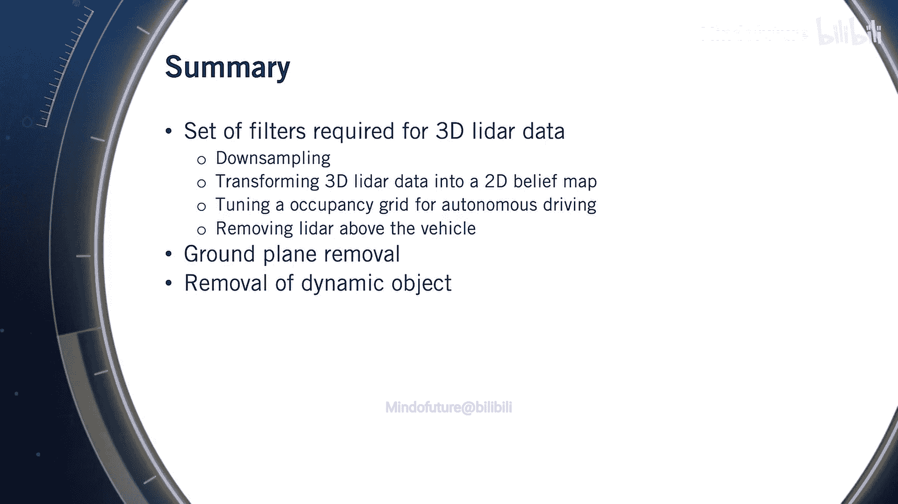

# 012：占据栅格更新

在本节课中，我们将学习如何将自动驾驶汽车采集的激光雷达扫描数据，转换为可用于构建占据栅格的过滤后表示。我们将首先介绍几种必须应用于3D扫描的过滤方法，然后了解如何将3D激光雷达数据投影到2D空间并转换为置信度地图，最后讨论调整占据栅格精度所需的几个参数。

## 从激光雷达到占据栅格的过滤流程

上一节我们介绍了占据栅格的基本概念，本节中我们来看看如何将原始的激光雷达数据转化为适合构建占据栅格的输入。这里展示的是一个典型的自动驾驶汽车在道路上行驶时获取的激光雷达扫描点云。

以下是必须应用于激光雷达扫描的几种关键过滤方法：

1.  **下采样**：为了确保更新操作能够实时运行，通常需要将激光雷达扫描的点数减少到一个更小的数量。
2.  **移除车顶以上点**：为了移除不影响驾驶的物体（如树木、电线、路牌），我们过滤掉所有高于自动驾驶汽车高度的激光雷达点。
3.  **移除可行驶表面点**：我们不希望将可行驶表面标记为被占据，因此需要移除所有击中可行驶表面或地面的激光雷达点。
4.  **移除动态物体点**：最后，我们移除所有动态或移动的物体（如行驶中的汽车或行人）的点。

## 过滤方法详解

### 下采样

下采样是通过移除或忽略冗余的激光雷达点来减少待处理点数的过程。自动驾驶中常用的激光雷达每秒可产生多达120万个点，这为车辆周围的所有物体提供了非常丰富的几何描述。然而，由于许多点都围绕着同一物体，捕获的是相同的信息，因此许多生成的点实际上是冗余的。

例如，一个路标被密集的激光雷达点覆盖，但实际上只需一小部分点就足以在占据栅格地图中指示障碍物的位置。最重要的是，每秒处理120万个点在计算上是不切实际的，因此必须移除一些点以提高后续所有操作的计算效率。

下采样可以通过多种方式实现，最简单的方法是使用一个系统性过滤器，沿着激光雷达扫描环保留每第 `n` 个点。也可以在距离图像中应用图像下采样技术，或在3D网格中进行空间搜索，用单个占据测量值替换点集合。这些方法在开源点云库（如PCL）或计算机视觉库（如OpenCV）中都很容易实现。

### 移除车顶以上点

第二个过滤器相对简单，即移除车辆高度以上的点（例如，高于2.4米的点）。这个过滤器通常假设地面是平坦的，但请注意，盲目应用这个假设是危险的。然而，过滤掉悬垂的树木、电线、桥梁和标志物等价值显著，因此值得在此讨论。

### 移除可行驶表面点

下一个过滤器涉及移除被认为落在可行驶表面上的点。由于激光雷达扫描的特性，图像中看到的许多同心圆环是由于激光雷达击中了可行驶表面，这些点不应与占据栅格地图中的被占据单元混淆。然而，事实证明这是一个具有挑战性的任务，因为会出现几个复杂情况。

首先，所有道路都有不同的几何形状，包括用于排水的可变凹度、不同的坡度和倾斜角、曲率等。这种变化很难预测。如果不移除地面点，占据栅格可能会出现伪影，导致死锁，即汽车认为道路被阻塞而无法继续行驶。

第二个问题是路缘在不同位置有不同的高度，并且道路边界在激光雷达数据中并不总是清晰定义的。这些变化可能导致部分路缘或不可行驶区域被当作地面的一部分而移除。

最后，需要检测道路上的小物体（如足球或乌龟），这意味着在点云上工作的简单几何方法很难解析前方道路的真实状态。处理这类问题的最佳方法是利用您在课程3中学到的，通过语义分割来利用视觉和深度神经网络。这可以在分割图像中看到，其中地面平面显示为深紫色。

然后，任务就变成了将视觉数据中检测到的可行驶表面映射到激光雷达点云，并屏蔽掉所有落在可行驶表面投影边界内的点。

### 移除动态物体点

所需的最后一个过滤器是移除所有动态物体，如移动的汽车或行人。这可以再次依靠感知模块来完成，该模块必须检测并跟踪场景中的所有动态物体。检测到的动态物体的3D边界框用于移除受影响区域内的所有点。还会在边界框的大小上增加一个小的阈值，以应对感知算法在物体位置估计中的任何小错误，从而提高点移除过滤器的鲁棒性。

然而，很多时候这并不令人满意，原因有二。首先，并非所有检测到的动态物体类别的实例都在实际移动。有些车辆可能停在路边，因此可以被视为占据栅格的一部分，因为它们确实是静态的。为了处理这个问题，感知模块需要使用动态物体轨迹来识别当前静止的物体，以便占据栅格构建器避免移除它们。

其次，由于感知模块所需的计算时间，通常动态物体在检测到后会有些延迟，这导致使用过时的物体位置来更新占据栅格，从而导致边界框遗漏动态车辆上的大部分激光雷达点。相反，我们可以基于物体轨迹预测移动物体的运动。将边界框沿着预测路径向前移动，可以从最新的激光雷达扫描中移除更多动态物体的点。

## 从3D到2D的投影与置信度地图生成

经过所有这些过滤后，激光雷达数据终于准备好从3D投影到2D。现在让我们看看实现这最后一步的一个简单而有效的技术。

首先，存储激光雷达点高度的 `Z` 值被设置为 `0`，从而将点云压缩到一个平面上。然后，将2D扫描平面划分为与占据栅格相同的网格模式。对于占据栅格的每个单元，统计落入其中的所有激光雷达点的数量。这个值将被用作占据置信度的度量。一个单元中的点越多，表示在该单元中测量到静态物体的可能性就越大。

## 参数调整与总结

本节课中，我们一起学习了将激光雷达点云转换为占据栅格所需的过滤技术。这些技术包括下采样、移除车顶以上的点、地面平面移除以及动态物体移除。然后，我们看到了一个将3D激光雷达数据转换为2D置信度地图的简单而有效的方法，正如第1课所解释的，这可用于创建占据栅格。最后，我们了解了占据栅格必须仔细调整和校准的所有不同方面。

在下一个视频中，我们将讨论高精地图，特别关注车道级地图及其在运动规划中的用途。下次见。