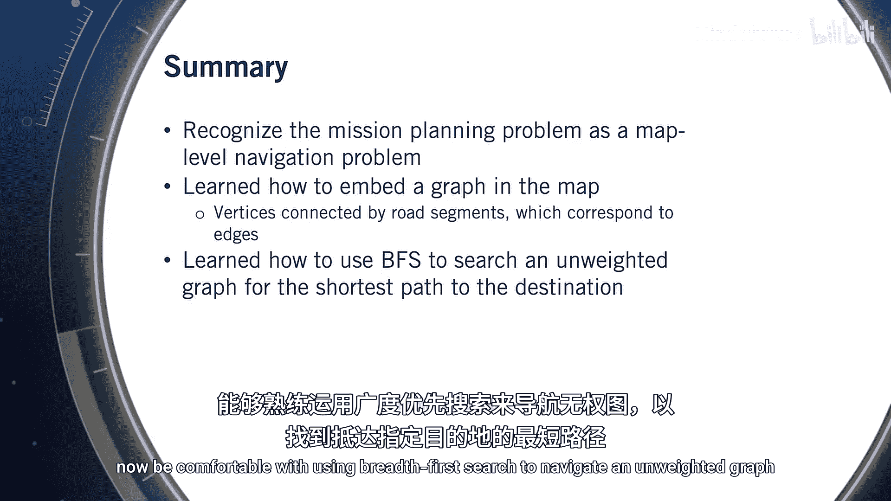

# 014：创建道路网络图

## 概述

在本节课中，我们将学习自动驾驶中的任务规划问题及其解决方法。我们将介绍图这一数学概念，探讨如何用它来表示需要导航的道路网络，并学习广度优先搜索算法如何应用于任务规划。

## 任务规划回顾

上一模块中，我们介绍了自动驾驶任务是运动规划的最高层级。本节中，我们来看看任务规划的具体目标。

自动驾驶任务的目标是：在道路网络中，为自车从其当前位置到指定目的地找到最优路径，同时抽象掉低层级的细节，如交通规则和场景中的其他交通参与者。在本模块中，我们将最优性理解为汽车到达目的地所需的时间或距离。

对于自动驾驶而言，任务规划被视为最高层级的规划问题。这是因为任务规划的空间规划尺度在公里级别。任务规划不关注低层级的规划约束，例如障碍物或车辆动力学。相反，任务规划在规划时将关注道路网络的各个方面，例如限速、道路长度、交通流量和道路封闭情况。

基于地图施加的这些约束，任务规划器需要找到到达所需目的地的最优路径。

关于道路网络，需要注意的一点是它具有高度结构化的特点，我们可以在规划过程中利用这一点来简化问题。通过利用这种结构，我们可以根据给定的地图，高效地找到通往目的地的最优路径。为此，我们需要使用一种称为“图”的数学结构，我们已将其叠加到这里的道路网络上。

## 什么是图？

图是一种离散结构，由一组顶点（记为 **V**）和一组边（记为 **E**）组成。

对于任务规划器，**V** 中的每个顶点对应于道路网络上的一个给定点。每条边 **E** 对应于连接道路网络中任意两点的路段。从这个意义上说，图中一系列连续的边对应于从一点到另一点穿过道路网络的路径。

这里展示了一个图的示例。目前，我们假设每个路段长度相等，因此该图的边都是**无权重的**。然而，在后续课程中，我们将放宽这一限制。

要生成这样的图，需要对道路网络进行离散采样，这将为我们提供图的顶点。然后，边将由根据道路规则连接每个采样点的路段来定义。

请注意，一般来说，仅仅因为点 A 通过一个路段与点 B 相邻，并不意味着点 A 可以从点 B 通过同一路段到达。这是因为在许多情况下，一个路段只能合法地沿一个方向通行。从这个意义上说，我们图的边是**有向的**，即边只能沿一个方向通行。我们通过在图中使用箭头表示边来显示其方向性。

## 使用广度优先搜索寻找最优路径

现在我们有了有向图。如何找到通往目的地的最优路径？

首先，我们在图中定位对应于自车当前位置的顶点（记为 **S**）和期望的目的地顶点（记为 **T**）。这两个顶点在图中显示如下。

一旦有了这两个顶点，我们就可以使用高效的图搜索算法来找到通往目的地的最优或最短路径。由于我们当前的图公式是无权重的，广度优先搜索是一个很好的候选算法。

从高层次看，BFS 可以被认为是遍历图中的所有顶点，但以这样一种方式进行：在深入图之前，首先评估所有相邻的顶点。从这个意义上说，图搜索就像在图中以移动波前的方式或“广度优先”地进行。

让我们逐步了解 BFS 算法的步骤。

我们构建三个数据结构来辅助搜索：
*   **开放队列**：待评估的顶点。
*   **封闭集合**：已被搜索算法评估过的顶点。
*   **前驱字典**：存储搜索结果。

**队列**是一种先进先出的数据结构，第一个被推入或添加到队列的顶点是第一个被弹出或从队列返回的顶点。**字典**是一组无序的键值对，对于封闭集合中的每个节点，存储一个前驱顶点，我们稍后会进行标识。

以下是算法的具体步骤：

1.  算法首先将我们的起始顶点 **S** 添加到开放队列。
2.  然后，当开放队列包含顶点时，我们从开放队列中取出第一个元素，并检查它是否是目标位置。
    *   如果是，我们就找到了最短路径。
    *   如果不是，我们则将当前顶点的所有**相邻**顶点（尚未在开放队列或封闭集合中的）添加到开放队列。这可以防止我们在图搜索中陷入循环。请注意，所谓“相邻”，我们指的是可以从当前顶点到达的所有顶点。
3.  由于我们使用队列来存储开放顶点，我们确保在深入图之前，先处理当前搜索深度的所有相邻顶点。因此，所有距离起始顶点一步之遥的顶点将在处理距离两步之遥的顶点之前被处理。
4.  当一个顶点被添加到开放队列时，我们在前驱字典中存储它的前驱顶点。这将帮助我们在找到目标后重建最优路径。
5.  最后，我们将当前活动的顶点添加到封闭集合，并返回到开放队列的下一个元素进行处理。

由于 BFS 算法的广度优先特性，当我们到达目标顶点时，我们已经处理了目标顶点所有可能的前驱顶点，这些前驱顶点都比目标顶点更接近起始顶点。这意味着当我们到达目标顶点时，我们已经找到了通往目标顶点的最短路径，可以终止算法。

## 算法示例

为了巩固我们对这个算法的理解，让我们看一个具体例子。

假设我们的任务规划器需要通过图中的一组顶点（现已标记）找到从点 **S** 到目的地 **T** 的最优路径。

第一步是处理起点 **S**，并将所有相邻顶点添加到我们的队列，并将它们的前驱设置为 **S**。通向相邻顶点的出边用蓝色高亮显示。将这些添加到队列后，我们将 **S** 添加到封闭列表。

接下来，我们弹出顶点 **A**。**A** 的出边通向 **D** 和 **B**，但 **B** 已经在我们的队列中，因此我们只将 **D** 添加到队列，并将 **A** 标记为其前驱。我们用红色高亮显示了这条通往 **B** 的重复路径，以表明我们不会将 **B** 两次添加到队列。我们现在已经处理了 **A** 的所有相邻边，并将其移动到封闭集合。

我们对 **B** 重复相同的过程，将 **E** 添加到队列，并将 **B** 作为其前驱。接着处理 **C**，它没有新的相邻顶点，因此不会向开放队列添加顶点。

接下来，我们从队列中处理 **D**，它只将 **T** 添加到队列，并将 **D** 作为其前驱，因为 **E** 已经被添加。当 **E** 被弹出时，它不会将 **C** 或 **D** 添加到队列，因为这两个顶点都已被处理并存在于封闭集合中。

最后，我们从队列中弹出 **T**。这是我们的目标顶点。因此，我们现在通过从 **T** 回溯到 **S** 的前驱链来重建路径。完成后，我们就找到了通往目的地的最优路径，用绿色高亮显示。

图中对应于我们最优路径的边序列，可以使用我们的地图转换为道路网络上的路线。然后，该路线可用于在我们规划层级的后续层中指导更详细的运动规划。

## 总结与展望

在本节课中，我们一起学习了任务规划问题，以及如何构建和使用图作为我们规划领域的地图层级表示。此外，您现在应该能够熟练使用 BFS 搜索来导航无权图，以找到通往给定目的地的最短路径。

在结束本视频之前，我们应该注意到，除了 BFS，还有高度相关的深度优先搜索算法等。深度优先搜索对开放集合使用后进先出的栈而不是队列。这一变化意味着评估的是最近添加的顶点，而不是最早的顶点。结果是搜索会快速深入图中，然后最终回溯到更早添加的顶点。

在下一课中，我们将通过为图中的边添加不同的权重来使图变得更复杂，以更好地反映使用不同路段的不同成本。我们将介绍迪杰斯特拉算法，一种处理这种新复杂性的方法。下次见。