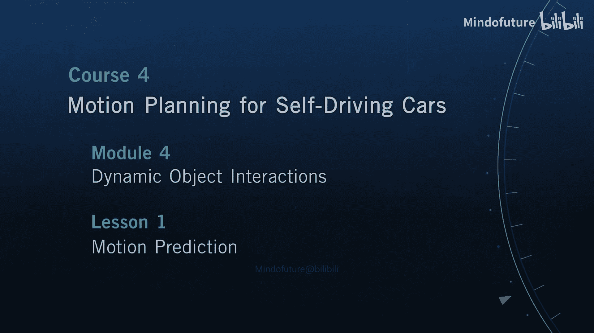
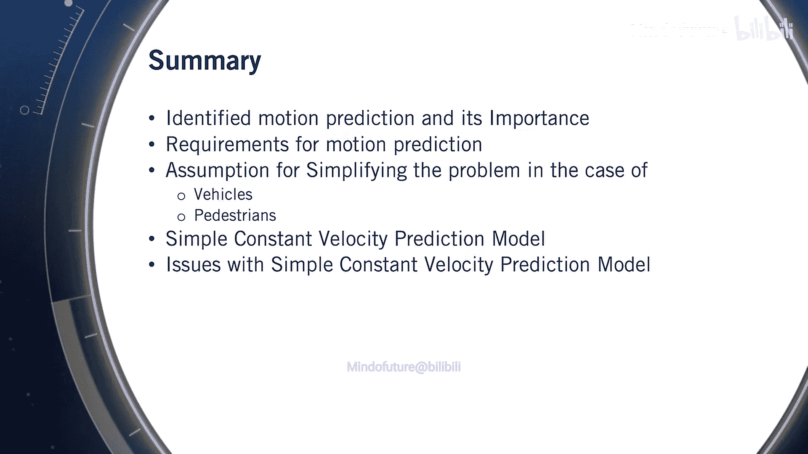

# 017：运动预测概述 🚗

在本节课中，我们将学习运动规划中一个至关重要的环节：动态物体的运动预测。我们将了解其定义、重要性、所需信息、面临的挑战，并从一个简单的预测模型开始实践。

运动预测旨在估计环境中所有动态物体在未来一段时间内的位置、航向和速度。这对于运动规划问题至关重要，因为它允许我们基于其他物体的预期运动来规划自动驾驶车辆的未来动作和机动。预测的路径还能确保自车计划执行的路径不会在未来与任何物体发生碰撞。

为了能够预测运动物体的轨迹，我们必须获取关于周围环境的一些信息，特别是与动态物体相关的信息。

以下是预测所需的基本信息：

*   **物体类别**：这是至关重要的信息，因为大多数预测模型对车辆和行人的算法处理方式不同。
*   **当前状态**：动态物体在环境中的当前位置和速度。这通常用一个向量表示，向量原点等于物体位置，大小等于其速度，方向等于其当前航向或行驶方向。没有这个最基本的信息，就无法对动态物体的未来状态进行预测。

此外，还有许多其他信息虽然不是预测所必需的，但可以极大地提高预测的准确性。

以下是一些能够改进预测的主要额外信息来源：

*   **状态历史（轨迹）**：动态物体在环境中移动时的状态历史记录。这非常有用，可以帮助我们更好地了解物体是如何在环境中机动的。
*   **高精度地图**：可以作为额外的信息来源，用于确定动态物体的未来行为。例如，车辆在道路上行驶时倾向于跟随各自的车道，这为改进预测准确性提供了强有力的线索。
*   **当前图像**：动态物体当前状态的图像也是一个有用的信息来源。对于车辆，图像可以提供关于当前转向灯或刹车灯状态的信息。对于行人，图像可以显示人的当前朝向，这有助于预测未来的行进方向，即使行人当前是静止的。

尽管运动预测任务的复杂性相当大，但我们可以使用一些假设来简化问题。我们将首先看看针对车辆的简化假设，然后再讨论行人。

**对于车辆的假设可以分为三类：**

1.  **基于物理的假设**：车辆必须遵循支配其运动的一套物理约束。我们可以将同样的车辆动力学应用于环境中的其他车辆来预测其运动。
2.  **基于机动的假设**：假设车辆在道路上的几乎所有运动都由环境中受限区域内的一组有限机动动作组成。例如，车辆很可能会保持在车道内，遵守停车标志等规则，不太可能驶上人行道或穿过障碍物。
3.  **交互感知的假设**：在基于机动假设的基础上，进一步假设动态物体会相互反应和交互。例如，在车辆并道时，目标车道内的车辆可能会减速以保持安全距离。

**对于行人的假设也可以归纳为类似的三类：**

1.  **基于物理的假设**：行人最高速度较低，但可以非常快速地改变运动方向和速度。这使得仅使用基于物理的假设来可靠地预测行人变得相当具有挑战性。
2.  **基于机动的假设**：行人倾向于使用人行道或其他行人专用区，进入可能与车辆接触的可行驶区域时主要使用人行横道。虽然将行人运动限制在这些区域是合理的假设，但并非硬性约束。
3.  **交互感知的假设**：行人拥有路权，自动驾驶汽车有责任在必要时停车。心不在焉的行人可能会毫无预警地走入车道，但在受到来车威胁时通常会停下。

现在我们对运动预测有了更好的理解，让我们来看一个简单、计算效率高的算法，它可以同等地应用于行人和车辆。该算法只对动态物体的运动做了一个极端的假设：**所有动态物体将保持其当前速度，包括大小和方向**。

理解了这一点，现在让我们看看这个简单的恒定速度模型的算法实现。

该算法接受三个基本输入：

*   **T**：预测时间范围，即预测物体未来位置的时间长度。
*   **DT**：更新率或路径模拟频率，即状态预测之间的时间间隔。
*   **X_object**：当前物体状态，包括动态物体的位置和速度。

该算法从当前时间0开始迭代，直到时间范围T结束，步长为DT。其输出是预测时间范围内每个时间步的预测物体状态（位置和速度）列表。

为了看看这些预测的效果如何，让我们看一个简单的例子。我们使用三秒的预测范围，一秒的更新步长，以及图中红色箭头所示的当前车辆状态。正如预期的那样，车辆的预测位置以恒定方向移动，步长固定，这与具有恒定限速的直线路段非常吻合。简而言之，这是因为在该路段上恒定速度假设是有效的。

然而，恒定速度估计失效的地方在于所有其他情况。虽然这个算法勉强属于基于物理假设的范畴，但它未能捕捉车辆动力学模型的全部复杂性，甚至无法体现车辆加速、减速或施加非零转向指令的能力。恒定速度假设的另一个重大缺陷是，它未能考虑车辆跟随道路形状变化的趋势。在这个弯曲道路的例子中，恒定速度模型预测路径将继续进入对向车道，这些预测完全不适合行为规划。同样，恒定速度预测也未能考虑道路标志以进行速度调整。接近停车标志的车辆往往会减速，而离开停车线的车辆往往会加速。该算法所做的假设非常强，并不适用于我们可能观察到动态物体的大多数情况。

运动预测的关键挑战实际上是，根据可用信息，为车辆或行人模型选择最可能的输入。尽管如此，恒定速度模型是一个极好的起点，有助于清晰地定义运动预测的概念。它依赖于关于动态物体的最少信息来形成预测，并且可以在完全无法获得额外线索的任何地方使用。

**总结**

在本节课中，我们学习了动态物体运动预测的任务及其对自动驾驶的重要性。然后，我们定义了为车辆和行人创建有效运动预测算法所需的最低限度和可选信息要求。接着，我们研究了一个用于预测物体未来位置的简单恒定速度算法，并指出了它的许多局限性。

在下一个视频中，我们将探讨通过使用高精度地图来增强运动预测的方法。