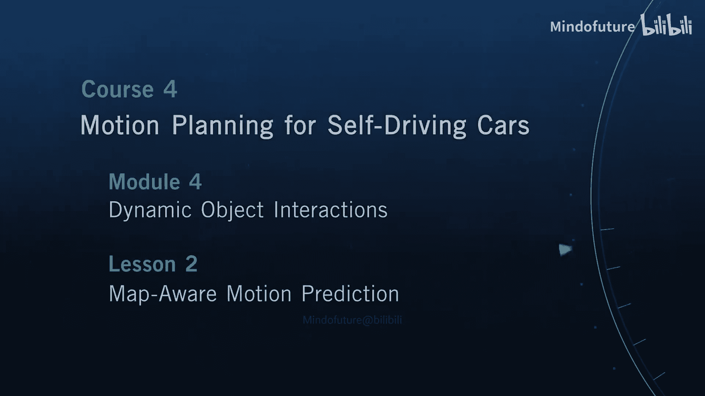
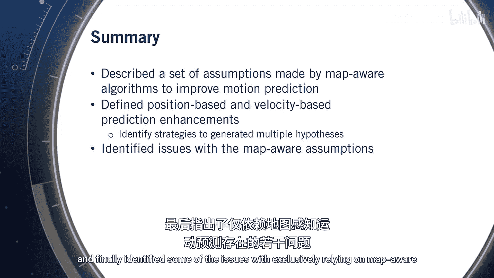

# 018：具备地图意识的运动预测

在本节课中，我们将学习如何利用高清地图信息来改进动态物体的运动预测。我们将探讨基于地图的算法所做的假设，并学习如何将这些假设应用于位置和速度预测，以生成更准确、更符合现实场景的轨迹。

## 概述：从恒定速度预测到地图感知预测

在上一节中，我们探讨了恒定速度运动预测，但这种方法仅在非常有限的场景中有效。为了改进预测，特别是针对车辆，基于地图的算法会做出两大类假设：一类用于改进车辆状态的位置分量，另一类用于改进速度分量。

## 基于地图的位置预测假设

以下是两种用于改进位置预测的主要假设。

### 车道跟随假设

第一个假设是，在给定车道上行驶的车辆通常会跟随该车道。例如，在弯曲的道路上，车辆很可能会沿着道路的曲率转弯。为了应用这一假设，我们可以使用车道中心线作为车辆的预测路径，而不是恒定速度预测生成的直线路径。

车道中心线被定义为一条折线，其上的每个点与车道左右边界的距离相等。虽然车辆的实际路径可能与中心线有微小偏差，但中心线可以作为一个很好的运动预测近似。

### 基于转向灯的预测

第二个假设是，可以根据车辆转向灯的状态来预测其车道变更或转向意图。如果感知系统检测到车辆的转向灯亮起，预测模型就可以纳入这一信息，调整预测路径。

## 多假设预测：处理不确定性

然而，将路径预测限制在单一车道中心线会带来两个主要问题。第一，驾驶员在正常驾驶中会变换车道。第二，在某些情况下（如路口），可能存在多条可选的中心线。

为了解决这些问题，我们需要考虑基于场景中其他智能体可能行为的多种假设。这被称为**多假设预测**。

在多假设预测方法中，我们会考虑车辆基于其在高清地图当前位置所有可能性的每一种名义行为。例如，在一个三岔路口，我们可以考虑三种可能性：左转、右转或保持静止。

基于转向灯位置、车辆在路口的状态等佐证信息，我们可以评估智能体在预测时间范围内执行每种假设的可能性。这些概率可以通过从大量类似路口的车辆行驶数据中学习获得，也可以通过实际测试进行工程设计和优化。

这种方法为行为规划器提供了更多模糊信息，要求规划过程同时考虑多种场景，并处理信念的概率表示。但如果处理得当，这种方法可以显著提高安全性，实现防御性驾驶策略，并在新信息改变概率时快速重新规划。

## 基于地图的速度预测改进

现在我们已经了解了如何利用地图改进预测轨迹的位置分量，接下来让我们深入探讨速度分量的改进。

### 基于道路曲率的速度调整

第一个改进基于已知的道路几何形状或曲率，以及对其他车辆如何应对曲率的预测。所有车辆在进入急弯或转弯时都会降低速度。我们可以使用一个预期的最大横向加速度（通常在 **0.5 到 1 米/秒²** 的范围内）来改进沿曲线行驶的速度估计。

### 整合交通规则元素

第二个更重要的改进是整合交通规则元素来改进速度估计。给定车辆的预期路径，任何道路元素，如停车标志、让行标志、限速变化或交通信号灯，都可以为速度预测提供信息。

对于交通信号灯，还需要知道其当前状态。在每种情况下，都可以基于高清地图中定义的规则元素线来预测停车位置。然后，可以沿其路径对车辆速度预测应用平滑的减速。

实际上，给定高清地图，可以预先处理每条道路的名义轨迹，并基于名义驾驶行为定义特定于车道的多假设先验。这既可以为自车规划其行为和轨迹提供指导，也可以用于改进对其他智能体的运动预测。

## 地图感知预测的局限性与挑战

当然，车道前方的障碍物、路口到达的优先顺序信息以及车道中的前导车辆都可以被整合进来，以改进对其他车辆的预测。然而，为单一自动驾驶汽车做决策的复杂性，限制了可用于改进运动预测的变量数量以及信息和逻辑的深度。

我们也不能完全依赖关于预期动态物体行为的假设来预测未来动作。动态物体并不总是按照驾驶员的预期名义行为行事。它们不会精确跟随中心线，不会以限速行驶，并且会以不同的速率加速和减速。此外，它们可能对预测系统尚未获得的信息做出反应，或者可能根本没有注意到某个规则元素。

所有这些变化都必须被考虑在内，多假设方法可以在一定程度上做到这一点。因此，最好的方法是跟踪这组假设上信念的演变，并在每个时间步基于感知系统提供的证据进行更新。

## 总结

本节课中，我们一起学习了地图感知的运动预测。我们描述了一组用于改进车道车辆运动预测的地图算法假设，定义了基于位置和速度的方法来改进运动预测，将多假设预测描述为维持关于其他车辆未来动作多种信念的一种方式，并最后指出了完全依赖地图感知运动预测存在的一些问题。

希望下次课程你能继续加入我们，届时我们将学习如何使用预测路径来计算动态物体对之间的碰撞时间。下次见。

