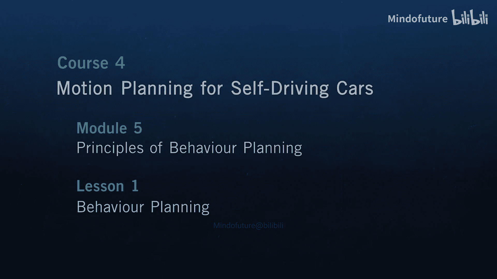
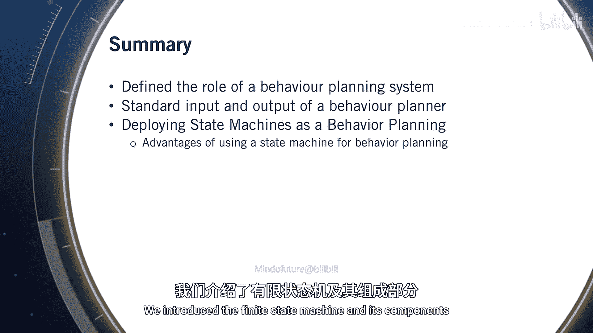

# 020：行为规划系统概述 🚗

在本节课中，我们将学习行为规划系统的基本概念。我们将定义行为规划系统的要求，探讨其典型的输入与输出，并介绍有限状态机及其在构建行为规划系统中的应用。

## 行为规划系统的定义与要求

行为规划系统负责规划一系列高级驾驶动作或策略，以在各种驾驶情境下安全地完成驾驶任务。这些策略必须考虑交通规则，并处理与环境中所有静态和动态物体的交互。规划器所做的高级决策必须确保车辆安全，并在环境中高效移动。

行为规划器需要在计算上高效地执行此类决策，以便快速响应环境变化，并能在自动驾驶车辆的硬件上部署。此外，行为规划器还应能够处理不准确（受测量噪声影响）和错误（受感知误差影响，如误检和漏检）的输入。

## 基础驾驶行为列表

以下是本模块将使用的五个基础驾驶行为列表：

1.  **跟踪速度**：在开放道路上无约束驾驶，唯一的限制是遵守速度限制。
2.  **跟随前车**：匹配前车速度，并保持安全跟车距离。
3.  **减速至停止**：在规划视野内，本车车道中存在停车点，车辆应减速至该点完全停止。
4.  **保持停止**：车辆应保持静止一段固定时间。例如，在停车标志处至少停止三秒。
5.  **并线**：车辆应向左或向右车道并线。

这个基础策略列表有助于我们理解行为规划的原理。但在实际应用中，需要考虑更多行为，行为规划器的整体复杂性也会随之增加。

## 行为规划器的输出

行为规划器的主要输出是当前环境下应执行的驾驶策略。除了驾驶策略，行为规划器还输出一组约束条件，用于限制局部规划问题。本模块将使用和填充的约束包括：

*   **默认路径**：从车辆当前位置到目标目的地的路径。对于许多行为，这通常是本车道的中心线。
*   **速度限制**：沿默认路径的速度限制。
*   **车道边界**：在正常驾驶条件下应保持的当前车道边界。
*   **未来停车点**：车辆需要到达的任何未来停车位置。仅当选择相关策略时才会填充此约束。
*   **高关注动态物体**：局部规划器应关注的动态物体集合。这些物体可能因距离近或预测路径而重要。

## 行为规划器的输入

为了使行为规划器能够产生所需的输出，它需要从自动驾驶软件栈的许多其他系统中获取大量信息：

1.  **道路网络知识**：来自高清地图，了解车辆附近完整的道路网络。
2.  **任务路径**：以道路网络图上的任务路径形式提供，指示应遵循哪些道路以到达目标位置。
3.  **车辆定位**：来自定位系统的精确定位信息，以便在车辆周围局部环境中正确放置高清地图元素。
4.  **感知信息**：包括所有观察到的环境动态物体（如汽车、行人、自行车）及其当前状态、预测路径、碰撞点和碰撞时间；所有观察到的静态物体（如停放车辆、施工锥、交通灯）及其状态；以及定义可执行策略安全区域的局部占据栅格地图。

## 有限状态机方法

拥有所有必要信息后，行为规划器必须选择适当的行为并定义必要的伴随约束，以保持车辆安全高效地移动。为此，我们将构建一套规则来考虑所有交通规则以及与其他动态物体的交互。

传统上，用于表示解决行为选择所需规则集的一种方法是**有限状态机**。在本模块中，我们将逐步构建一个基于有限状态机的行为规划器，并讨论这种方法的局限性。

为了更好地理解有限状态机方法，让我们通过一个简单示例来了解如何处理单个场景：一个无交通的停车标志交叉路口。

有限状态机的第一组组件是**状态集合**。对于行为规划系统，状态代表可能遇到的每种可能的驾驶策略。在我们的示例中，只需要两种可能的策略或状态：`跟踪速度` 和 `减速至停止`。行为规划器定义的策略决策由有限状态机的状态设定。

每个状态都有一个与之关联的**进入动作**，即首次进入状态时要执行的动作。对于我们的行为规划器，这些进入动作涉及设置伴随行为决策所需的约束输出。例如，一旦进入`减速至停止`状态，我们还必须定义沿路径的停车点。同样，`跟踪速度`状态的进入条件会设置要跟踪的速度限制。

有限状态机的第二组组件是**转移**，它定义了从一个状态到另一个状态的移动。在我们的两状态示例中，可以从`跟踪速度`转移到`减速至停止`，也可以从`减速至停止`转移回`跟踪速度`。注意，也可以存在返回当前状态的转移，从而触发该状态的进入动作重复执行。

每次转移都伴随一组**转移条件**，这些条件需要在切换到下一个状态之前得到满足。在处于某个状态时，会监控这些转移条件以确定何时应发生转移。对于我们简单的示例，从`跟踪速度`转移到`减速至停止`的转移条件包括检查当前车道中是否存在一个在阈值距离内的停车点。同样，如果我们在停车点速度已降至零，则可以从`减速至停止`转移回`跟踪速度`。

这个两状态示例突出了基于有限状态机的行为规划器最重要的方面。随着场景和行为的增加，所需的有限状态机会变得显著更复杂，包含更多的状态和转移条件。

## 有限状态机的优势与局限

有限状态机可以是行为规划中非常简单有效的工具。我们可以将其视为行为规划定义的直接实现，该定义要求我们定义满足交通规则的策略（状态）和局部规划约束（进入动作），并检查与环境中的其他动态和静态物体的安全交互（转移条件）。

通过跟踪当前策略和驾驶环境状态，只需要考虑从当前状态出发的相关转移，这大大减少了每次迭代需要检查的条件数量。由于行为规划被分解为一组具有相互转移的状态，所需的各个规则保持相对简单。这导致了直接的实现，不同行为之间有清晰的划分。

然而，随着状态数量的增加，定义所有可能的转移及其条件的复杂性会爆炸式增长。也没有明确的方法来处理输入数据中的不确定性和错误。这些挑战意味着，随着我们接近完全的L5级自动驾驶，有限状态机方法往往会遇到困难。但对于具有受限运行设计域的系统来说，它是一个极好的起点，因为它允许管理可控数量的状态。我们将在本模块的最后一个视频中探讨这些局限性以及行为规划的替代方法。

## 总结

本节课我们一起学习了行为规划问题及其在整个运动规划系统中的角色。我们讨论了行为规划模块的标准输入和输出，介绍了有限状态机及其组件，并将其应用于一个两状态的行为规划问题。

接下来，我们将开始为我们的有限状态机行为规划器添加更多功能。在下一课中，我们将学习如何处理没有任何动态物体的交叉路口场景中的所有相关规则。