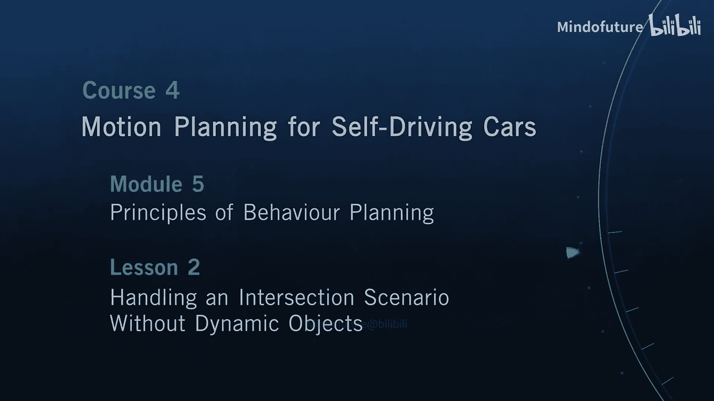
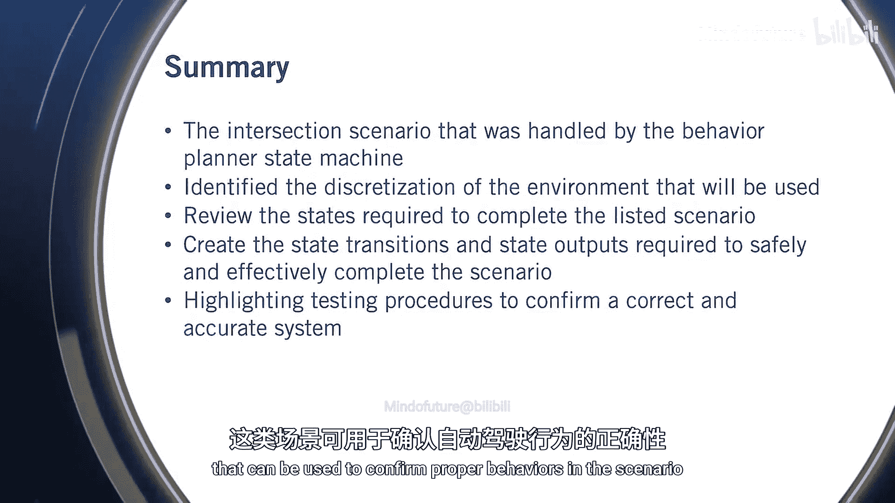

# 021：处理无动态物体的交叉路口场景

在本节课中，我们将学习如何构建一个行为规划系统，以处理一个更完整的交叉路口场景。我们将从定义场景细节开始，然后学习如何将交叉路口地图离散化，以建立清晰的状态转换。接着，我们将定义安全高效完成给定场景所需的状态和转换。最后，我们将介绍验证行为规划系统正确性所需的测试流程。

## 场景定义

上一节我们介绍了行为规划器的概念和有限状态机的基础知识。本节中，我们来看看如何构建系统来处理一个更完整的交叉路口场景。

我们首先要定义将要处理的具体场景。该场景是一个四向交叉路口，每个方向都有两条车道和一个停车标志。下图展示了这样的交叉路口，其中红线代表车辆必须在其后方停车的停止线。

到本节结束时，车辆应能在此交叉路口左转、右转或直行。目前我们暂时不考虑动态物体，将在下一节视频中讨论它们。

## 交叉路口区域离散化

我们已经为行为规划器定义了一个非常受限的操作设计域。现在开始实现行为规划器。首先，我们看看如何将交叉路口离散化，以便在环境中更简单地做出决策。

交叉路口区域可以划分为三个部分：

*   **接近区**：车辆应开始安全制动的区域，在图中以红色高亮显示。
*   **停车区**：车辆必须停车并等待合适时机继续行驶的区域，在图中以绿色高亮显示。
*   **通过区**：车辆实际穿过交叉路口的区域，在图中以橙色高亮显示。

每个区域的大小基于两个主要因素动态变化：

1.  **自车速度**：速度越高，安全舒适停车所需的距离越长。
2.  **交叉路口大小**：交叉路口越大，每个区域也必须越大。

## 定义状态与转换

为了处理这个场景，我们需要三种高级驾驶操作。

以下是三种操作状态及其定义：

1.  **保持车速**：此状态仅受道路当前限速约束。通常，这是在进入交叉路口任何区域之前，或安全进入“通过区”之后执行的操作。其进入动作是设置速度限制。
2.  **减速至停车**：此状态强制物体的未来轨迹在到达停止点前停车。其进入动作是定义停止点位置。
3.  **停车**：此状态指示车辆在其当前位置保持停止。其进入动作是启动一个计时器，在继续通过交叉路口前等待固定时间。

现在，我们来看看自车在此场景中会遇到的不同情况，并找出编码正确行为规划解决方案所需的有限状态机元素。

让我们从自车进入交叉路口区域之前开始看起，此时它只有一个约束：遵循道路限速。这个约束是基于“保持车速”状态的进入动作设置的。

当自车进入“接近区”（红色区域）时，它必须开始减速至停车标志处，因此将转换到“减速至停车”状态。从“保持车速”转换到“减速至停车”的转换条件就是进入“接近区”。

然后，一旦开始减速，自动驾驶车辆必须执行的下一个操作是在停止线前或交叉路口的“停车区”内完全停止。为确保这一点，车辆保持在“减速至停车”状态，直到其速度为零且位置在“停车区”内。“减速至停车”状态的进入动作是建立一个安全的停车位置。由于场景简单，这是一个单一的停车位置，即高精地图提供给规划器的停止线。然而，我们将在下一课中看到，一旦有其他动态物体与自车交互，这将变得困难。

一旦完全停止，车辆进入“停车”状态。作为进入动作，会启动一个计时器，以确保车辆在继续行驶前（根据典型的驾驶规则）在停止状态停留三秒钟。

计时器完成后，规划器自动转换到“保持车速”状态，并遵循任务规划器提供的路线通过交叉路口，无论是左转、右转还是直行。以上就是使用有限状态机处理简单四向交叉路口所需的全部计算。

## 处理输入噪声与测试

在整个过程中，至关重要的是我们要理解我们作为人类专家如何分析场景，以及由此产生的行为规划器的具体能力是什么。这些需要被捕获在操作设计域定义中，并且我们需要确保创建一个完整的状态机，能够处理给定场景中可能出现的所有情况。

一个对状态机性能有重大影响的特定问题是输入中的噪声。上面定义的状态转换条件是精确的，依赖于车辆精确到达停止点并达到零速度。然而，即使没有其他动态物体需要检测，车辆状态的定位估计也可能包含噪声，无法精确满足这些条件。为了处理这种类型的输入噪声，我们可以引入噪声阈值超参数。这是一个小的阈值，允许接近零的速度被接受为停止状态。在下一课处理更复杂的动态物体场景时，我们将继续看到这些超参数。

现在我们已经完成了有限状态机的创建，如何测试它是否有效？传统上，要确认行为规划系统的功能，需要进行四个阶段的测试，这遵循了我们在第一门课程中对整车安全评估的讨论。

以下是四个测试阶段：

1.  **基于代码的测试**：用于确认代码逻辑是否正确。例如，基于代码的测试可以告诉程序员，地图中设置的限速是否会是有限状态机产生的限速。然而，这些检查无法确认状态转换是否正确，或者状态是否能够处理给定场景中的所有情况。
2.  **仿真测试**：在模拟环境（如Carla）中执行，状态机执行其设计要处理的场景。这种类型的测试能够确认状态机转换和状态覆盖是否正确。仿真中执行的测试数量应能代表驾驶该场景时可能遇到的所有可能情况，以捕获程序员可能遗漏的任何边界情况。通常，选择一个有代表性的测试集并非易事，尤其是随着场景复杂性的增加。
3.  **封闭场地测试**：一旦确信状态机在仿真中按预期运行，就进行此类测试。这种测试针对那些在仿真中难以精确确认的特定场景，例如真实环境中的参数调优以及感知输出中的噪声和错误。
4.  **道路验证测试**：所有之前的测试都是在高度受控的环境中进行的，而道路测试可能高度不可预测，并且经常以工程师未曾想象的方式使系统崩溃。然后，可以将场景的新变体纳入测试过程的早期阶段。

## 总结

本节课中我们一起学习了以下内容：

1.  我们首先定义了要处理的场景和操作设计域：一个所有方向都有停车标志的单交叉路口场景。
2.  然后我们看到了如何将交叉路口离散化，以便在制定状态图转换时使用每个区域。
3.  接着，我们构建了系统的状态和转换，以正确定义整个交叉路口所需的行为。
4.  最后，我们回顾了可用于确认场景中正确行为的四个测试阶段。

在下一节视频中，我们将展示如何在与其他动态物体交互的情况下处理相同的交叉路口场景。正如我们将看到的，这会使状态机变得复杂得多，也更有趣。我们下节再见。

