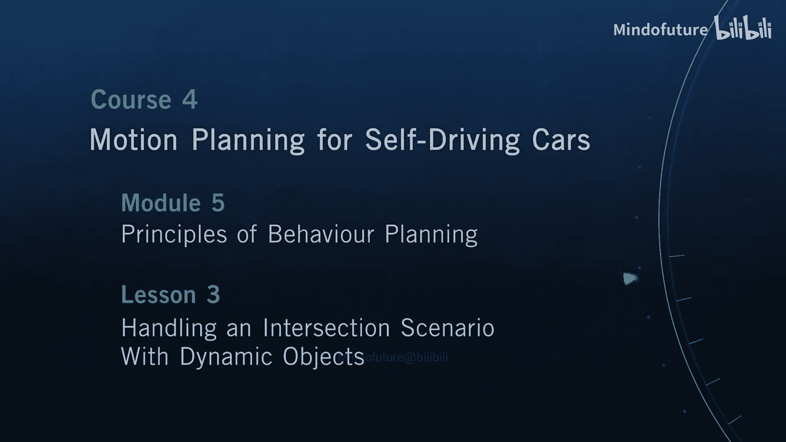
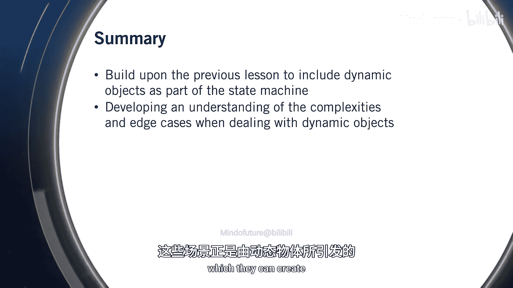

# 022：处理有动态物体的交叉路口场景 🚦

在本节课中，我们将学习如何扩展行为规划器，使其能够在四向停车路口场景中安全地与动态物体（其他车辆）进行交互。我们将回顾关键的距离测量概念，扩展有限状态机以包含新的状态和转换，并简要讨论处理动态物体时可能遇到的复杂边缘情况。

## 回顾与动态物体的交互

上一节我们介绍了无交通情况下的基本行为规划器。本节中，我们将重点关注如何与动态物体进行交互。

为了安全地处理其他车辆，我们需要测量与这些物体关键交互点的距离。以下是三个核心概念：

1.  **到动态物体的距离**：定义为自车当前位置到环境中任何动态物体中心的欧几里得距离。
2.  **到碰撞点的距离**：到达与另一个动态物体潜在碰撞点的距离。
3.  **碰撞时间**：到达给定碰撞点所需的时间。其计算方法在之前的视频中已讨论。

## 扩展有限状态机

现在，让我们扩展有限状态机，以应对动态物体带来的额外复杂性。我们需要将所需的机动动作增加到四个，以正确处理此场景中与车辆的所有交互。

首先，回顾我们第一版有限状态机中包含的机动动作：
*   **保持车速**：唯一约束是给定道路的速度限制。
*   **减速停车**：要求自车在环境中特定位置减速至停车点。
*   **停车**：保持在停车位置。

我们需要添加的新机动动作是：
*   **跟随前车**：此状态要求自车跟随前车速度并保持安全距离。前车是指同一车道中正前方的任何车辆。安全距离与速度相关，安全速度和安全距离在行为规划器的每次迭代中都会根据交互情况进行更新。

## 定义状态转换

定义了扩展有限状态机的所有状态后，我们开始填充状态转换。我们将采用与上一课类似的方式，从给定状态开始，识别所有从该状态出发的转换，然后再处理下一个状态。

以下是构建状态转换的过程：

**1. 从“保持车速”状态开始**

自车位于交叉路口外，处于“保持车速”状态。与上一课类似，一旦进入**接近区**，自车将转换到“减速停车”状态。

然而，这里有一个额外情况：当另一辆车出现在自车前方或驶入自车所在车道时。在这种情况下，我们将通过执行**跟随检查**，尝试转换到跟随该车辆的状态。

跟随检查可分解为两个要素：**距离检查**和**同车道检查**。
*   距离检查确认车辆足够近，应该被跟随。
*   同车道检查确认车辆确实与自车在同一车道。

对于距离检查，我们可以使用**到动态物体的距离**（到物体的欧几里得距离）并与一个阈值进行比较。
对于同车道检查，为简化起见，我们将检查前车是否在车道界限内，以及动态物体的航向是否在自车航向的给定阈值内，以表明其行驶方向相同。

**2. “跟随前车”状态的转换**

在“跟随前车”状态，我们只定义两个转换：
*   前车可能在自车接近或到达交叉路口之前驶离车道，导致切换到“保持车速”状态。
*   或者，当前车驶出当前车道（通常是进入交叉路口），而自车已处于“到达区”或“接近区”时，直接转换到“减速停车”状态。我们添加的转换条件是：当自车处于接近区或到达区时，**到碰撞点的距离**大于**到停车点的距离**。在这种情况下，自车应转换到“减速停车”状态，并将停车点设置为交叉路口停车线的正确位置。

**3. “减速停车”状态的考虑**

在“减速停车”状态，自车持续减速，直到在停车线处完全停止，这将导致切换到“停车”状态。

然而，我们必须再次考虑到，车辆有可能在交叉路口处切入自动驾驶汽车前方（例如从车道驶出或超车机动）。与之前类似，当自车处于接近区或到达区时，我们在整个“减速停车”状态期间执行跟随检查。如果检查返回为真，则转换到“跟随前车”状态。不过，在这种情况下，距离检查考虑的是前车的**到碰撞点的距离**是否小于**停车点距离**，以便优先进入跟随前车模式。

**4. 完成扩展：从“停车”状态出发**

最后，为了完成有限状态机的扩展，让我们看看一旦停车后可能面临的情况。为简化起见，我们假设一种非常保守的驾驶风格：我们的自动驾驶汽车会等待所有车辆清空交叉路口的接近区、到达区或通过区后，再继续通过。

我们将为四向交叉路口定义简单的检查，用四个简单的标签识别所有车辆的行驶方向，并且只考虑其他直行通过交叉路口的车辆。
*   相对于自车车身坐标系，相对航向在 **-45度到45度** 之间的车辆物体将被标记为与自车**同向行驶**。
*   相对航向在 **45度到135度** 之间的车辆将被标记为**向右行驶**。
*   相对航向在 **135度到-135度** 之间的车辆将被标记为**朝向自车行驶**（对向）。
*   相对航向在 **-45度到-135度** 之间的车辆将被标记为**向左行驶**。

可以使用动态物体的预测路径来改进这种简化，特别是在有额外的感知信息可用于改进对通过交叉路口行驶方向的预测时。

现在我们可以定义从“停车”状态出发的转换。我们将有两组转换：要么是“跟随前车”，要么是“保持车速”，这取决于车道中是否存在满足跟随检查的车辆。

在每种情况下，转换条件根据我们的任务计划所需的通过交叉路口的路径而变化：
*   当自车需要**左转**时，任何从左方、右方接近的车辆或任何对向车辆都必须清空**交叉路口通过区**，自车才能继续行驶。
*   当自车需要**直行**时，只有从左方或右方接近的车辆需要清空交叉路口。
*   当自车需要**右转**时，只有从左方接近的车辆需要清空交叉路口。

从这个简单的“停车”状态转换定义中，希望你能体会到处理因到达交叉路口顺序而产生的优先权问题，以及其他车辆也可能左转或右转的可能性所需的额外检查。

## 边缘情况讨论

到目前为止，在创建状态机的过程中，我们对动态物体的行为做了一个特别强的假设：即所有动态物体都遵守交通规则。然而，情况并非总是如此，这种困难导致了许多也需要考虑的边缘情况。

让我们快速讨论几个例子，说明这个强假设可能出错的情况：
1.  驾驶员无意中驶入对向车道，进入自车车道。
2.  激进驾驶员在自车已开始通过交叉路口时仍加速冲过路口。
3.  车辆未在交叉路口停车。
4.  车辆停放在交叉路口附近。如果该车辆未被标记为停放（从而可能被当作静态物体而非动态物体处理），我们的行为规划器可能会陷入死锁状态，等待这辆停放车辆移动。

这远非所有可能性的完整集合。行为安全评估和测试的主要目标之一就是尽可能多地发现意外行为的变化，以便它们也能被检测、分类并纳入行为规划设计过程。

然而，仅仅发现边缘情况是不够的。我们必须定义自动驾驶汽车应如何应对每一种情况。对于这些紧急机动（如急转弯或急刹车），需要定义更多的转换和条件。这是一个活跃的研究和开发领域。

## 总结

本节课中，我们一起学习了如何创建一个能够与遵守交通规则的动态物体进行交互的有限状态机。通过观察动态物体可能引发的众多可能边缘情况中的几个，我们看到了处理动态物体为何如此具有挑战性。

在下一课中，我们将看到如何继续构建我们的行为规划器，使其能够同时处理多个场景。下次再见。