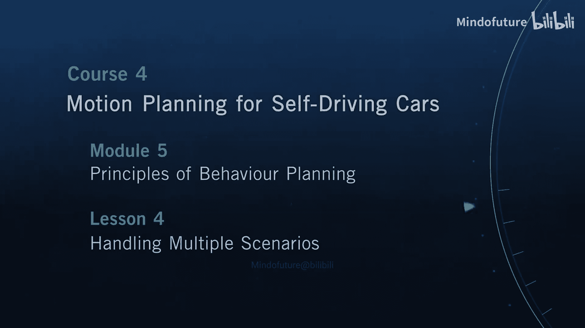
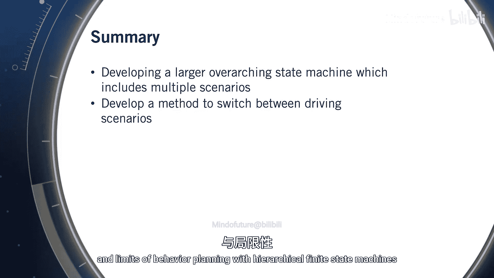

# 023：处理多重场景

欢迎来到行为规划模块的第四个视频。在上一个视频中，我们为有限状态机行为规划器引入了动态对象。在本视频中，我们将开发一个更强大的行为规划器，它能够同时处理多种驾驶场景的决策过程。

我们将通过引入**分层有限状态机**的概念来实现这一点。同时，我们还将开发一种方法，用于在不同驾驶场景发生时进行切换。

让我们开始吧。

## 单一状态机的局限性

到目前为止，在本模块中，我们已经开发了一个能够处理单一动态四向停车路口场景的有限状态机行为规划器。

然而，在实际驾驶中，会遇到许多类似的场景。例如，三向停车路口、交通灯控制的路口以及直行道路场景等。虽然许多场景由于处理逻辑相似而具有共性，但每个场景本质上都需要不同的驾驶行为。

处理这些多重场景的一种方法是，在一个不断扩大的行为网络中，为单一状态机添加更多的状态、转换和条件。但是，这种方法存在几个问题。

以下是这种方法的主要问题：

1.  **规则爆炸**：我们需要开发额外的逻辑来区分当前场景，以及处理每个场景所需的规则。这很快会导致“规则爆炸”问题，即添加新场景所需的规则数量变得难以想象地庞大。
2.  **计算负担**：由于每个时间步都需要评估大量额外的规则和状态转换，所需的计算时间会显著增加。
3.  **复杂性与可维护性**：随着需要考虑的情况数量迅速增加，这样的系统变得复杂且难以创建和维护。

本质上，随着复杂性的增加，我们失去了在第一课中强调的使用有限状态机的所有优势。

## 分层有限状态机

不过，我们可以采用另一种方法：将每个高级场景表示为单一状态。这允许我们在高级场景状态之间创建更简单的转换。

在这个例子中，我们可以看到状态代表了一个直行道路场景和我们之前处理的四向路口场景。对于每一个这样的高级场景状态，我们将存储一个低层级状态机，用于独立处理该场景。

例如，对于路口场景，低层级状态机就是我们在过去两节课中构建的那个。这种表示方法被称为**分层状态机**，其中超级状态代表每个场景，子状态代表在每个场景中要处理的驾驶操作。

高级场景状态机之间的转换，将是一个基于高清路线图和动态车辆信息来定义何时进入新场景的规则。

## 场景切换机制

假设我们有一个简单的分层状态机，包含两个场景：一个是带有行人横道的直行道路，另一个是基于停车标志的路口。

要从直行道路切换到停车标志路口，自动驾驶车辆必须接近该路口。这可以通过检查沿任务计划到下一个路口的距离来实现。

我们在这里讨论的所有转换都发生在超级状态层面。接下来要回答的问题是：在处理子状态操作时，我们如何在场景之间切换？

一种方法是在当前场景的超级状态中，为关键操作子状态引入转换出口。

让我们继续以路口场景为例。首先，确定哪个状态将是退出该场景的关键出口状态。我们能够退出路口的唯一方式，是在“跟踪速度”或“跟随前车”状态中，并且已经通过了路口。因此，让我们将出口转换放在那里。

转换的条件是确认该场景确实已完成。在这个例子中，我们可以使用到下一个停车标志路口的距离。如果这个距离大于给定的阈值，我们就可以退出路口场景。

通过这种转换方法，我们能够在场景切换之间保持操作。在这种情况下，路口超级状态中的“跟踪速度”状态将连接到我们进入的下一个场景的“跟踪速度”状态。

## 扩展性与优缺点

通过创建一个新的超级状态场景节点，并配备一个能够处理该场景的子状态状态机，就可以将额外的多车道场景添加到这个分层状态机中。

这种类型的有限状态机有其固有的优点和缺点。

以下是这种方法的优点：

1.  **计算效率**：由于其在每个超级状态内创建独立状态机的细分特性，这种方法通过重构搜索空间，限制了任何单个时间步所需的计算时间。
2.  **易于测试和编程**：这种细分特性也使得分层状态机的测试和编程变得显著更容易。

然而，分层状态机也存在问题。虽然它限制了所需规则的数量，但这种方法仍然无法完全解决规则爆炸问题。规则数量庞大的一个原因是，所有场景都有完全分离的状态机，因此许多规则在不同场景中为了处理相似行为而彼此重复。

最终，分层方法允许系统设计者处理比扁平的单层有限状态机更大量的复杂性。只要能在每一层定义关键状态，这个想法可以扩展到多层。

实际上，有限状态机所强化的“在任何给定时间只有一个行为是活动的，并且所有到其他行为的转换都可以明确定义”的观点，对其能处理的场景集合大小存在限制。尽管如此，它仍为自动驾驶汽车中的典型行为规划提供了一个有用的工具。

## 总结

在本节课中，我们一起学习了以下内容：

我们首先介绍了能够同时处理多个场景的**分层有限状态机**。接着，我们讨论了如何在超级状态和子状态层面，在不同驾驶场景之间进行转换。最后，我们探讨了使用分层有限状态机进行行为规划的能力与局限。

请加入我们的下一个视频，在那里我们将讨论一系列先进的研究方法，这些方法能够解决我们目前在行为规划中遇到的一些问题。

下次见。

