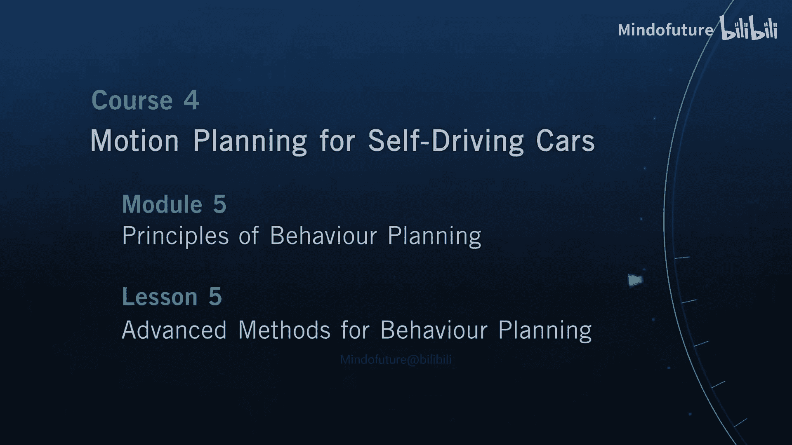
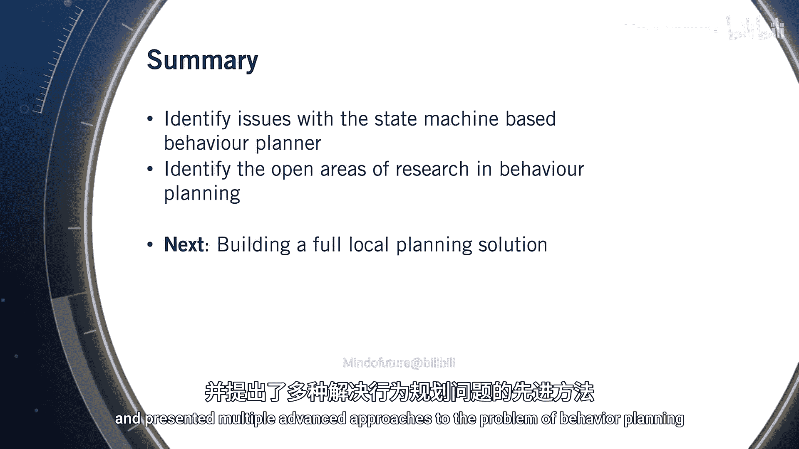

# 024：行为规划高级方法

欢迎来到行为规划模块的第五个，也是最后一个视频。在本视频中，我们将讨论基于状态机的行为规划方法的局限性。然后，我们将概览一些旨在解决这些局限性的替代性行为规划系统。通过本视频的学习，您应该对行为规划中使用的主要方法有一个全面的了解。

让我们首先指出状态机模型存在的问题。

我们在整个模块开发过程中发现的第一个问题是**规则爆炸**问题。这意味着，随着我们开发出更完整的场景和处理策略集合，所需规则的数量会迅速增长。这个限制意味着，虽然可以开发一个有限状态机行为规划器来处理有限的操作设计域，但用有限状态机开发一个具备完整四级或五级自动驾驶能力的车辆几乎是不可能的。

处理噪声环境是下一个问题。虽然我们在第2课和第3课中看到了如何通过添加超参数来处理某些噪声，但这种噪声处理方法只能应对非常有限的情况。要处理所有类型的输入不确定性，需要不同的方法。

关于这一点，我想指出的下一个问题是**超参数的实际调优**。随着所需行为变得更加复杂，用于离散化环境和处理某些低级噪声的超参数数量迅速增长。所有这些超参数都必须非常仔细地调整，这可能是一个漫长的过程。

最后，我们将讨论的最后一个问题是**处理未遇到过的情况**。由于这种方法是基于编程的，很可能出现一种情况，即系统的编程逻辑会以不正确或非预期的方式做出反应。

基于状态机的方法被归类为**专家系统**，即由人类专家设计和开发的系统。然而，状态机并非唯一设计的此类专家系统。

还有一些方法依赖于规则数据库，这些规则在每个时间步都应用于输入数据。规则被组织成层次结构，其中安全关键规则优先于乘坐舒适性规则或防御性驾驶规则。每条规则只有在适当的条件出现时才会被激活，以影响输出策略的选择。

这种基于规则的系统不会遇到我们在分层状态机中遇到的规则重复问题，因为规则可以应用于整个操作设计域或其大部分区域。然而，基于规则的系统必须非常仔细地制定规则，以确保它们不会相互产生负面影响，或在多条规则同时激活时导致意外结果。

由于这两种专家系统通常都依赖专家用户来设计所有可能的场景，因此它们都面临着上述相同的问题。

针对我们上面指出的部分问题，一个可能的解决方案是扩展人类专家型规划器，使其融入**模糊逻辑**。模糊逻辑是一种系统，它使用一组清晰、明确定义的值来创建一组更连续的模糊状态。

为了简单了解基于模糊的系统如何工作，让我们看一下车辆跟随行为的例子。

之前我们设置了一个参数化的距离，将空间划分为跟随车辆或不跟随车辆。而在模糊系统中，我们能够拥有一个连续的空间，在这个空间上可以应用不同的规则。

例如，一个模糊系统可能对非常接近的前车做出强烈反应，但当距离较远时，对速度匹配或距离跟随的要求则不那么严格。

虽然基于模糊的规则系统比传统的离散系统更能处理环境噪声，但规则爆炸和超参数调优仍然是模糊系统面临的问题。实际上，模糊系统可能导致更严重的规则爆炸，因为处理模糊输入集需要更多的逻辑。伴随规则爆炸而来的是超参数调优的巨大挑战。

接下来我想讨论的一个令人兴奋的研究方法是使用**强化学习**进行行为规划。强化学习是机器学习的一种形式，其中智能体通过采取行动并接收连续奖励来学习如何与给定环境互动。

智能体首先在模拟环境中进行“游戏”，这意味着开始时智能体并不擅长特定任务。然而，随着时间的推移，随着智能体最大化其奖励，它们最终会掌握任务。通过在模拟环境中学习，在学习过程中经历的许多失败不会产生现实世界的后果。

更具体地说，我们可以说智能体正在尝试学习一个由 **`P`** 表示的策略，该策略将给定的环境 **`S`** 映射到给定的动作 **`a`**。为了将强化学习的概念与行为规划联系起来，假设我们正试图教自动驾驶汽车如何跟随前车。

在这种情况下，我们的策略 **`P`** 将尝试执行车辆跟随。我们的动作可以明确定义为要执行的行为，也可以通过选择期望的加速度和转向率来隐式定义行为。环境可以由一组连续的变量表示，这些变量告诉我们相关信息，例如到所有物体的距离和我们的任务路径。最后，奖励函数可以基于最佳跟随距离，在首选距离处给予最高奖励，对距离过近的惩罚比对距离过远的惩罚更重。

由于自动驾驶车辆可能遇到的情景和输入种类极其繁多，直接使用强化学习进行行为规划不太可能成功。因此，通常会应用一些进一步的调整。其中一种调整称为**分层强化学习**，我们将问题划分为策略空间中的低级策略和场景中的高级策略，这类似于分层有限状态机。然后，每个低级策略独立学习，只有在成功学习后，才能学习高级策略来完成一个场景。

经常应用的第二种技术称为**基于模型的强化学习**。在基于模型的强化学习中，智能体不仅尝试学习策略 **`P`**，还尝试学习智能体周围当前环境的模型。这种方法如何应用于自动驾驶汽车行为规划的一个例子是包含动态物体运动模型。如果智能体理解动态物体的运动模式，它就可以创建更有效的环境规划。

虽然强化学习是一个非常令人兴奋且前景广阔的研究领域，但它也有自身的局限性。许多用于学习自动驾驶所需策略的模拟环境过于简化，由于其简单性，学到的策略可能无法转移到现实世界环境中。过于逼真的模拟器则会导致严重的计算需求问题，尤其是在为自动驾驶学习运行数千次变化广泛的场景重复时。

第二个是关于安全的问题。虽然强化学习中有一些技术试图确保强化学习器创建的轨迹满足安全约束，但对于学习到的系统仍然无法进行严格的安全评估，因为它们在决策方式上大多是“黑箱”。

研究界目前还在探索许多其他有趣的想法。其中许多都试图从人类驾驶行为中学习。例如，在**逆强化学习**中，不是尝试在给定奖励函数的情况下获得策略，而是使用人类驾驶数据作为策略，并尝试学习人类使用的奖励函数。一旦学习了奖励函数，算法就可以像人类驾驶员一样执行驾驶操作。

最后，**端到端方法**将原始传感器数据作为输入，并尝试通过学习人类驾驶命令（在模仿学习方法中）来输出油门、刹车和转向指令。这种方法由NVIDIA的研究人员在其论文《End to End Learning for Self-Driving Cars》中开创。虽然这没有被明确归类为行为规划，但端到端方法在其输出选择过程中仍然隐式地执行了行为选择的任务。

这些简要的解释只是触及了这个庞大且快速发展的研究领域的表面。行为规划仍然是自动驾驶研究的热点之一，也是实现现实世界五级自动驾驶最棘手的瓶颈之一。我们在补充材料中为有兴趣深入了解的读者提供了一份该领域近期工作的阅读清单。

让我们总结一下本视频讨论的内容。

我们介绍了基于有限状态机规划的一些问题，并提出了多种解决行为规划问题复杂性的高级方法。

至此，我们的行为规划模块已经结束。在本模块中，我们定义了使行为规划系统能够实现自动驾驶所需的要求。然后，我们逐步创建了针对四路交叉口特定场景的这样一个系统。接着，我们添加了动态车辆交互，并扩展到包含多个场景。最后，我们简要回顾了行为规划研究界涌现的一些令人兴奋的方法。

请加入我们的下一个模块，在那里我们将使用参数化曲线和非线性优化构建一个完整的局部规划解决方案。