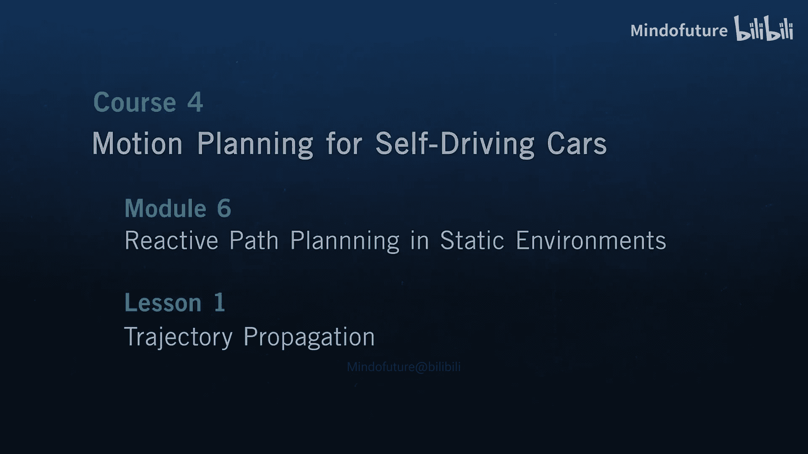
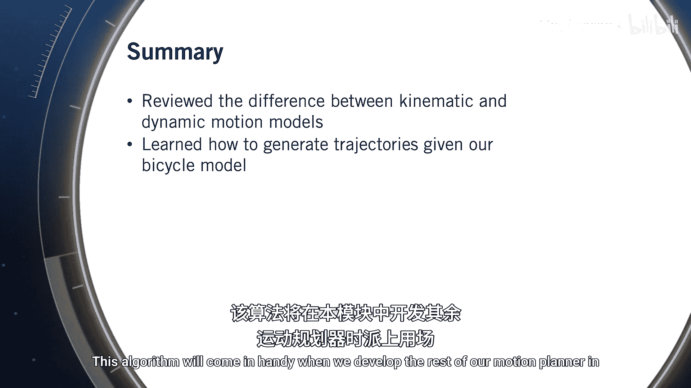

# 025：轨迹传播与反应式规划

在本节课中，我们将学习如何基于运动学自行车模型，构建一个反应式运动规划器。我们将介绍路径预测和碰撞检查的概念，并专注于静态环境下的规划，作为实现自动驾驶汽车行为与路径规划的第一步。

## 运动学模型与动力学模型

上一节我们介绍了本模块的目标，本节中我们来看看机器人运动模型的基础知识。

首先，我们需要区分运动学模型和动力学模型。
*   **运动学模型**描述了机器人的运动方程，但**忽略**了质量和惯性对其运动的影响。其输入通常是线速度、角速度及其导数。
*   **动力学模型**则**考虑**了质量和惯性的影响，因此更为复杂。其输入通常是力和力矩。

为了说明这一点，我们可以对比两个粒子模型：
*   运动学粒子模型：`x(t+Δt) = x(t) + v * Δt`
*   考虑摩擦的动力学粒子模型：`m * a = F - μ * m * g`

在路径规划和轨迹优化中，我们通常关注**运动学模型**，以使运动规划问题在计算上更易处理，而将简化动力学所引发的问题留给控制器去解决。

## 自行车模型回顾

现在，让我们回顾在第一门课程中介绍过的自行车模型。该模型是描述汽车运动的常用简化模型。

以下是其运动方程：
*   `ẋ = v * cos(θ)`
*   `ẏ = v * sin(θ)`
*   `θ̇ = v / L * tan(δ)`

这些方程的含义是：
*   机器人的状态由其位置 `(x, y)` 和相对于x轴的航向角 `θ` 定义。
*   模型的输入是速度 `v` 和前轮转向角 `δ`。
*   根据这些运动学方程，当前的机器人状态和输入共同决定了轨迹随时间的变化。

需要明确的是，我们通常无法直接控制机器人的状态（如直接指定其到达某个XY位置）。但我们可以设计一系列控制输入 `U_n`，根据运动学方程，使机器人到达目标位置。这一系列输入就对应了机器人将遵循的轨迹。

## 轨迹生成：从连续到离散

了解了运动学方程的例子后，你可能会问：我们如何为给定的输入序列实际计算出一条轨迹？

我们给出的运动学方程本质上是一个连续时间微分方程组。为了生成轨迹，我们将关注这些方程的**离散化**形式。离散化模型使我们能够轻松高效地为给定的控制输入序列传播轨迹。

有多种方法可以离散化连续时间微分方程，这里我们使用简单的零阶保持法。离散化的一个结果是，我们可以递归地实现序列中所有状态更新的求和运算。

以下是离散化后的递归更新公式：
*   `x_{k+1} = x_k + v_k * cos(θ_k) * Δt`
*   `y_{k+1} = y_k + v_k * sin(θ_k) * Δt`
*   `θ_{k+1} = θ_k + v_k / L * tan(δ_k) * Δt`

这种递归求解的优势在于计算效率。我们无需为轨迹上的每个点重新计算之前所有更新的总和，而只需使用前一个计算出的点，增量地计算下一个点。在本模块中，我们将一直使用这种递归解法。

## 轨迹传播的应用

如果我们将这种离散化方法应用于整个控制输入序列，就能得到机器人将遵循轨迹的精确近似。

这不仅对轨迹规划有用，也对**运动预测**非常有用。例如，在驾驶场景中，如果我们知道其他交通参与者的运动学模型，并对其可能采取的控制输入有合理的猜测，就可以估算出他们未来的轨迹，从而帮助我们规划自身的运动以避免碰撞。

以下是两个应用示例：

**示例一：恒定输入**
假设我们对自行车模型施加恒定的速度输入和恒定的转向角输入。如下图所示，这将导致机器人以恒定速度沿圆弧行驶，同时其航向角随时间步长缓慢变化。

**示例二：避障机动**
如果我们根据某个转向函数，在路径上改变转向角，就可以执行更复杂的机动，这对于避障等任务至关重要。这本质上是局部规划问题的核心：计算所需的控制输入，以安全导航到给定目标点。

如下图所示，如果像之前一样以恒定转向角行驶，将会导致碰撞。为了避免碰撞，我们给机器人一系列不同的转向角输入，使其成功绕开障碍物。

## 总结与预告

本节课中我们一起学习了运动学模型与动力学模型的区别，并回顾了自行车模型。接着，我们讨论了如何利用轨迹传播算法，为给定模型和控制输入集计算轨迹。该算法将在我们开发本模块其余运动规划器时派上用场。

希望本视频让你对如何根据机器人的运动学模型和任意输入生成轨迹有了深入理解。在下一个视频中，我们将讨论一些高效的碰撞检查方法，用于评估不同规划路径的安全性。下次见。