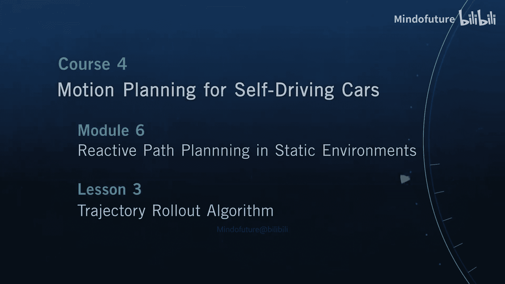
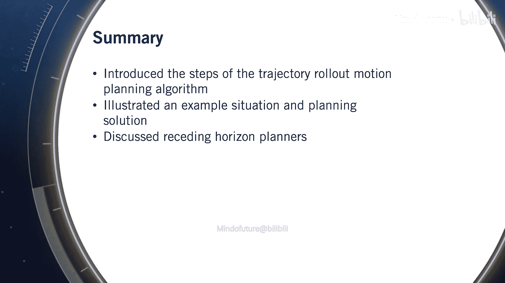

# 027：轨迹展开算法

在本节课中，我们将结合前两课的知识，开发一种称为“轨迹展开规划器”的反应式运动规划算法。这将为我们介绍轨迹规划的任务，并为后续学习模块7中更高级的规划方法打下基础。

## 概述

轨迹展开规划器是一种反应式规划方法。它通过在当前工作空间点生成一组候选轨迹，利用局部障碍物信息筛选无碰撞路径，并选择能最大化目标函数（通常包含向目标前进的奖励项）的路径。通过反复执行此过程，我们得到一个能对环境做出反应、同时稳步向目标前进的“滚动时域”规划器。

## 算法步骤详解

上一节我们介绍了算法的整体思路，本节中我们来看看实现轨迹展开规划器的具体步骤。

### 1. 轨迹生成

第一步是在每个时间步生成一组轨迹。在轨迹展开算法中，每条轨迹对应在固定时间范围内，对机器人持续施加一个固定的控制输入。

我们通过在可用输入值范围内均匀采样这些固定输入，来生成各种潜在的候选轨迹。通过覆盖输入频谱上的多种轨迹，我们提高了轨迹搜索的质量和机器人的可操作性，因为我们在探索更广泛的候选路径集。

如果只使用小范围的输入，计算时间会减少，但可能会错过计算中潜在的候选轨迹，从而降低规划器生成的轨迹质量。然而，采样过多的候选轨迹意味着每一步都有额外的计算开销，因为每条额外的轨迹都需要生成、检查碰撞并进行评分。

选定输入集后，我们需要使用车辆的**运动学模型**（如第一课所述）向前传播状态，从而生成沿轨迹的未来状态。

以自行车模型为例，两个输入是**速度**和**转向角**。如果我们保持速度恒定，但让转向角在 `-π/4` 到 `π/4` 的范围内变化，我们就得到一组弧线作为候选轨迹。这些弧线是通过递归计算运动学方程生成的。

### 2. 碰撞检查

现在我们有了弧线集，可以检查哪些是无碰撞的。对于碰撞检查算法，我们假设给定一个表示车辆工作空间离散化的**占据栅格**。

这种离散化以矩阵形式存储，矩阵中的每个值表示工作空间中对应位置是否被占据。然后，我们可以使用上一视频讨论的基于“扫掠区域”的方法进行碰撞检查。

回忆一下，我们通过将机器人的车身沿路径扫掠，并取给定轨迹每个时间步所有足迹的并集来生成扫掠区域。汽车的足迹对应于占据栅格中的一组索引，因此沿路径每个旋转和平移的点也对应于占据栅格中的不同索引。这些索引存储在集合数据结构中以消除重复项。

然后，我们可以检查扫掠区域的每个点，看哪些点与占据栅格中被占据的元素重叠。具体做法是遍历扫掠区域集合中的每个点，并检查占据栅格中相关索引是否存在障碍物。如果扫掠区域中任何点被占据，则该轨迹包含碰撞。

### 3. 路径选择与目标函数

完成上一步所有轨迹的遍历后，我们将得到一组无碰撞、运动学可行的轨迹，然后可以使用目标函数对它们进行评分。

每个目标函数都需要一个主要元素，即某种奖励向目标点或区域前进的方式，这是运动规划问题的最终目标。一个简单有效的方法是在目标函数中加入一个与候选轨迹末端到目标点距离成正比的项。

然而，有时我们也希望鼓励反应式规划器产生其他行为。正如我们在模块1中看到的，目标函数的例子包括最小化到车道中心线的距离或惩罚路径的曲率。有时我们也希望奖励那些最大化到最近障碍物距离的路径，以增加规划器未来时间步可用可行路径的灵活性。

正如模块1所讨论的，没有完美的目标函数，你需要根据应用场景设计自己的目标函数。对于我们的反应式规划器，我们将使用到目标的距离作为要最小化的目标函数，即此处显示的第一个公式 `J = distance_to_goal`。

一旦有了目标函数，我们就可以遍历无碰撞轨迹，并选择能最大化目标函数（或最小化惩罚，取决于目标函数的表述方式）的路径。

## 算法实例演示

让我们通过一个具体例子将整个算法串联起来。

假设占据栅格中的障碍物为红色，目标区域为黄色，汽车的初始点为 (0,0,0)。假设我们的转向角范围在 `-π/4` 到 `π/4` 之间，步长为 `π/8`。假设我们使用恒定速度 0.5 米/秒。此外，假设规划器使用 0.1 秒的时间步长，且每条规划轨迹总持续时间为 2 秒。

如果我们应用第一课概述的、使用自行车运动学模型的轨迹传播算法，就可以为转向角范围内每个选定的转向角生成一组路径。

*   第一条轨迹的转向角为 `-π/4`，因此轨迹向右弯曲。
*   下一条轨迹的转向角为 `-π/8`，生成的轨迹曲率比第一条小。
*   接下来是转向角为零的轨迹，导致汽车直线前进。
*   正转向角轨迹与负转向角轨迹对称，并使汽车向左转。

现在我们有了候选轨迹集，需要使用上一视频概述并在本节回顾的碰撞检查算法检查每条轨迹是否无碰撞。将足迹沿每条轨迹平移和旋转后，我们检查结果扫掠区域中每个占据栅格索引是否存在障碍物。如果任何索引包含障碍物，则该路径被标记为有碰撞（我们用红色表示）。所有无碰撞路径用绿色表示，然后我们可以使用目标函数进行评估以找到最佳路径。

回忆一下，我们的目标函数是到目标的距离。最小化此距离的路径现在用黑色标出。这就完成了我们的第一次规划迭代。

## 滚动时域规划

此时，我们有了供车辆执行的轨迹。然而，我们不会在下一次规划周期之前完全执行这条轨迹。相反，车辆只执行该周期中的前几个点。具体数量取决于规划频率，我们的规划时域将根据进度向前移动。

这正是您在本专项第一门课程中应用于车辆控制的滚动时域方法。

总结一下，在每个时间步，我们规划一条 2 秒的轨迹，但每次只执行其中的 1 秒。这样做，我们的规划时域的结束时间在每个规划周期向前移动 1 秒。这被称为滚动时域规划器，因为在每个规划周期，我们都有一个固定的规划时间范围，其结束时间慢慢向到达目标的时间点“后退”。

一旦下一个规划周期开始，我们重复整个过程。我们继续这个过程，直到计算出到达目标区域的轨迹（我们在每次迭代结束时检查）。在我们的示例问题中，您现在可以看到规划器到达目标区域所采取的其余步骤。

关于这个规划器需要注意的一点是，它是“短视”的，即它不直接规划一条通往目标的路径，而是根据子路径能让机器人多接近目标来贪婪地采样子路径。这可能导致规划器目光短浅，陷入死胡同，并且通常会导致规划器找到次优路径。然而，这个规划器大大降低了到达目标区域的规划问题的复杂性，并且速度足够快，可以用作在线规划器。

## 总结

本节课中我们一起学习了轨迹展开运动规划算法的步骤，结合了前两课介绍的关于轨迹传播和碰撞检查的概念。为了巩固这个概念，我们详细讲解了一个该算法运行的示例。最后，我们介绍了滚动时域规划器的概念，并讨论了它们在规划到目标区域时可能如何目光短浅。

现在，您应该对轨迹展开算法的工作原理有了很好的了解。在下一课中，我们将讨论动态窗口法，以及它如何帮助我们的轨迹展开算法生成更舒适的轨迹。