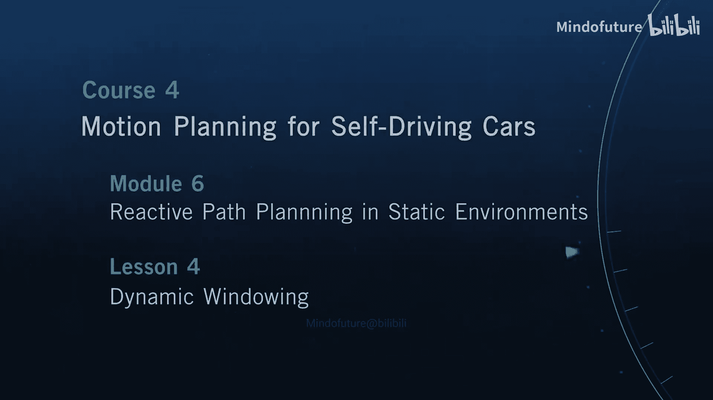
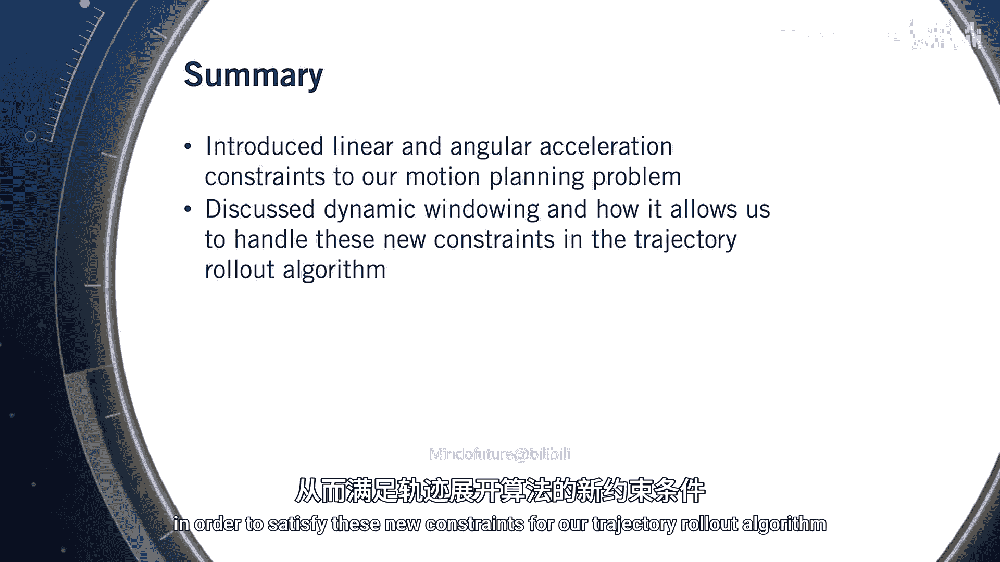

# 028：动态窗口法

在本节课中，我们将学习如何为上一课开发的轨迹展开算法增加一项名为“动态窗口”的技术。动态窗口法允许我们对车辆轨迹施加线性和角加速度约束，以提升车辆在规划周期之间行驶时的乘坐舒适性。

具体来说，学完本课后，你将能够为课程一中推导的自行车模型添加加速度约束，并能够使用动态窗口法修改轨迹展开算法以适应这些新约束。

## 回顾自行车模型

首先，让我们回顾第一课中讨论的自行车模型运动学方程。本质上，自行车模型的两个输入是线速度 `v` 和转向角 `δ`，它们会随时间改变机器人的位置和航向。

这套运动学方程的一个特点是，它没有考虑加速度或加加速度等高阶项。这些高阶项正是导致车内乘客不适的原因，因此我们应该尝试在运动学模型中解决这个问题。

## 引入加速度约束

即使不将课程一中讨论的完整动力学模型纳入轨迹规划过程，我们也可以通过限制所选输入来考虑快速变化对乘坐舒适性的影响。我们可以为自行车模型允许的线性和角加速度范围添加约束。

这样做将限制车辆在行驶其规划轨迹时，乘客所体验到的力和扭矩的大小。然而，这需要权衡取舍：我们的运动规划器在每次规划迭代中会失去一些机动性。

具体来说，在添加角加速度约束后，我们可能无法移动到转向角集合中的每一个可能的转向角，因为它们可能引起过高的角加速度。此外，我们也无法在规划迭代之间过快提升或降低速度。

## 推导角加速度约束

让我们专注于角加速度约束，并推导由此产生的转向角限制。

回想一下，自行车模型的角速度由公式 `ω = v * tan(δ) / L` 给出。因此，角加速度的大小近似等于起始和结束转向角的角速度之差的绝对值除以所使用的时间步长 `Δt`。

利用规划器中 `v` 和 `L` 始终为正的事实重新整理项，我们得到约束条件：`|tan(δ₂) - tan(δ₁)| ≤ ω̇_max * L / v`。

## 实例分析

为了帮助理解这对规划器的影响，让我们分析一个具体例子。

假设我们的自行车模型在所有候选轨迹上以恒定的线速度 `v = 1 m/s` 移动，当前转向角 `δ₁ = π/8`。假设该机器人的最大和最小转向角分别为 `π/4` 和 `-π/4`，转向角步长为 `π/8`。此外，假设我们的轨迹以 `Δt = 0.1 s` 的时间分辨率采样，自行车模型机器人长度为 `L = 1 m`。最后，将角加速度约束为 `ω̇_max = 0.6 rad/s²`。

将每个潜在的转向角代入我们的转向角集合，我们发现，如果我们将转向角改为 `-π/8` 或 `-π/4`，则会违反角加速度约束。然而，根据新约束，将其改为 `π/4` 或保持为 `π/8` 都是有效的选择。

为了说明这一点，我们将不允许的轨迹标记为红色。剩余的绿色轨迹仍然可供我们在上一课开发的反应式规划器的后续步骤使用。

这说明了，一般来说，添加的约束会在一定程度上降低机器人的机动性，同时促进更舒适的轨迹。约束集越严格，机器人的机动性就越差。

## 扩展到线性加速度约束

我们也可以将类似的逻辑应用于线性加速度约束和我们可用的线速度输入范围的情况，甚至可以同时将两种约束应用于机器人。

总的来说，动态窗口方法允许我们在规划过程中对轨迹的演变施加更多限制，从而产生能更好地同时满足广泛目标的运动。

## 总结

本节课中，我们首先为自行车模型引入了额外的加速度约束。然后，我们推导了动态窗口法的过程，以在每个时间步限制我们的轨迹集合，从而满足轨迹展开算法的这些新约束。

恭喜你完成了本模块的学习。让我们回顾一下所涵盖的内容。

我们首先发展了轨迹传播的概念，以便为给定的运动模型生成轨迹。接着，我们讨论了碰撞检查，这对于为自动驾驶汽车制定无碰撞运动规划是必要的。然后，我们将这两个概念结合到轨迹展开规划器中，并使用动态窗口法对其进行增强以处理加速度约束。

现在，你应该对以轨迹展开算法为核心的反应式规划有了坚实的基础。这是一种紧凑而有效的通用运动规划策略，适用于具有各种目标和约束的广泛规划任务。

在下一个模块中，我们将开始讨论动态环境，并使用轨迹传播和碰撞检测来预测其他物体的运动并判断是否可能发生碰撞。我们下节课见。

