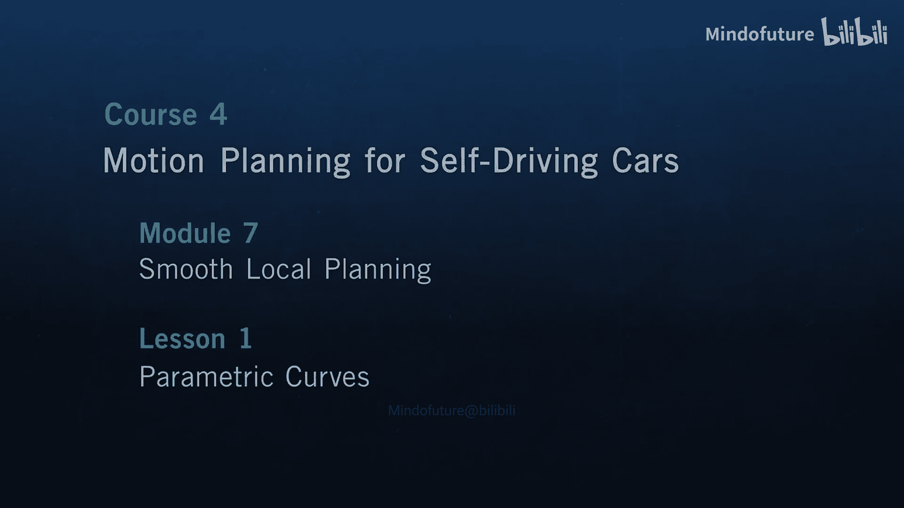
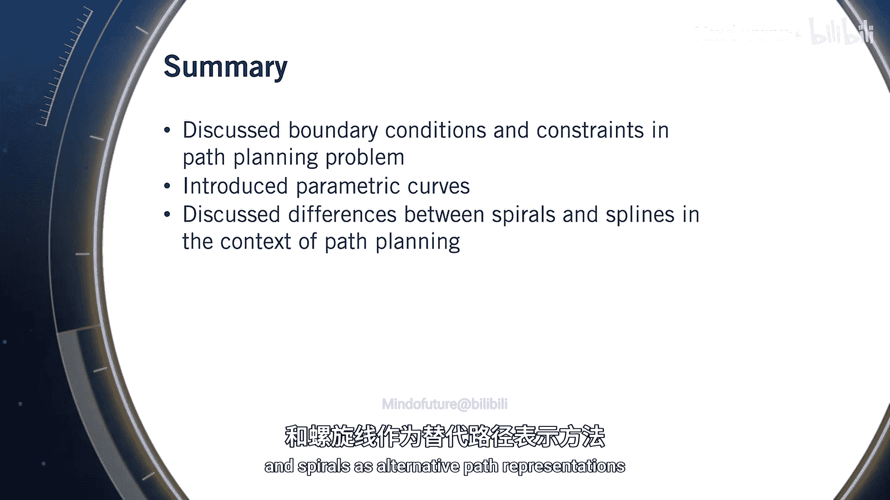

# 029：路径规划问题与参数曲线

在本节课中，我们将学习分层运动规划器的最底层——局部规划器。我们将介绍路径规划问题的基本要求、边界条件，并深入探讨用于表示路径的参数曲线，特别是样条曲线和螺旋曲线的区别与优劣。

## 概述

欢迎来到课程4的最后一个模块。本模块将讨论分层运动规划器的最底层，即局部规划器。局部规划器负责以无碰撞、高效且舒适的方式，执行行为规划器所请求的机动动作。其输出结果可以是一条轨迹（在给定时间点的一系列空间位置），也可以是一条路径及其速度剖面（一系列空间点及其对应的所需速度）。这个计划随后可以作为参考输入，传递给在第一门课程中开发的控制器。

本模块将基于我们在模块4中介绍的响应式规划器进行构建，使其能够处理自动驾驶运动规划问题中的一些细微差别。具体来说，我们将从离散时间转向连续时间，以生成平滑、参数化的路径，便于控制器进行跟踪。

## 路径规划问题与边界条件

理解路径规划问题的第一步是理解其最基本的要求。对于路径规划问题，给定起始位置、航向和曲率，需要找到一条满足车辆运动学约束、到达目标位置、航向和曲率的路径。

在优化问题的背景下，起始值和结束值可以表述为问题的边界条件，而车辆的运动学则表述为优化变量的连续时间约束。边界条件是指，对于任何可行的优化解，路径两端点必须满足的条件。如果违反了这些边界条件，无论路径本身多么优秀，我们都没有实现到达目标点的核心目标，因此该路径对我们无用。

## 参数曲线简介

为了简化优化问题的表示，我们将路径定义为一条参数曲线。什么是参数曲线？参数曲线是一组可以用特定参数描述的方程。这些参数通常表示路径的遍历过程，无论是通过弧长还是简单地从0变化到1。

例如，这里有一个用于描述路径X和Y位置的三次参数方程集合。方程的参数u从0变化到1，对应我们从路径起点到终点的行进过程。向量值函数R包含了对应于给定u值的每个点的x和y位置。

对于自动驾驶，我们通常（但不总是）要求路径是参数曲线。为什么？我们通常关注根据边界条件、运动学约束和目标函数来优化给定路径的规划方法。拥有路径的参数化表示使得建立优化问题更简单，因为我们有一个可以直接提供给目标函数F的函数。

## 两种常见的路径参数化方法

在自动驾驶领域，有两种常见的路径参数化类型。

### 五次样条曲线

第一种是五次样条曲线，它是车辆X和Y位置的五阶多项式函数。五次样条由两个方程给出，一个用于描述x沿样条的进展，一个用于y。它共有12个参数，6个用于x方程，6个用于y方程。这些参数对应于构成曲线形状的多项式系数。

五次样条的一个优点是，对于给定的位置、航向和曲率边界条件，存在一个满足这些条件的样条系数的封闭形式解。这非常理想，因为它允许我们立即生成满足边界条件的可行解，然后可以进一步优化。然而，五次样条的缺点是通常难以将曲率约束在特定范围内，而这在自动驾驶中经常是必需的。其曲率作为弧长的函数通常不是多项式，这可能导致样条中出现曲率的尖峰甚至不连续性，使得在整个样条域内近似满足曲率约束变得困难。

### 多项式螺旋线

作为替代方法，我们也可以使用多项式螺旋线来表示路径。这些曲线提供了沿其弧长每个点的曲率的封闭形式方程。对于自动驾驶，通常选择三次多项式作为弧长的曲率函数，当然高阶函数也是可以接受的。

使用多项式螺旋线的主要优点是，其结构非常有利于满足路径规划问题中经常要求的近似曲率约束。由于螺旋线是曲率的多项式函数，其曲率值不会像在五次样条中那样发生极端快速的变化。这意味着我们只需约束螺旋线上少数几个点的曲率，螺旋线就很可能在整个曲线上都满足曲率约束。这在执行路径优化时非常有用，因为约束数量会大大增加每次优化步骤的计算量。

多项式螺旋线的缺点在于，与五次样条不同，它没有位置和航向的封闭形式解。因此，我们必须执行迭代优化才能生成满足边界条件的螺旋线。位置方程会导致菲涅尔积分，而该积分没有封闭形式解，因此需要使用数值近似技术来计算螺旋线的最终端点。

## 样条与螺旋线的对比

在比较样条和螺旋线的优缺点时，我们几乎可以看到一种对偶性：一方的弱点正是另一方的强项。样条仅基于起点和终点就提供了封闭形式的解，而螺旋线则不能。螺旋线确保了沿路径的平滑曲率变化，而样条则不能。因此，您需要根据具体的应用场景来确定哪种方法更合适。简而言之，样条带来计算效率，而螺旋线则使曲率约束的实现更容易。

在本模块中，由于我们强烈关注确保局部规划器生成的路径能够被车辆平滑、安全地执行，因此我们将重点使用多项式螺旋线来开发我们的路径规划器。不过，后续描述的许多技术同样可以应用于五次样条。

## 总结

本节课我们概述了自动驾驶路径规划中使用的边界条件和参数曲线。我们介绍了样条曲线和螺旋曲线作为替代的路径表示方法，并讨论了它们在路径规划背景下的差异。

在下一课中，我们将讨论如何使用本节课介绍的三次螺旋参数化，以及本课程前面定义的约束和目标函数，来建立路径规划优化问题。