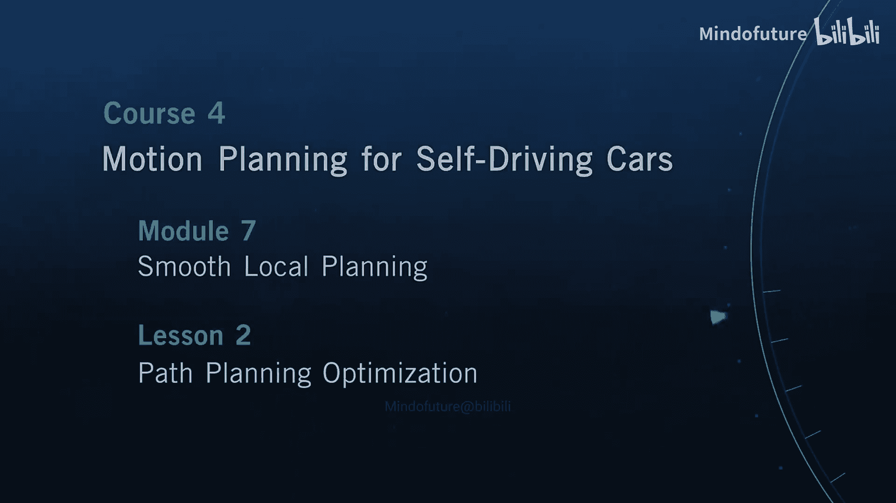
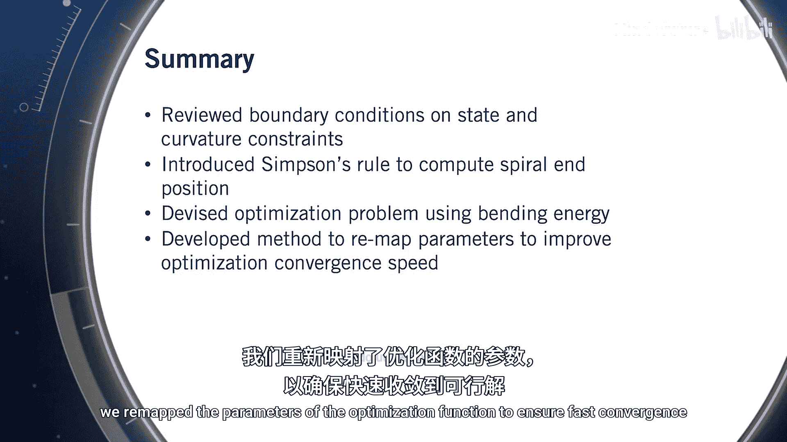
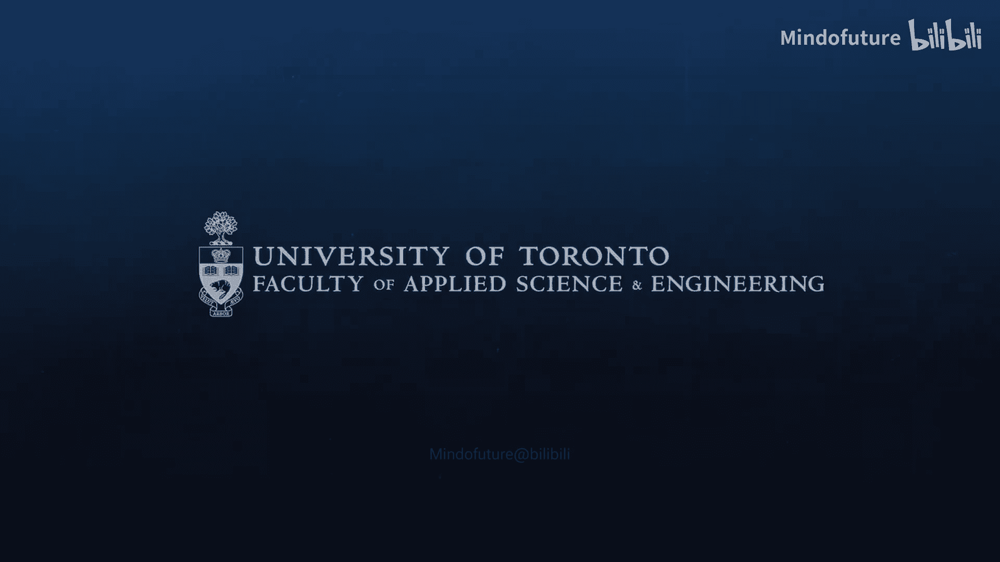

# 030：路径规划优化




在本节课中，我们将讨论如何将模块1中介绍的目标与约束，与上一课引入的三次螺旋线和边界条件相结合，从而构建一个路径规划优化问题。通过求解此问题，我们将能够生成满足所有约束的平滑、可行的路径。

在本视频结束时，你将能够：识别使用多项式螺旋线进行平滑路径规划所需的边界条件和约束；近似处理某些必需的约束以提高优化问题的可处理性；了解如何映射所需参数，以使优化问题能快速收敛到一个可行解。

## 边界条件与约束

上一节我们介绍了三次螺旋线的基本概念，本节中我们来看看如何为其添加约束。回顾上一课，边界条件描述了规划两点之间路径所需满足的最低要求。本质上，它们要求对于给定的起始位置、航向和曲率，规划的路径必须在特定的位置、航向和曲率结束。这为我们提供了优化问题的第一组约束，即边界条件。

然而，正如上一课所讨论的，三次螺旋线没有关于螺旋线末端位置的封闭形式解。为了用螺旋线参数来写出约束，我们需要使用数值积分技术。我们将应用辛普森法则。

## 应用辛普森法则

辛普森法则是一种常用的数值积分技术，通常比其他简单方法更精确。这是因为它评估的是给定函数二次插值的积分，而非某些方法（如中点法则和梯形法则）中的线性插值积分。

以下是辛普森法则的公式：

```
积分 ≈ (Δx/3) * [f(x0) + 4f(x1) + 2f(x2) + 4f(x3) + ... + 2f(x_{n-2}) + 4f(x_{n-1}) + f(x_n)]
```

其中，`n` 为偶数，`Δx = (b - a) / n`。

在我们的具体规划问题中，如果取 `n = 8`，该近似对于我们将要执行的优化来说足够精确，同时计算成本不会太高。

由于航向角 `θ` 是三次螺旋函数的积分，我们可以为其显式定义一个封闭形式的解，即一个四阶多项式。

然后，我们可以使用每个分割点处的 `θ` 值，通过辛普森法则近似计算三次螺旋线的 `x` 和 `y` 位置。`x` 和 `y` 的积分分别是 `cos(θ(s))` 和 `sin(θ(s))`，将其代入辛普森法则中的 `f`，形成以下表达式。

现在，我们有了一个有用的近似，可以通过弧长参数 `s` 定义的任何弧长点来计算螺旋线的 `x` 和 `y` 位置。我们将使用辛普森法则计算的 `x` 和 `y` 近似值记为 `x_s` 和 `y_s`。

回到边界条件，我们现在有了路径终点位置的近似值，并且可以用螺旋线的已知参数写出边界条件。

## 运动学约束

在定义目标函数之前，我们需要考虑运动学约束。对于自动驾驶路径规划，我们将重点关注曲率约束。汽车有绝对的最小转弯半径，并且需要保持在横向加速度限制内，以维持车轮牵引力和乘坐舒适性。

现在假设我们的汽车可以实现的最小转弯半径为 2 米，这对应于最大曲率 `κ_max = 0.5` 弧度/米。

在螺旋线上的每个点都写出这个曲率约束相当困难。然而，由于螺旋线的多项式性质，我们只需要约束曲线上几个均匀分布的点。因为曲率的多项式函数是连续且行为良好的，在执行优化时，我们很可能生成满足曲率要求的螺旋线。

为简化起见，让我们约束曲线在三分之一和三分之二弧长点处的曲率。起点和终点的曲率已在边界条件中约束。

完成这一步后，我们现在有了作为螺旋线参数函数的曲率约束。我们拥有了求解优化问题所需的所有约束。

## 目标函数：弯曲能量

拼图的最后一块是我们希望最小化的实际目标函数。我们希望鼓励规划路径的平滑性和舒适性，一种方法是将绝对曲率均匀分布在路径上。这可以通过最小化规划参数曲线的弯曲能量来实现。

曲线的弯曲能量是其曲率平方沿整个路径弧长的积分。由于我们有一个描述三次螺旋线的曲率多项式函数，弯曲能量积分在螺旋线参数方面有一个封闭形式的解。此外，其梯度也有封闭形式的解。

现在我们已经有了目标函数，可以将所有内容整合到我们的路径规划优化问题中。

## 优化问题的简化与重构

出于我们的目的，我们将假设初始边界条件为零。这意味着我们在车辆坐标系中定义局部规划问题，并导致本视频中定义的、使用辛普森法则的航向及 `x`、`y` 近似表达式得以简化。这意味着初始边界值约束可以被移除，因为它们已经包含在我们的积分计算中。

然而，这个优化问题的设置存在一个实际问题，可能导致在使用标准非线性规划求解器求解时速度变慢或根本不收敛。主要问题与最终位置和航向的等式约束有关。因为等式约束必须被精确满足，对于数值优化器来说，从一个不可行的起点（通常是任意问题实例给优化器的起点）生成可行解是相当困难的。

为了缓解这个问题，在优化中通常将等式约束软化以提高优化器性能。软约束将严格的约束转换为目标函数中惩罚严重的项。通过“严重惩罚”，我们的意思是约束惩罚项系数应至少比一般优化目标大一个数量级。

我们还将假设初始曲率已知且通常设为 0，这对应于 `a0 = 0`。这减少了一个优化变量。

软化这些约束后，我们的新优化问题如下。

我们需要解决的最后一个问题与优化参数有关。虽然使用三次螺旋系数在我们的目标函数中更有直观性，但考虑到最终的曲率边界约束，我们实际上可以减少搜索的参数数量。

让我们使用一组不同的参数（记为向量 `P`）来重新定义三次螺旋线，其中 `P` 有五个元素：`P0` 到 `P3` 表示起点、三分之一点、三分之二点和终点的曲率。最后一项 `P4` 是路径的最终弧长。

方便的是，我们在曲率参数和螺旋参数之间有一个封闭形式的映射。因此，我们可以轻松地将所有约束和目标项计算为这些新 `P` 变量的函数，而不是螺旋线的系数。优化解决后，我们可以使用这里的方程将结果映射回螺旋系数。

由于我们已经知道起点和终点的曲率，我们可以消除两个变量：`P0` 和 `P3`。这使我们的优化问题只剩下三个变量：`P1`、`P2` 和 `P4`。通过利用边界条件，我们减少了优化问题的维度，这将显著提高计算速度。

最终的优化问题如下。我们已经用映射到 `P` 参数后的等效函数替换了螺旋参数函数。请注意，初始和最终路径曲率 `P0` 和 `P3` 是常数，因此优化变量现在仅为 `P1`、`P2` 和 `P4`。由于路径起点和终点的曲率边界条件是已知的，这种简化才成为可能。

## 总结

本节课中我们一起学习了如何构建平滑路径规划的优化问题。



首先，我们回顾了此问题所需的边界条件和约束。然后，讨论了如何使用辛普森法则数值计算螺旋线的终点位置。接着，引入了弯曲能量目标以鼓励平滑性，并形成了一个通用的螺旋优化问题。最后，我们重新映射了优化函数的参数，以确保快速收敛到可行解。

虽然有很多新信息需要消化，但我们希望本节课让你深入了解如何执行平滑路径规划。本节课将我们在模块1和模块4中讨论的许多主题联系在一起。如果你觉得有些内容具有挑战性，可以在重新学习本课之前复习那些模块。在下一课中，我们将讨论如何在Python中执行优化，为你实现完整的路径规划器做准备。



