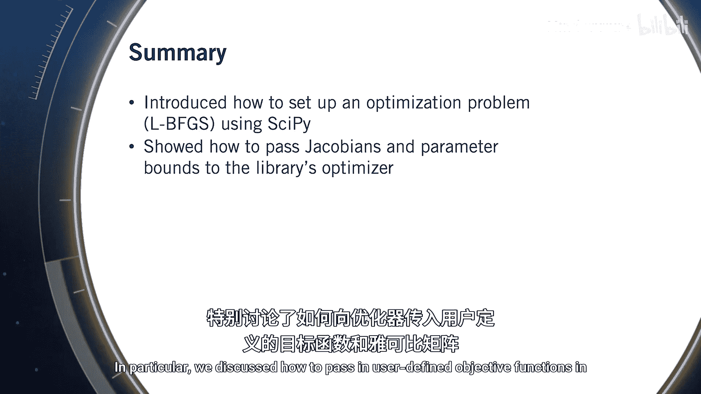

# 031：Python中的优化实现 🐍

在本节课中，我们将学习如何在Python中实现优化，以巩固本模块及整个专项课程中讨论过的优化概念。我们将重点介绍如何使用SciPy优化库来解决通用的非线性优化问题。

通过本视频的学习，你将掌握如何使用该库来设置和调用一个带约束的优化问题。具体来说，你将学会如何向优化器传递雅可比矩阵，以及如何定义优化问题中所需的参数边界。

## 优化库简介

上一节我们介绍了优化的基本概念，本节中我们来看看如何在Python中实现它们。优化是一个内容极其丰富的领域，我们无法在本专项课程中深入探讨所有细节。

SciPy优化库涵盖了一些最流行的优化算法，使其易于访问并保证了合理的实现效率。许多已实现的优化方法在所需参数类型上具有相似的结构。为了将其抽象成一个简单的接口，SciPy优化库包含了一个通用的`minimize`函数。

以下是该库中可用的一些优化方法示例：
*   共轭梯度法
*   内尔德-米德法
*   狗腿法
*   BFGS法

关于这些方法的更多细节，请参阅补充材料中的链接。库将运行的具体优化算法取决于你传递给此函数的`method`参数。`method`参数还将决定优化算法需要哪些额外参数。

## 设置优化问题

例如，在我们将要使用的L-BFGS-B算法中，我们不仅需要最小化的模型，还需要模型的雅可比矩阵和变量边界。当模型是单标量值函数时，雅可比矩阵简化为梯度。这个雅可比矩阵通过`jac`参数传递给`minimize`函数，如函数调用所示。

我们希望最小化的实际函数是`minimize`函数的第一个参数。约束通过`constraints`变量作为约束字典或对象的列表传入。此外，还有一个可选的`options`参数，高级用户可以用它来自定义优化器的输出内容。这些优化算法还需要为模型或目标函数的优化变量提供一个初始猜测值，这在函数调用中由`x0`给出。

## 具体示例：BFGS算法

让我们以BFGS算法为例，具体说明如何使用SciPy实现优化。本质上，对于BFGS算法，我们需要传入我们希望最小化的实际目标函数的函数指针，以及一个评估目标函数雅可比矩阵的函数的函数指针。这些函数将接收所有优化变量的向量，以便在特定点评估目标函数和雅可比矩阵。

优化完成后，`minimize`函数将返回一个`result`变量。结果中名为`x`的成员变量将返回达到局部最小值时的最终优化变量向量。

## 定义约束

正如我们之前提到的，我们也可以为大多数算法的优化问题指定约束。这些约束以列表或字典的形式给出。最简单的约束类型是目标变量的不等式约束，称为边界。

边界在L-BFGS-B算法中指定为一个列表的列表，其中每个子列表长度为2，包含每个优化变量的上下界。换句话说，第一个子列表对应x0的边界，第二个子列表对应x1的边界，依此类推。然后，这些边界被传递给`minimize`函数的`constraints`可选参数。

线性和非线性约束也可以传递给优化器，但目前我们将重点放在使用边界作为优化约束。更多细节，你可以查看在线的SciPy优化文档。

你还可以通过传入一个Python列表来组合多种类型的约束，列表中包含你希望在优化器函数中使用的每个约束对象。

## 总结

本节课中我们一起学习了如何使用SciPy优化库来设置优化问题。具体来说，我们讨论了如何将用户定义的目标函数、雅可比矩阵以及参数边界传递给优化器。你现在应该对如何使用这个Python库解决一般优化问题有了很好的了解。更多信息，你可以查阅SciPy优化库的文档。

在本节课之后，我们有一个编程作业，让你有机会练习我们在这里讨论的概念，并为模块结束项目做好准备。