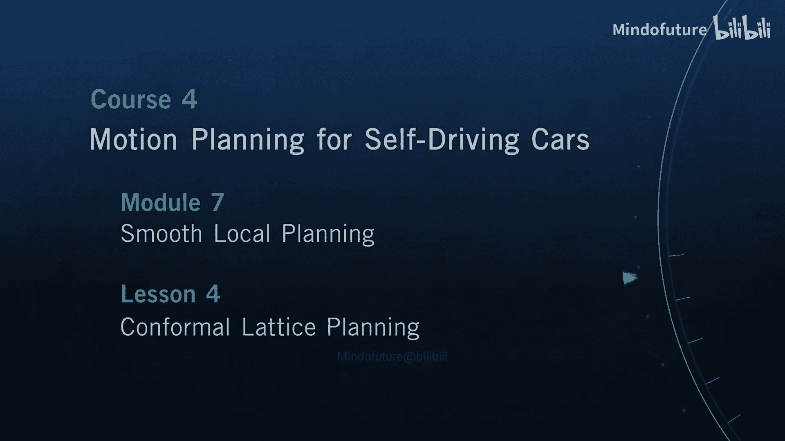
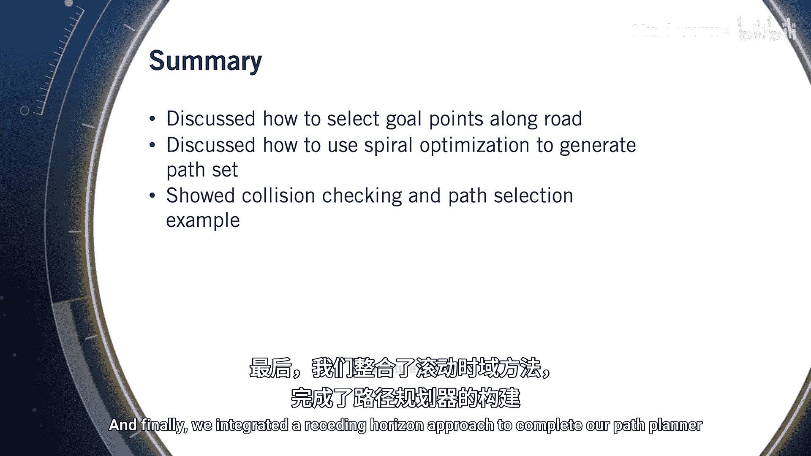

# 032：共形格点规划

在本节课中，我们将运用前几课开发的优化技术，推导一个完整的路径规划器——共形格点规划器。学完本视频后，你将能够实现一个共形格点规划器来解决路径规划问题。你将理解如何沿道路采样点，以及如何使用第二课开发的优化公式为每个点规划路径。你还将能够判断路径是否无碰撞，并选择最能跟踪所需道路的最佳路径。

## 概述与目标

上一节我们介绍了路径规划的基本概念，本节中我们来看看共形格点规划器的核心思想。

与所有路径规划器一样，其目标是从自动驾驶汽车的当前位置规划一条可行且无碰撞的路径到达给定的目标状态。共形格点规划器利用道路的结构化特性来加速规划过程，同时避开障碍物。它专注于那些在目标路径左右轻微转向的平滑路径选项，因此生成的规划结果非常接近人类驾驶行为。

在道路上规划路径时，除非遇到紧急停车情况，汽车通常不应考虑离开道路。因此，共形格点规划器选择一个中心目标状态，以及一系列替代目标状态，这些替代状态是通过相对于道路航向从中心目标状态横向偏移形成的。

下图展示了一个共形格点的例子，其中每条路径的终点都从中心路径横向偏移，而中心路径对应于道路上的一个目标点（以金色高亮显示）。

我们可以这样做，是因为通常汽车应该沿着车道向前行驶。我们不关心那些不会导致前进的路径，因此可以大大减少搜索空间，使共形格点规划器在计算上易于处理。

## 目标状态选择

那么，我们如何选择这个目标状态呢？一般来说，为路径规划选择目标状态时存在一个关键的权衡。

如果你选择一个靠近当前车辆位置的目标状态，可以减少找到通往目标点路径所需的计算时间。然而，这也会降低规划器以平滑舒适的方式避开路径前方更远处障碍物的能力。这在高速行驶时可能成为问题，因为汽车在规划周期之间会覆盖更长的距离。

通常，我们规划中使用的目标范围是基于汽车速度和天气条件等因素动态计算的。然而，为了本模块的简洁性，我们将使用一个固定的目标范围。我们将目标点取为沿车道中心线、位于我们前方一个目标范围距离的点。

下图展示了这一点，金色点对应选定的目标位置，蓝色点对应横向偏移的目标点，它们将用作格点中每条螺旋线的替代终点约束。车道中心线的黑色部分弧长等于我们选定的目标范围。

在每个规划步骤中，我们将基于相同的范围重新计算目标点，并沿着车道向前推进。

## 路径生成与采样

一旦找到这些目标状态，我们就可以计算到达每个目标所需的螺旋线。此时，我们暂不关心路径是否无碰撞，只希望得到到达每个目标状态的、运动学上可行的路径。

因此，我们可以使用第二课开发的优化公式来求解从当前位置到每个终点位置的三次螺旋线。如果任何螺旋线在运动学上不可行或无法到达所需的目标状态，我们就丢弃这些螺旋线，不再将它们视为潜在路径。

请注意，一旦优化问题得到解决，我们只有结果参数向量 **P**。然后，我们必须撤销最初对螺旋系数执行的变换，以便从 **P** 向量中检索它们。

获得螺旋系数后，我们可以沿着螺旋线采样点，以获得整个路径的离散表示。由于我们没有沿螺旋线位置的封闭形式解，我们再次需要进行数值积分。然而，由于这次我们需要在整个螺旋线上的多个点处评估积分，因此需要一种更有效的方法来解决这些积分。

这里我们应用线性插值方法——梯形法则。梯形法则在此上下文中比辛普森法则高效得多，因为曲线上的每个后续点都可以从前一个点构造出来，所以我们只需要对螺旋线进行一次扫描即可获得所有需要的点。而辛普森法则则需要为每个点求解积分近似，效率要低得多。在Python中，我们可以使用累积梯形函数来实现这一点。

应用梯形法则后，我们现在有了每个目标点对应螺旋线的离散表示。重要的是，我们要跟踪每个点的曲率以及位置和航向，因为这将有助于我们后续的速度剖面规划。曲率和航向有封闭形式的解，因此不需要数值积分。

应用梯形法则后，我们现在得到了为每个目标状态生成的一组路径，如下图所示。

## 碰撞检测

现在我们有了完整的路径集，需要看看哪些是无碰撞的。为此，我们可以使用模块4中讨论的任何一种碰撞检测技术。最通用的方法是使用二进制占据栅格，如果单元格被占据则值为1，否则为0。

然后，我们可以获取汽车在占据栅格单元格中的足迹，并将该足迹扫过螺旋线上的每个点，以生成路径的覆盖区域。如果覆盖区域中某个单元格的占据栅格包含障碍物，则该路径将与障碍物发生碰撞，应标记为有碰撞。如果沿着整个路径的覆盖区域中的所有单元格从未发生这种情况，则该路径被视为无碰撞。

或者，如果自车和车道中的每个障碍物都可以用圆形近似包围，我们可以使用圆形检查。然后，我们将自车的圆形放置在路径上的每个点，并检查与落在自车车道内的每个障碍物的碰撞。

为了说明碰撞检查的结果，我们在路径中添加了一辆停放的车辆，现在我们需要规划绕行。在将覆盖区域扫过每条螺旋线后（类似于我们在模块4中的做法），我们将无碰撞路径标记为绿色，将与障碍物碰撞的路径标记为红色。

## 路径选择

此时，我们有一组可行且无碰撞的路径，但需要一种方法来选择最佳路径进行跟踪。选择过程在很大程度上是一个设计选择，因为对于给定的规划应用，可能有多个有用的标准。

例如，我们可能希望选择尽可能远离障碍物的路径，因此我们可能会为过于接近占据栅格中障碍物的路径添加惩罚项。我们可能还希望惩罚偏离最近车道中心线太远的项，因为我们不想在执行变道时长时间跨线行驶。

目前，我们将使用一个简单的度量标准，即偏向规划器从路径集中选择尽可能接近中心目标状态的路径。只要惩罚随着你远离中心目标而增加，具体的惩罚函数并不重要。

通过偏向中心路径，我们鼓励规划器遵循参考路径，只有当参考路径不可行或与障碍物碰撞时才允许其偏离参考路径。为简单起见，我们可以将此函数取为从中心目标状态到我们正在检查的路径的目标状态的位移。

然后，我们可以遍历路径集中的每条路径，找到最小化此惩罚的路径，并选择它作为最终路径发布。在我们的示例中，选定的路径以蓝色高亮显示。

如果现在随着汽车沿路径移动，我们从多个时间步重复此过程，我们的规划器就能够规划出一条在避开障碍物的同时收敛到目标状态的路径。类似于我们在模块4中开发的反应式规划器，该规划器以后退视野的方式朝着车道尽头的目标前进。

## 总结

本节课中我们一起学习了构建一个完整路径规划器的关键步骤。

在本视频中，我们首先定义了共形状态格点规划器方法，该方法选择沿道路在我们前方某个目标点横向偏移的点。然后，我们使用第二课开发的螺旋优化方法为每个点规划路径。接下来，我们讨论了如何修剪这组路径使其无碰撞，以及如何选择剩余的最佳路径。最后，我们集成了后退视野方法来完成我们的路径规划器。

现在你已经对整个路径规划算法有了概览，希望你能够看到本课程的许多内容如何最终形成了一种有效解决路径规划问题的方法。在下一个视频中，我们将讨论如何获取由路径规划器计算出的输入路径，并为汽车沿该路径移动时生成要遵循的速度剖面。然后，我们将拥有一套完整的参考信号传递给控制器执行，从而完成分层运动规划过程的所有三个阶段。

