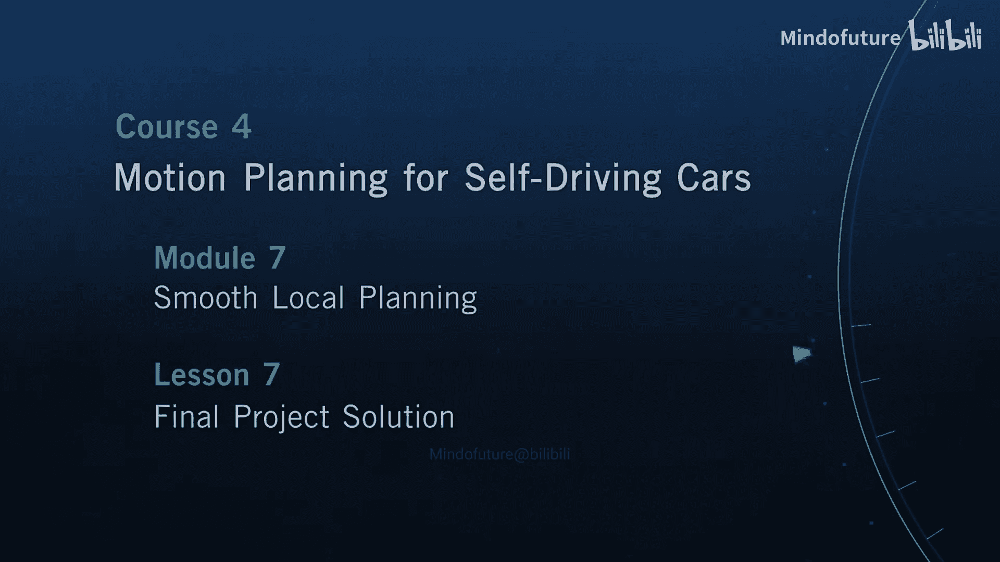
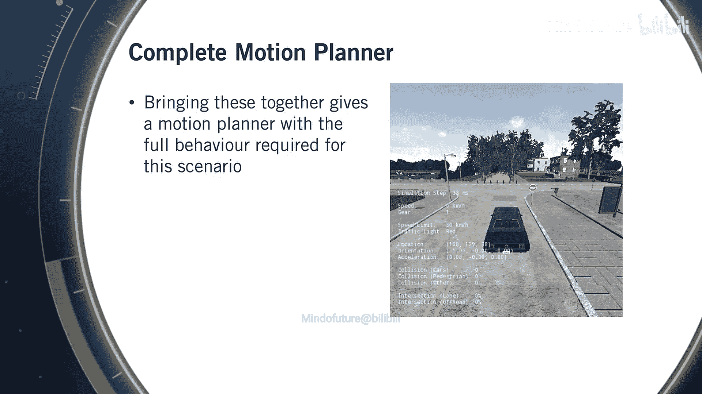
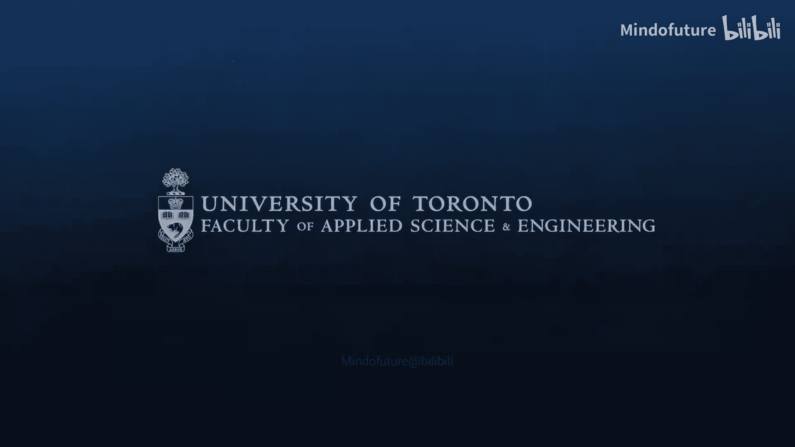

# 035：最终项目解决方案详解 🚗

在本节课中，我们将详细解析课程4最终项目的解决方案。该项目综合了本课程及专项课程中涵盖的多个核心概念。我们将回顾完成项目所需的四个主要任务，并逐一解释其实现方法。

## 概述

最终项目要求实现一个功能完整的运动规划器，以应对Carla模拟器中的三阶段场景。解决方案主要围绕四个核心步骤展开：路径生成、路径碰撞检查、速度曲线生成以及行为规划。接下来，我们将深入探讨每个步骤。

## 路径生成 🛣️

上一节我们概述了项目目标，本节中我们来看看第一个任务：路径生成。本项目已提供优化螺旋线至目标点所需的全部代码。因此，您需要完成的主要工作是从给定的航点序列中提取目标点。

以下是实现步骤：

1.  **迭代航点**：遍历所有航点，找到距离自车最近的航点。
2.  **选择前瞻点**：从最近航点开始，继续向前遍历，直至找到一个距离自车至少为“前瞻距离”的航点。这个距离代表了我们在每个规划周期内为车辆规划的前方距离。
3.  **生成目标状态集**：选定目标航点后，沿该航点道路航向的垂直方向（旋转90度）进行横向偏移，生成一组目标点。这为车辆提供了多个可选路径，以便规避障碍物。横向偏移确保了规划的路径集符合道路结构。
4.  **坐标变换**：将这些目标点从全局坐标系转换到自车坐标系。在自车坐标系中，自车位于原点且航向角为零。
5.  **路径优化**：将转换后的目标点传递给螺旋优化器，计算得到可用于后续规划步骤的路径。

完成路径生成后，我们得到了一组候选路径。

## 路径碰撞检查与选择 🚧

现在，我们需要从路径集中计算并选择一条最佳、可行且无碰撞的路径供自车跟随。

我们采用在模块4中介绍的基于圆形的方法进行碰撞检查。

具体实现如下：

1.  **覆盖圆形**：沿着路径上的每个点，在车辆位置上方覆盖圆形。这生成了一组圆形，保守地近似了自车行驶的扫掠区域。
2.  **碰撞检测**：检查每个障碍物点是否位于路径上任何圆形内部。
3.  **标记碰撞路径**：如果有任何障碍物点落入圆形内，则将该路径标记为存在碰撞。
4.  **筛选路径**：对每条路径重复此过程，将所有与障碍物发生碰撞的路径从后续考虑中移除。

碰撞检查完成后，我们从无碰撞的路径中，选择终点最接近车道中心线的那条作为最佳路径。这样选择是为了让我们能够沿着车道中心线跟踪全局航点，即使因为路径上的障碍物而需要暂时偏离路线。需要注意的是，这种选择可能导致车辆尽可能贴近障碍物行驶，因此我们必须确保碰撞检查是保守的，并留有一定的缓冲空间。

## 速度曲线生成 ⚡

选定合适的路径后，我们需要为其生成速度曲线。根据要执行的行为，我们会获得一个参考速度。

速度规划逻辑如下：

*   如果正在减速停车或保持停止状态，目标速度应为 `0`。
*   否则，目标速度应为道路限速。
*   然而，我们必须考虑前方车辆。如果前车速度比我们慢，我们可能会撞上它。为了处理这种情况，我们将目标速度设置为 **`min(参考速度， 前车速度)`**。
*   我们还需要确保在到达前车原始位置时，速度已降至前车速度，否则仍有碰撞风险。

基于以上信息，我们现在可以沿着路径构建一个从当前速度到目标速度的斜坡轨迹。

*   如果存在前车，斜坡曲线的终点将是 **`前车位置 - 时间间隔缓冲`**。
*   否则，斜坡曲线的终点将是路径的终点。

## 行为规划 🚦

本项目中将面临的唯一交通管制元素是停车标志，因此这将是行为规划器的重点。

我们的行为规划器将包含三个状态：

1.  **正常车道跟随状态**
2.  **减速至停止状态**
3.  **保持停止状态**

以下是状态机的运作流程：

*   在正常驾驶过程中，车辆保持在 **车道跟随状态**。
*   一旦规划路径的终点穿过停车标志的停止线，我们就从正常驾驶切换到 **减速至停止状态**，目标是在该停止线定义的停止点停车。为此，必须确保规划的路径长度能提供足够的时间进行舒适减速。
*   车辆完全停止后，转换到 **保持停止状态**，确保车辆在停车标志处完全停止一段固定时间（本项目为2秒）。
*   时间结束后，转换回 **车道跟随状态**，继续进行正常驾驶。

这样就完成了状态机的转换循环，使我们能够处理路径上的停车标志。

## 总结

本节课中，我们一起学习了最终项目解决方案的四个核心组成部分：路径生成、碰撞检查与路径选择、速度曲线生成以及行为规划状态机。完成所有这些步骤后，我们就得到了一个功能完整的运动规划器，能够处理本项目提出的场景。

如果您在项目的任何部分遇到困难，可以尝试按照本视频讨论的方法重新实现该部分，以查看是否能提升其性能。当然，课程中对本项目的许多方面都定义了多种方法，您选择使用哪种方法并无限制。如果您找到了其他非常有效的方法，欢迎在论坛中与我们分享。

现在您已经完成了课程项目，应该对课程4中涵盖的运动规划概念有了扎实的理解。在最后两个视频中，我们将结束本课程以及整个专项课程。感谢您的辛勤付出，祝您在未来的所有自动驾驶项目中一切顺利！