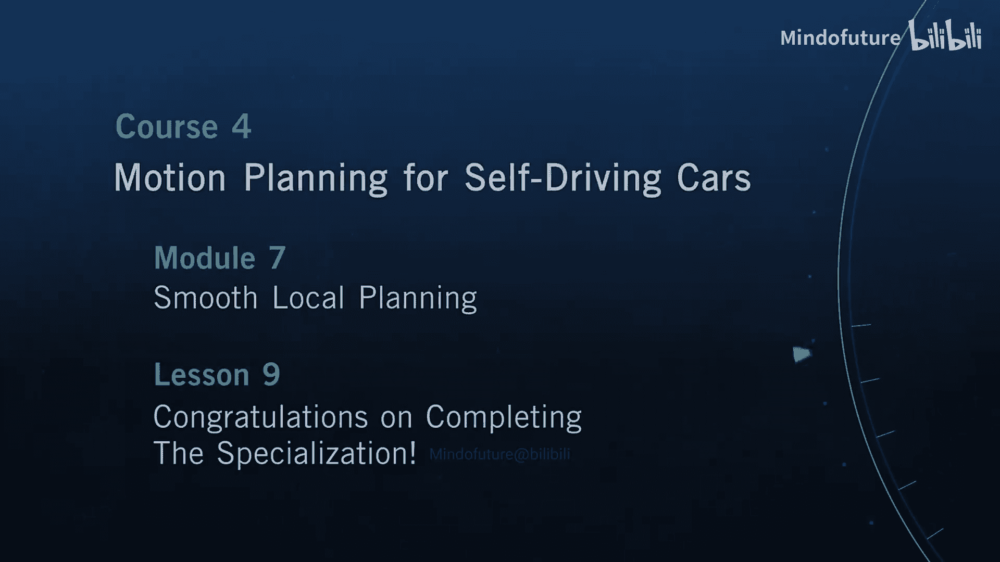
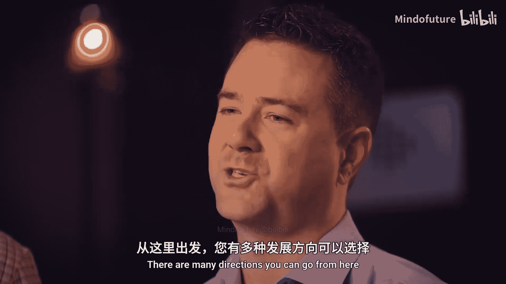
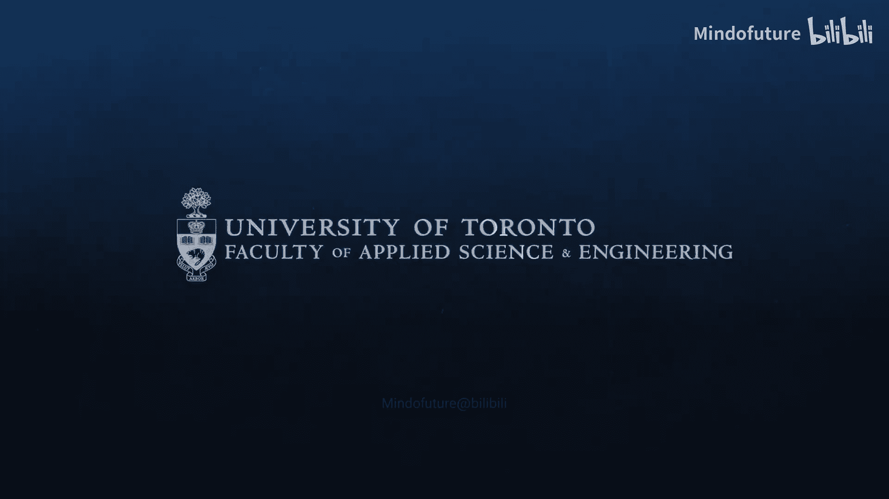

# 037：课程总结与未来展望 🚗

在本节课中，我们将对多伦多大学自动驾驶汽车专项课程进行总结，回顾所学内容，并探讨未来的学习方向与职业机会。

---

大家好。Stephen和我本人想亲自花时间感谢大家为完成这个专项课程所付出的所有努力，并祝贺大家出色地完成了任务。

你们已经完成了多伦多大学的自动驾驶汽车专项课程。

你们应该已经为进入自动驾驶汽车领域的职业生涯做好了准备。

无论是在学术界还是工业界，都有大量的机会可以继续在这一领域发展和贡献力量。

我们需要像你们这样的人来帮助我们共同构建自动驾驶汽车的未来。

---

## 课程内容回顾 📚

在这个专项课程中，我们涵盖了大量内容。

从基础的车辆控制，到状态估计，再到感知，最后到路径规划。

这些部分中的每一个对于整个自动驾驶汽车软件栈都至关重要。

现在，你们已经将这些动态的部分整合起来，创建了一个功能完整的自动驾驶系统。

---

## 补充学习资源 💡

在你们离开之前，我们想提醒大家几个额外的项目，这些可能是在学习主要课程内容时没有时间仔细查看的。

以下是课程中包含的补充资源：

*   **专家访谈**：我们收录了多位来自工业界和学术界的同事的精彩访谈，为你们正在学习的许多方面提供了额外的视角。我们采访了安全保证专家 Kristof Shanetsky、Oxbotica 联合创始人兼首席执行官兼牛津大学教授 Paul Newman，以及在湾区领先公司积极参与自动驾驶领域的三位工程师 Diana Burges、Winston Liu 和 Andy Wong。
*   **延伸阅读材料**：我们在整个专项课程中包含了延伸阅读的链接。这些材料经过精心挑选，旨在帮助你们在深入研究课程涵盖的任何主题时，能轻松找到一个好的起点。

我们希望你们能花时间查看这些优秀的资源，并在论坛中进行讨论。

---

## 职业前景与未来方向 🛣️

你们所学习的内容应该已经为你们进入自动驾驶汽车行业的职业生涯铺平了道路。

这个行业正在蓬勃发展，对具备你们所掌握技能的工程师和开发人员有着巨大的需求。

从这里出发，你们可以朝许多方向发展。以下是几个可能的方向：

*   **性能优化**：你们可以选择进一步探索如何调整和改进自动驾驶汽车软件以获得更好的性能。
*   **高级功能开发**：或者，例如，使车辆能够执行更具挑战性的机动动作。
*   **深入理论研究**：你们也可以选择更详细地研究课程中描述的某项技术背后的数学原理，以更好地掌握所涉及的原则。

可能性与机遇是无穷无尽的。最终，选择哪条道路取决于你们自己。

但你们现在已经掌握了基础知识，可以为一个将对世界产生巨大影响的领域做出贡献。

你们可以帮助塑造自动驾驶汽车将为我们社会带来的积极变化，并从根本上改变我们的互动方式。

---

## 结语与祝福 🌟

带领大家走过我们讨论过的关于如何构建自动驾驶汽车的所有不同主题的旅程，对我们来说绝对是一段激动人心的经历。

我们希望你们和我们一样享受这个过程。

这对 Stephen 和我自己来说都是一次巨大的学习经历。

我们很期待看到你们从课程中学到了什么，以及你们未来将如何运用所学的知识。

路上见。