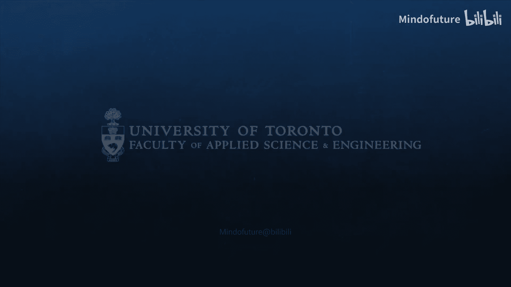
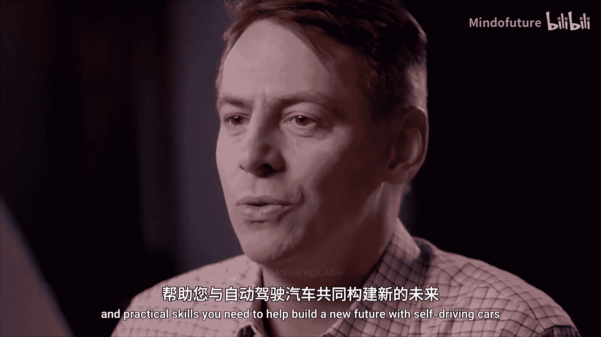
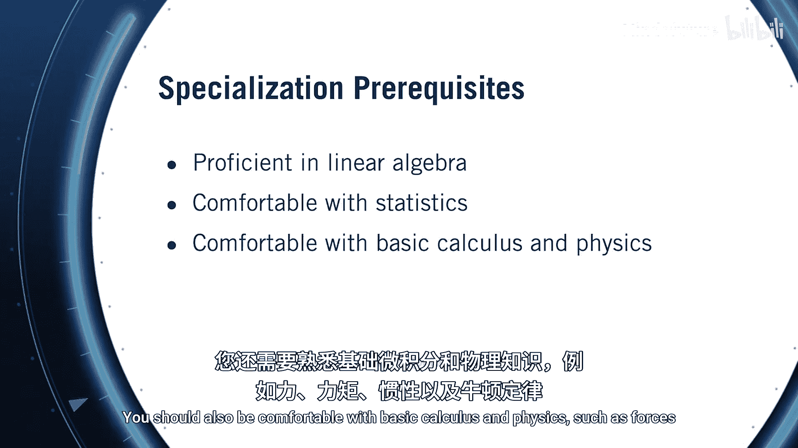
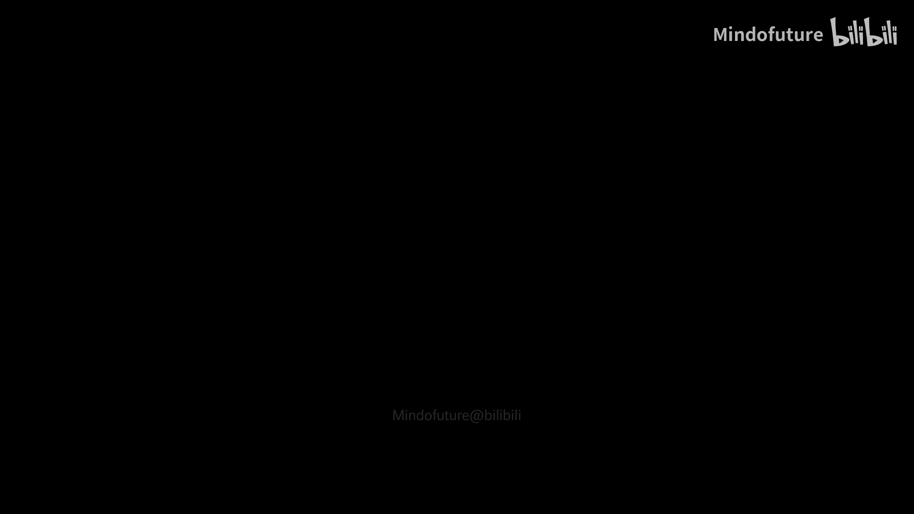

# 001：欢迎来到自动驾驶汽车专项课程

在本节课中，我们将介绍多伦多大学自动驾驶汽车专项课程的概览、课程结构以及学习本课程所需的基础知识。

大家好，欢迎来到多伦多大学的自动驾驶汽车专项课程。我是Steven。我是Jonathan，我们将作为您在整个专项课程中的讲师。自动驾驶汽车是沉睡的巨人，它有能力改变一切：道路安全、每个人的出行便利性，同时大幅降低驾驶成本。本专项课程将教授您在自动驾驶行业开启职业生涯所需的知识。

无论您来自学术界还是工业界，这些课程都将为您提供基础知识和实践技能，帮助您与自动驾驶汽车共同构建新的未来。在整个课程中，我们将向您展示来自我们研究以及我们自己的自动驾驶汽车（我们称之为“Autonoose”）的真实世界数据和场景。

经过数十年的应用研究和获奖研究，我们多伦多大学很高兴向您展示自动驾驶的细节。本专项课程共有四门课程。

## 课程一：自动驾驶汽车简介

在第一节课程中，我将向您介绍自动驾驶汽车的软件和硬件架构。到本课程结束时，您将能够为自动驾驶汽车设计一个基本的硬件系统，识别自动驾驶软件栈的主要组件，并为自动驾驶汽车项目创建安全评估策略。

接下来，您将学习开发完整的车辆运动模型，为纵向控制定义**PI控制器**，为横向车辆控制定义路径跟踪控制器，并在CARLA模拟器中测试您的控制设计。

## 课程二：状态估计与定位

上一节我们介绍了自动驾驶汽车的基础，本节中我们来看看状态估计与定位。在专项课程的第二门课程中，我将教授您关于自动驾驶汽车的状态估计、传感和定位知识。到本课程结束时，您将理解参数和状态估计的关键方法，开发和使用典型车辆定位传感器的模型，将扩展卡尔曼滤波器和无迹卡尔曼滤波器应用于车辆状态估计问题，并将LiDAR扫描创建的点云注册到静态环境的3D地图中。

## 课程三：视觉感知

在第三门课程中，我将教授您自动驾驶汽车的视觉感知。完成本课程后，您将能够将3D点投影到相机图像平面上，校准针孔相机模型，应用特征检测、描述和匹配算法进行定位与建图，开发和训练用于目标检测和语义分割的神经网络。您将把这些方法应用于车辆跟踪和可行驶路面估计。

## 课程四：运动规划

在第四门也是最后一门课程中，我将教授您自动驾驶汽车的运动规划。到本课程结束时，您将能够设计轨迹展开运动规划方法，计算与静态和匀速运动物体的碰撞时间，在复杂的道路网络上规划路线，为车辆定义高级行为和在通过交叉口、绕过停放车辆以及并线时的状态转换，在存在静态障碍物的环境中开发运动学上可行的路径，计算满足速度、曲率和移动物体运动规划约束的速度曲线，规划行为并执行操作以安全地通过世界，并在CARLA模拟器中获得调试和测试自动驾驶算法的宝贵经验。

## 学习前提

因此，到专项课程结束时，您将对自动驾驶软件栈的架构和组件有详细的了解，并将能够编程您自己的自动驾驶汽车。由于我们教授的是如何编程您自己的自动驾驶汽车，本专项课程有几项先决条件。

以下是您需要掌握的基础知识：

*   **线性代数**：您应精通线性代数，熟悉矩阵、向量、矩阵乘法、秩、特征向量和逆矩阵。这些背景知识将帮助您理解整个课程中的控制、状态估计、感知和规划算法。
*   **统计学**：您还应熟悉统计学，特别是高斯概率分布。这些知识对于状态估计和感知非常重要，例如当我们从GPS和惯性测量中估计车辆速度和航向时。
*   **微积分与物理**：您应熟悉基础微积分和物理学，例如力、力矩、惯性和牛顿定律。

当然，了解如何驾驶汽车是有帮助的，但由于汽车是自动驾驶的，这并不是本专项课程的硬性要求。如果您不具备这些必要的先决条件，Coursera上有优秀的机器人学、人工智能、深度学习和其他课程，可以帮助您为本专项课程做好准备。

## 总结与展望

自动驾驶是一个不断发展和变化的领域，因此不仅要跟上自动驾驶知识，还要跟上机器人学、人工智能和深度学习的发展，这将有助于您保持技术技能的敏锐。我们还有很长的路要走，我们需要先驱者来帮助我们到达那里。

那么，您准备好开始这段旅程了吗？

🎼是的。

本节课中我们一起学习了多伦多大学自动驾驶汽车专项课程的整体框架，包括四门核心课程（简介、状态估计与定位、视觉感知、运动规划）的主要内容与学习目标，并明确了成功学习本课程所需的数学与物理基础。