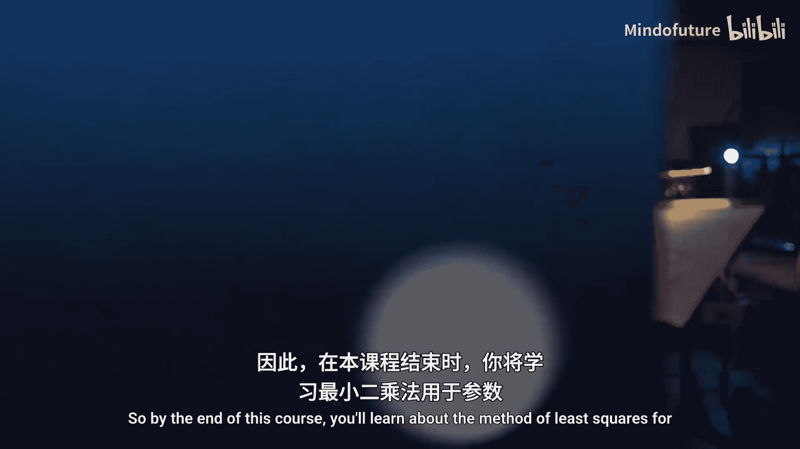
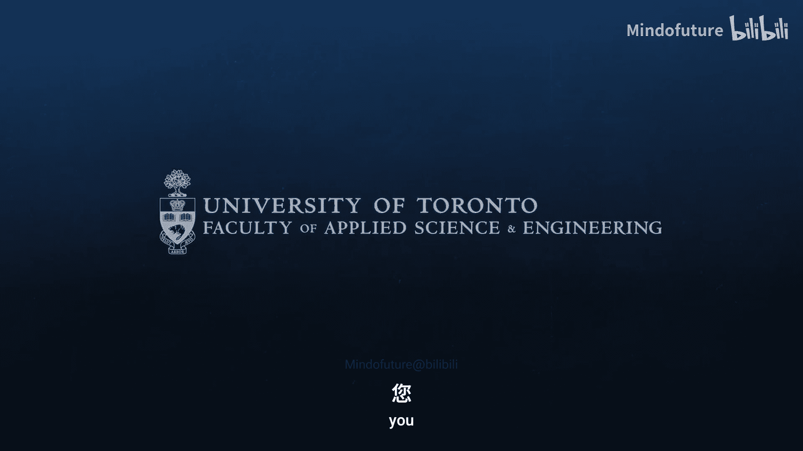

# 002：课程介绍与概述 🚗

在本节课中，我们将学习多伦多大学自动驾驶汽车专项课程的第二门课程。这门课程将聚焦于自动驾驶汽车的状态估计与定位问题，这是实现安全、可靠自动驾驶的核心技术之一。

欢迎来到多伦多大学自动驾驶汽车专项课程的第二门课程。

我是Jonathan，我将担任本课程的讲师。

如果你是第一次加入我们，我建议你先学习专项课程的第一门课程，以便熟悉自动驾驶汽车的硬件和软件架构，以及车辆模型与控制的基础知识。

如果你已经完成了第一门课程的学习，那么你已经熟悉了自动驾驶架构、车辆动力学建模、纵向与横向控制。

你也学习了自动驾驶汽车的安全保障知识，并使用CARLA模拟器设计了纵向和横向控制器。

在本课程中，我们将深入探讨自动驾驶问题的另一面，学习不同类型的传感器，以及如何利用它们进行自动驾驶汽车的状态估计与定位。

状态估计是根据通常带有噪声的测量值，确定某个物理量最佳值的过程。

我们说测量值带有噪声，是因为传感器并非完美无缺。

如果你反复测量同一个量，每次得到的结果都不会完全相同。

例如，如果你将温度计插入一杯40摄氏度的茶中，温度计第一次可能显示39.8度，第二次显示40.1度，依此类推。

状态估计为我们提供了一种方法，可以综合所有这些带有噪声的温度测量值，来估计茶的真实温度。

因此，状态估计对于任何带有传感器的设备都至关重要，自动驾驶汽车也不例外。

对于自动驾驶而言，最重要的一类状态估计就是定位，即确定汽车在世界中的位置及其运动状态的过程。

定位极其重要，因为即使你拥有世界上最好的控制器设计，如果不知道汽车的状态，你也无法使用它。

因此，在本课程结束时，你将学到以下内容：

以下是本课程的核心学习目标：
*   用于参数和状态估计的**最小二乘法**。
*   将**线性卡尔曼滤波器**及其非线性变体——**扩展卡尔曼滤波器**和**无迹卡尔曼滤波器**应用于状态估计问题。
*   为典型的定位传感器（如GPS、惯性传感器和激光雷达单元）开发模型。
*   学习**激光雷达扫描匹配**和**迭代最近点算法**。
*   最终，利用这些工具将多个传感器数据流融合成一个用于自动驾驶汽车的单一状态估计。

作为本课程的最终项目，你将应用所学知识，在CARLA模拟器中为自动驾驶汽车开发一个完整的车辆状态估计器。

你将开发的估计器与当今自动驾驶汽车中使用的非常相似，这将是一个非常有效的方式，帮助你建立对这些系统在实践中如何工作的直觉和理解。

你准备好了吗？让我们开始吧。

本节课中，我们一起学习了本课程的核心目标与内容框架。我们了解到状态估计是处理传感器噪声、获取准确信息的关键，而定位是自动驾驶汽车实现精确控制的基础。在接下来的课程中，我们将逐一深入这些激动人心的主题。