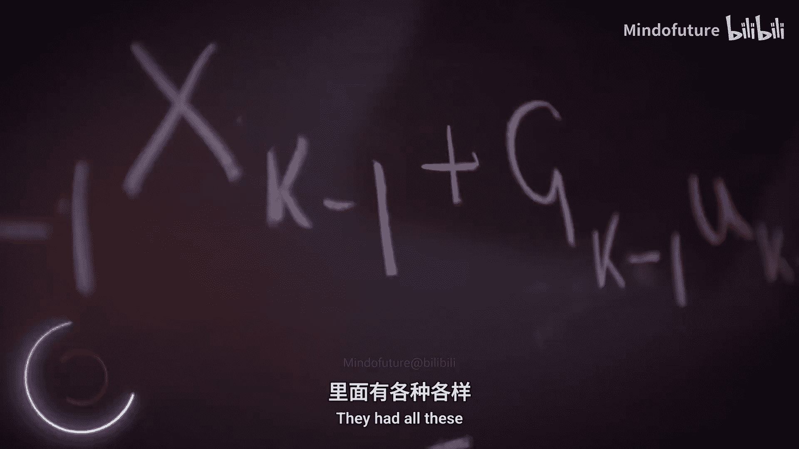
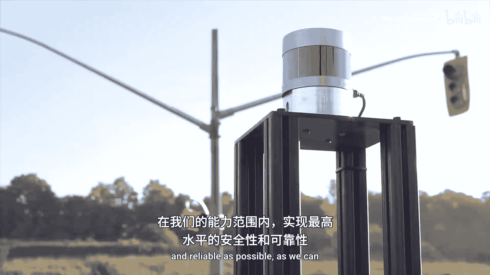

# 003：认识讲师乔纳森·凯利

在本节课中，我们将认识本课程的讲师乔纳森·凯利教授，了解他的背景、职业动机以及他对自动驾驶技术领域的看法。

***

我叫乔纳森·凯利，是加拿大多伦多大学航空航天研究所的助理教授。

***

童年时期，我每个月都喜欢去杂志店，总是阅读《大众机械》或《大众科学》。这些杂志上有许多有趣的文章，内容涵盖从太空旅行到新型交通工具，再到新的计算机设计，内容非常吸引人。

因此，这最终促使我开始将科学技术视为一个可能的职业选择。

***

在我还很小的时候，发生了一件大事，即第一次航天飞机灾难——挑战者号事故。我至今仍清楚记得那一刻，当时我想，天哪，一定是出了什么严重的问题，后果是多么可怕。那场巨大的爆炸发生时，我记得自己震惊地呆坐着，心想技术总是可靠的。那是我当时的看法，我认为技术永远不会失败。汽车不会无缘无故爆炸。但在电视上看到这一幕，让我深刻认识到，扎实的工程确实至关重要。

在那些危及生命或可能改变人生的情境中，可靠的工程是极其重要的。

***

自动驾驶汽车在许多方面与此非常相似。作为工程师，我们有责任将这些系统设计得尽可能安全可靠。这是近期最令人兴奋的技术革命之一。

每天都有新的想法、新的技术和新的设计涌现。我常常坐在办公桌前，看到人们提出的创新性新想法和技术时，都会感到眼前一亮。

这种兴奋感也来自于它正在改变技术格局，并有可能让很多人受益。

***

本节课中，我们一起认识了乔纳森·凯利教授，了解了他如何因童年兴趣而投身科技领域，以及他从挑战者号事故中领悟到的工程责任。这些背景奠定了他对自动驾驶技术安全性与可靠性的高度重视，也让我们看到了这一领域充满活力的创新前景。