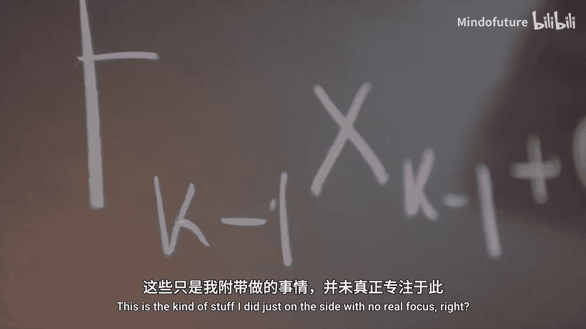
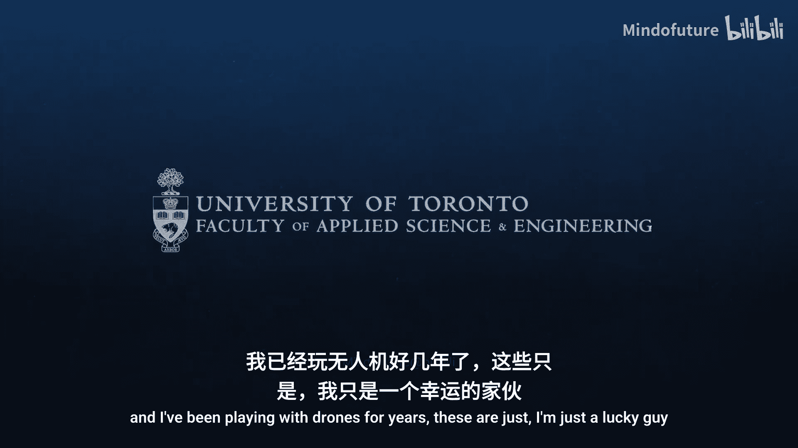

# 004：认识讲师史蒂文·瓦斯拉恩德

## 概述
在本节课中，我们将通过讲师史蒂文·瓦斯拉恩德的个人经历与见解，了解他如何从一名广泛的兴趣爱好者成长为自动驾驶与机器人领域的研究者。他的故事揭示了将基础学科兴趣应用于前沿科技项目的路径，并为我们理解自动驾驶系统的构建与挑战提供了背景。

---

## 从广泛兴趣到专业聚焦
我童年时兴趣广泛，热爱各种事物。我曾认为自己可以成为一名科学家，或许是物理学家，也可能是化学家，但当时其实并没有明确的方向。成长过程中，我并未过多担忧未来，而是度过了一个田园诗般的童年。

随着年龄增长，大约在十六、七或十八岁时，我开始思考需要做一些有趣的事情来充实人生。正是在这个阶段，我开始主动迎接挑战，并逐渐认清是什么在持续驱动我前进。

## 发现解决问题的乐趣
我热爱解决数学问题，也喜欢在放学后与朋友们一起钻研化学或微积分挑战。这些活动都是我课余时间自发进行的，并没有特别明确的目标。

直到我开始认真尝试选择一项事业时，才发现那些我喜欢的活动，在特定的应用领域中会频繁出现。

---

## 职业生涯的起点：航空工业
大学毕业后，我实际上在普拉特·惠特尼加拿大公司工作，这是一家小型喷气发动机制造商。在普拉特·惠特尼工作期间，经历非常迷人。

我们有机会做一些诸如测试喷气发动机控制系统的事情，这让我充分接触了航空学的乐趣。然而，航空学领域的挑战在于其极其严格的安全要求。

你所做的每一件事都必须严谨可靠，并且每次执行都必须精确无误。因此，该领域的发展实际上受制于经过反复验证的、已有三十年历史的技术。这对于一名试图推动变革、改变世界的年轻工程师来说，是相当令人沮丧的。

## 转向学术研究
于是，我带着从航空航天工业中获得的宝贵经验以及对安全的专注，进入了研究生生涯，投身于航空与航天学领域，并开始建造无人机。

---

## 投身机器人学与自动驾驶
是的，这就是解决问题，是算法开发。具体来说，是处理机器人任务。

例如，让无人机降落在行驶的汽车上，或者让自动驾驶汽车自行泊车、穿越障碍区域。所有这些问题都非常实际、非常具有应用性，并且你在构建过程中就能看到成果。你可以看到它的运行效果——如果无人机错过了汽车，它就会坠毁失败。这其中有一种令人兴奋的、非常有趣的成分。

## 构建自动驾驶汽车的基本步骤
要制造一辆自动驾驶汽车，首先必须将一辆普通汽车改造成线控驾驶车辆。这意味着你可以将计算机接入汽车，并向油门、转向和刹车发送指令，汽车将实际执行这些操作。

一旦具备了这种能力，你就可以真正开始编程让它做任何你想做的事情。

接下来，你必须在后备箱中添加一整套传感器和计算设备。拥有了所有这些部件，你就可以开始构建自己的自动驾驶车辆了。

---

## 研究重点与学术角色
我的研究实验室围绕这样一个理念建立：如果我们拥有一个真实的测试平台，并将其置于真实情境中，我们就能更快地了解当前方法的局限性。

我们真正关注的是寻找特别适合学术界的研究问题。例如，处理恶劣天气条件、处理一些边缘案例，或者试图从理论上证明我们所使用的方法具有可量化的安全性。因此，在学术界确实有很多具体问题可供我们研究。

我们可以尝试许多大胆的想法，可以比工业界可能的方式更快地、或者更少约束地探索可能的解决方案空间。

---

## 自动驾驶的未来与挑战
我们无疑将看到这些车辆的性能不断提升。我们将看到像特斯拉自动驾驶仪这样的系统逐年变得更好。我们还将看到真正自主的车队在受限领域内运行，这些领域被认为是安全可控的。

但我仍然认为，要实现最终的、在任何你想驾驶的地方都能实现的完全自动驾驶，我们还有很多工作要做。这仅仅是因为汽车可能失败的方式太多，它们必须理解的情境太多，有太多无法提前预测的奇怪状况。

---

## 给初学者的建议
如果你刚接触自动驾驶领域，并认为这是一个美妙的领域且想尝试，我认为你首先应该做的显然是学习这个Coursera专项课程。

除此之外，还有数百种方法可以丰富你的知识，并更好地了解如何进入这个领域。要知道，整个领域都依赖于机器人学、计算机视觉、神经网络与深度学习的基础。这些都是你可以深入研究的领域，而真正有趣的是，这些知识也适用于其他美妙的应用。

想想机器人操纵器，想想手机摄像头系统及其改进的视频拍摄功能，想想无人机飞行和物体跟踪——你可以用这些知识做无数的事情。

对于那些正在思考自动驾驶是否是一个值得投入、值得探索的方向的人，有一点是绝对明确的：这个市场将持续增长。对我们项目中毕业生的需求简直是无法满足的，这非常惊人。

---

## 总结
回顾过去，从放学后钻研随机数学问题到现在从事自动驾驶汽车研究，并多年来一直与无人机打交道，我只是一个幸运的人。

本节课中，我们一起跟随史蒂文·瓦斯拉恩德教授的讲述，了解了他从广泛兴趣者到专业研究者的历程，认识了自动驾驶系统构建的基本步骤与核心挑战，并获得了针对初学者的宝贵学习与发展建议。他的经历表明，将基础学科的热情与解决实际问题的实践相结合，能够引领我们走向令人兴奋的技术前沿。