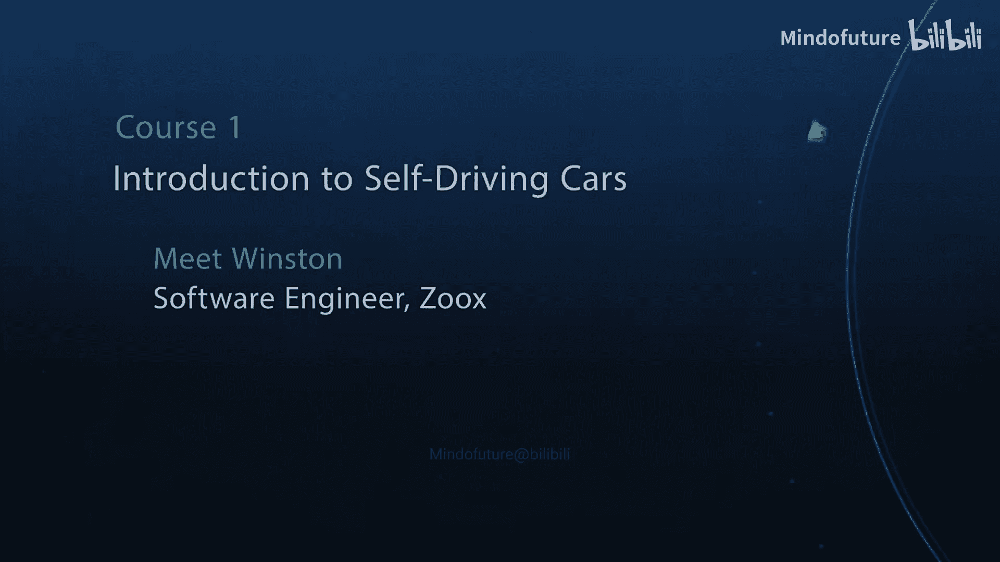
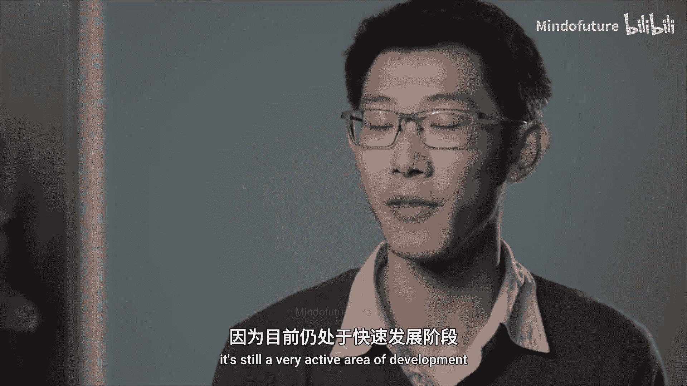

# 006：认识软件工程师温斯顿

在本节课程中，我们将认识一位在自动驾驶领域工作的软件工程师——温斯顿，并了解他如何进入这个行业，以及他目前从事的工作内容。

我的名字是温斯顿·维尤。我目前在Zoox公司担任定位与地图构建方向的软件工程师。

我进入自动驾驶领域的契机是在大学最后一年。当时，通用汽车公司与汽车工程师学会（SAE）联合发起了一项名为“Autodrive”的学生竞赛。这项竞赛为期三年，每年年底都会有一次比赛。最终目标是让各学生团队在三年后能够打造出一辆**SAE自动驾驶等级4**的车辆。

我负责领导轨迹规划团队，并设计了我们在第一年比赛中使用的轨迹规划和变道算法。

最终，我们团队赢得了第一名。我们提交了一篇详细阐述我们设计的论文，这项工作至今仍在推进。可以说，那一刻我明确了自己对自动驾驶汽车的兴趣。

这背后还有一个小故事。在我大学生涯初期，我曾是“无人飞行器”学生团队的成员。我们当时在建造一种半自主的固定翼无人机。它们由遥控器控制，搭载了工业摄像头和机载计算设备。我负责领导该项目的计算机视觉部分，具体任务是检测绘制在木质标牌上的字母。这些标牌被放置在地面上，而我们的飞机则在200英尺的高空飞行。

有一天，当我开车行驶在街道上时，我想到：我能否将用于检测标牌的这些计算机视觉工具，应用到检测道路标志上呢？我产生了一个想法：在我父母的车上安装网络摄像头，然后开车在社区里转，检测所有的街道标志。不过，我的父母对此并不太支持，所以这个项目最终没有进行下去。

后来，当学校的Autodrive团队开始招募成员时，我觉得这很酷。而当我真正开始参与这个项目后，我意识到这就是我想从事的事业。于是，我走到了今天这一步。

在Zoox公司，我隶属于CLAMS团队。CLAMS这个词像是一种贝类，它代表**C**alibration, **L**ocalization **A**nd **M**apping **S**imultaneously（同步校准、定位与地图构建）。我主要专注于地图构建方面的工作，这主要涉及生成3D地图。我无法透露更多细节，但可以说，目前通过构建我们的地图，我对旧金山地理的了解，可能比亲自到访那里还要多。

真正让我每天早上充满动力去工作的原因是，我正在处理这些非常前沿且极其酷炫的问题。这些问题之所以前沿，是因为它们仍然是当前非常活跃的开发领域，许多公司或个人此前并未深入涉足。

---

在本节课中，我们一起认识了软件工程师温斯顿，了解了他通过学生竞赛进入自动驾驶行业的经历，以及他目前在同步定位与地图构建领域所从事的具体工作。他的故事展示了实践项目和解决前沿问题在职业发展中的重要性。