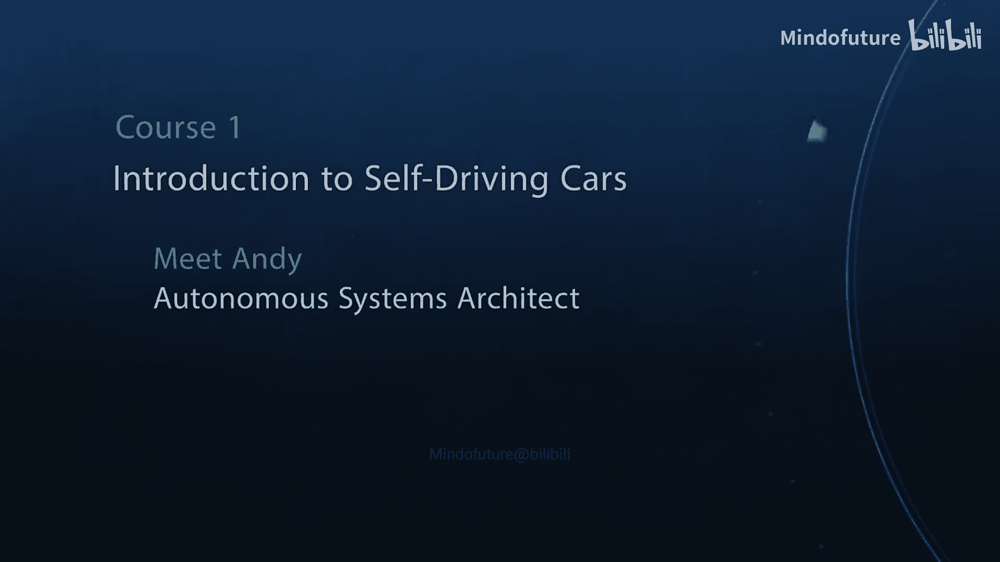
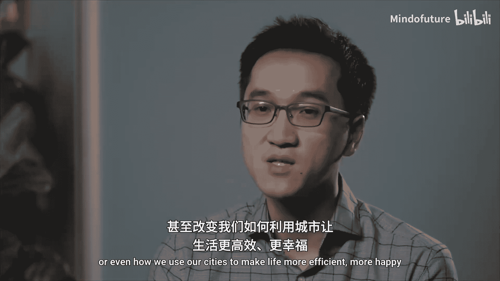

**自动驾驶汽车的状态估计和定位：P07：认识自动驾驶系统架构师安迪**

在本节课中，我们将通过系统架构师安迪的视角，了解自动驾驶行业的起源、发展以及一名系统工程师在其中的角色与工作内容。

大家好，我是安迪·王，一名自动驾驶系统架构师。我的机器人学生涯始于高中。我是加拿大最早参与机器人竞赛的学生之一。进入大学后，我协助共同创立了一个机器人团队。当时的指导老师刚从美国回来，向我们介绍了那里正在举行的一项名为**DARPA挑战赛**的比赛。这项赛事是推动整个自动驾驶行业兴起的关键活动之一。受此启发，我们开展了一些自动驾驶赛车活动，我也参与其中。从那时起，我便深深着迷于此。

工作几年后，我重返研究生院深造，期间主修**车辆控制与动力学**。现在，我从事下一代自动驾驶汽车平台的研发工作。作为一名系统级工程师，我有幸能与多个不同的团队广泛合作，共同构建一个完整的系统。这意味着我既要与负责**感知、运动控制软件**等的软件工程师协作，也要与设计**传感器和车辆平台**的硬件工程师合作。

我认为机器人技术非常有趣，而自动驾驶这个特定问题尤其令我热爱，因为它能直接影响人类的生活质量。我们不仅致力于提升安全性、挽救生命，这项技术还有可能帮助我们重塑对交通的思考方式，甚至改变城市的使用方式，让生活更高效、更幸福。

本节课中，我们一起了解了自动驾驶系统架构师安迪的个人经历与职业背景。他分享了从学生时代的机器人竞赛，到参与行业起源的DARPA挑战赛，再到目前负责整合软硬件的系统架构工作的历程。这帮助我们理解了一名系统工程师在复杂的自动驾驶项目中所扮演的跨领域协调与整合的关键角色。